# PIXEL ENGINE SIM v0.7 build 269

**A lightweight, 8-bit style internal combustion engine *designer* & simulator** inspired by *Automation*.

**▶ Play it live: [ipaliog-a11y.github.io/Engine_simulator](https://ipaliog-a11y.github.io/Engine_simulator/)** — redeployed automatically on every merge to `main`.

Design an engine from the ground up — cylinders, bore & stroke, compression, forced
induction, exhaust, fuel octane, injection and ignition — then run it on the dyno and
watch the physics respond. Web-based, fully offline-capable, installable as a PWA.

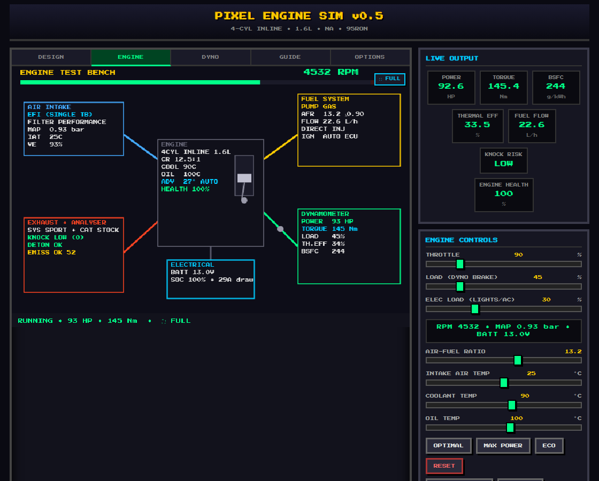

## Features

### Engine Designer (new in v0.3)
Since build 239 the ENGINE tab shows the engine as six cards, picked from a menu (stacked and folding on a phone):
**BLOCK**, **HEAD & VALVES**, **AIR & BOOST**, **INTAKE & EXHAUST**, **FUEL & SPARK** and **COOLING & ELECTRICS**. Each
number has a slider whose ticks are the factory engines, a **?** explains every input (what it is, what it trades, the
factory engines' values), each change shows its effect beside it, and a side panel shows what the engine gives (power,
torque, grade, reliability, cost, the curve) and what holds it back (valve float against the redline, knock against its
limit), worked out by BUILD's own code before you press it. **BASIC** hides the finer settings that **ADVANCED** shows.

Load one of **16 preset builds** from the dropdown — petrol, diesel, rotary and 2-stroke
(1.6 sport, kei turbo, hot-hatch, ITB
screamer, 2JZ six, muscle V8, blown V8, V12 supercar…), or configure your own on the
**ENGINE** tab and press **BUILD & DYNO**. Every parameter feeds the physics:

- **Engine type / cycle** — **petrol 4-stroke**, **diesel (compression-ignition)**,
  **2-stroke**, or **rotary (Wankel)**. Each reshapes the physics: a power stroke every rev
  (2-stroke & rotary) doubles the firing frequency for high specific output; diesel runs lean
  and unthrottled with no spark-knock, big low-end torque and the best efficiency; 2-stroke
  and rotary are thirsty and HC-heavy; rotaries rev sky-high and turbine-smooth. Switching type
  retargets the compression / redline / AFR ranges and disables what doesn't apply.
- **Bottom end** — cylinder count (1–12; rotors 1–3 for rotary), layout (inline / V / boxer),
  bore, stroke, compression ratio, redline. Bore × stroke × cylinders sets the displacement.
- **Air path** — naturally aspirated / turbo / supercharger, boost target, **intercooler size**
  (none / small / large core — a bigger core cools the charge more but adds a little spool lag),
  turbo size, **turbo configuration** (single / twin / sequential / compound), **turbine**
  (fixed housing / **variable geometry** — vanes shut to spool, open at the top), **anti-lag**,
  **supercharger type** (roots / twin-screw / centrifugal), **nitrous** (small / big shot),
  exhaust (stock / sport / race) and a **catalytic converter** (none/decat / sport / stock).
  Twin/sequential/compound turbos spool earlier and flatter; PD superchargers make boost from
  idle while centrifugals build it with rpm²; anti-lag keeps the turbo lit (at a wear cost);
  nitrous is a big power adder from a bottle. A cat cleans the exhaust but adds a little
  back-pressure; deleting it frees a few hp at the cost of emissions.
- **Induction (metering)** — intake system (1/2/4-bbl carburetor, sidedraft carbs,
  mechanical injection, single-throttle EFI, or individual throttle bodies) and air filter
  (open stacks → restrictive). A carburettor's venturi and the filter cost the charge the
  pressure they drop at the flow (so a carb engine fades at the top); the system also sets
  AFR-metering precision (EFI is most efficient; carbs waste fuel), throttle response and idle quality.
- **Valvetrain (derived physics)** — cam profile (stock / sport / race), variable valve timing,
  **valves per cylinder** (2 / 4 / 5), **valve material** (steel / titanium) and **valve springs**
  (stock / performance / race). Nothing here is a lookup multiplier: the intake valve diameter your
  bore can physically fit, what that valve weighs, where it **floats**, and how badly the port
  chokes are all derived from geometry and mechanics. Four valves give 22% more intake area than two
  for the same bore, and five give *less than four* — which is why the industry abandoned them. The
  panel shows the **valve float rpm**, and flags it red when it falls below your redline, because
  then the engine cannot use the rev range it claims. A
  wilder cam moves the powerband up and adds top-end at the cost of low-end torque and idle
  quality; VVT recovers the bottom end for a broad powerband.
  **VALVETRAIN** (twin or single cam over buckets, rockers or roller fingers, or pushrods) sets how much the cams rub:
  the engine's friction is built from its own bearings, pistons, rings and valvetrain (the Sandoval–Heywood model).
- **Electrical** — alternator size (60 / 120 / 180 A). With a live **ELEC LOAD** control
  (lights/AC), a small alternator plus heavy load at idle drains the battery — low system
  voltage then weakens the spark. Ignition type sets a dwell/misfire RPM limit (a
  distributor falls off up top; coil-on-plug holds to redline).
- **Fuel & spark** — fuel type (pump gas / race gas / E85 / methanol), fuel octane (RON,
  pump gas only), injector type (port / direct), ignition type (distributor / wasted spark /
  coil-on-plug), **ignition control** (*Fixed* — a locked advance you dial in — or *Auto*, an
  ECU that tracks MBT timing and retards just enough to stay off knock), and the **fuel mixture**:
  *Manual* (one AFR you set everywhere) or *Auto*, a **3D ECU fuel map** that targets near-stoich
  at light load and enriches under load & boost for power/EGT — just like a real fuel map (the
  default on fuel-injected builds; a live **load×RPM heat-grid** shows the target AFR in every
  cell with a marker on the current operating point, and the map is **editable** — tap a cell and
  nudge it richer/leaner to hand-tune the mixture, or reset to the factory grid). Carbs/mechanical
  injection stay manual. Each
  fuel has its own energy density, stoich AFR, knock rating and charge-cooling — alcohols resist
  knock and cool the charge (more power headroom) but burn far more fuel.
- **Cooling** — radiator size (small / stock / large), cooling fan (none / mechanical /
  electric), oil cooler, and thermostat opening temperature.
- **Reliability / wear** — the engine has a live **health** that falls under abuse:
  sustained detonation, overheating, lean-under-boost and running past valve float wear it (a
  clean tune barely ages; holding the rev limiter does not, since a redline is the speed an
  engine is rated for, and a real engine's stock springs are sized to float past it). A worn engine makes less power; at zero health it lets go and must be
  rebuilt (BUILD & DYNO or RESET). This puts real stakes on every design and tune choice.

These couple realistically: octane, compression, boost, intake temperature and ignition
advance all feed a **knock model**, and direct injection / higher octane buy back knock
margin so you can run more boost or timing. Get it wrong and the ECU derates power. The
**cooling subsystem** sets running temperatures in Auto Thermal mode — an under-sized
radiator with no fan will heat-soak and overheat under load (and at idle), which in turn
saps power; a large radiator, electric fan and oil cooler keep it cool.

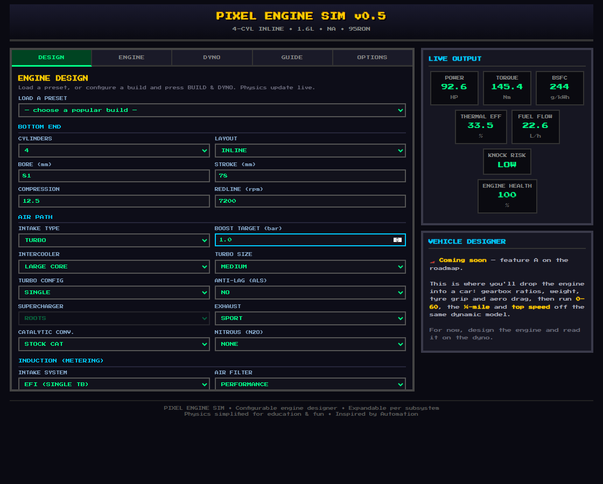

### Electric drive (in progress — the plan is in `plans/hybrid-electric/`)
Pick **ELECTRIC (BATTERY)** as the engine type and the ENGINE tab trades the combustion sections for **MOTOR**
(rotor diameter and stack, poles, turns per phase, magnet grade and retention, cooling, top speed), **INVERTER**
(silicon IGBT or SiC, current rating) and **BATTERY** (chemistry, cells in series, capacity, technology year). Since
build 238 these are seven cards picked from a menu (stacked and folding on a phone), each number with a slider whose
ticks are the real drives in the presets, a **?** that explains the input, the effect of every change beside it, and a
side panel of what the drive gives and what holds it back (battery or motor; rim, inverter or design limit), worked
out live by the same physics as the DYNO; **BASIC** hides the finer settings that **ADVANCED** shows. Torque,
the knee where the voltage runs out, the top speed, every loss and the heat are derived from those
(`src/js/electric.js`, checked against the measured Tesla Model 3 motor and ORNL's 2012 Leaf). The LIVE bench runs the
drive against the dyno brake with the pack sagging and the winding heating until the controller derates it; the DYNO
draws torque, power and efficiency at the pack's charge and the magnets' heat. On the road (build 180) an electric car
runs one reduction (matched to its top speed, GEARING biases it), takes energy back braking through the same path as an
engine's overrun, and pays for its heat over a lap: round the Nordschleife the battery management holds the pack near
55 °C and cuts the drive, and an air-cooled motor is cut far more. The TRACK tab shows the motor, the pack and the
energy. In a race (build 181) an electric car runs on its pack's usable energy, beside engines in the same field, with
no charging in the pit lane: its energy manager plans the power that lasts the distance and corrects it lap by lap, the
pack and the motor heat from lap to lap, and a car whose pack cannot last retires OUT OF CHARGE. MOTOR TYPE (build 182)
offers an induction motor beside the magnet one: no magnets, a copper-cage rotor magnetised by the stator's own current,
less efficient at its best and hotter in the rotor, but with no drag at all when it is not driving; built from the
Tesla Model S 60's published geometry it gives 430 Nm, 259 kW (225 published) and a knee at 5700 rpm. A car can carry
more than one motor (build 183): two at the rear, one per wheel, and one at the front, which makes it all-wheel drive.
Three Teslas are factory cars, matched on their hardware: the Model 3 RWD (0-100 6.18 s against 6.1), the Model Y Long
Range (dual motor, an induction front) and the Model S Plaid (three motors, 2.52 s against the 2.52-2.56 s measured).
The VEHICLE tab gives an electric car's consumption over the WLTP cycle (build 184), driven second by second through the
same drive: 120, 141 and 166 Wh/km from the pack for the three Teslas against their homologated 117, 138 and 158.

**Hybrids** (from build 186): any engine can carry a HYBRID system. PARALLEL (P2) puts a motor on the gearbox's input
shaft with a small pack of hybrid cells, designed in the same MOTOR / INVERTER / BATTERY fields; its torque adds to the
engine's in the 0-100, the lap and the race, it regenerates braking, and over a lap it sustains its charge. DEPLOY
FULL gives all the hardware can, ECO only fills the engine's curve (the Hyundai Ioniq Hybrid's calibration, checked
against MotorWeek's instrumented run). Every combustion car also gets its WLTP fuel (build 187): the same cycle,
each second in the gear that burns least, the fuel off the engine's own map, a cold start the engine warms out of: the
GR Yaris 7.85 L/100 km against 8.2, the Civic Type R 8.24 against 8.2-8.8. A hybrid's cycle is run by its energy
manager (build 188): each second electric only, the engine with the motor helping or charging, or regeneration,
whichever costs least with the pack's energy priced so it ends the cycle where it started. The Ioniq Hybrid: 5.05
L/100 km against Hyundai's 4.4-5.2. An ATKINSON cam closes the intake late.
POWER-SPLIT (eCVT, build 189) is Toyota's planetary: MG1 holds the engine at the speed it wants, MG2 drives the
wheels through one reduction, no gearbox. The 2016 Prius, its engine matched to its 72 kW: 0-100 in 11.2 s against
10.6, and 4.44 L/100 km on the WLTP cycle at the real engine's efficiency against Toyota's 4.14.
SERIES (build 193) drives the wheels with the motor alone and lets the engine only charge: the Nissan Qashqai
e-POWER runs 0-100 in 7.4 s against Nissan's 7.9. PLUG-IN (build 194) starts the pack full: WLTP then runs the regulation's
plug-in procedure, and the BMW 330e gives a 55 km electric range and 1.7 L/100 km weighted against BMW's 59-66 km and
1.6-1.9. A hybrid can carry a FRONT MOTOR on its own axle (build 195): the Porsche 918 Spyder runs 0-200 in 7.4 s
against Porsche's 7.2.
In a race (build 196) a plug-in starts on a full pack and spreads its own charge over the distance, and the HYBRID
TUNE's DEPLOY LIMIT and HARVEST LIMIT set a racing class's energy a lap.
Build 199 adds 50 real combustion cars from a research pack (`research/vehicles-batch-1/`): performance SUVs, track
cars, pickups, the first V6s, classics from the 1960s to the 1980s and more kei cars and hot hatches.
The VEHICLE tab's G-G DIAGRAM (build 200) draws how hard the car can corner, brake and accelerate at 60, 120 and
180 km/h, from the lap's own physics, with every point of a lap over it.
Its SUSPENSION CALCULATOR (build 218) opens one corner of the car as a quarter car: change the sprung and unsprung mass,
spring rate, motion ratio, bound and rebound damping and tyre rate, and read the body's and the wheel's natural
frequencies, the damping as a share of critical, the response to a road wave and the corner driven onto a step.
The PARTS tab (build 205) is a part designer: pick a type of part, then its options. The first is the exhaust (header
construction, primary diameter and length, the pipes after the collector, the silencer), previewed on the engine you
have built and saved to a library whose parts appear in the ENGINE tab's EXHAUST choices. The second is the intake
manifold (build 206): runner length and bore, and a variable length with a flap. The third is the air filter (build 210):
its media and housing, whose pressure drop at the flow the engine draws is now what any filter costs. The fourth is the
camshaft (build 249): duration, lift, lobe separation, lobe profile and the VVT phaser's range. The fifth is the
intercooler (build 255): core face, depth, cooling fins and charge pipe. Since build 256 every core's effectiveness
comes from its fins and its pressure drop is made up by the compressor.
An electric car is heard (build 198): its motor's whine, the inverter's switching and the reduction's gears, each at
the frequency its build gives it, on the bench and on the lap replay.
On the LIVE bench (build 190) a hybrid runs with its motor and pack: a HYBRID panel draws the power flowing between
engine, motors, pack and brake, gauges the charge, and offers the drive modes (AUTO, EV, HOLD, CHARGE, SPORT, ENGINE
ONLY, MANUAL). Its VIEW selector also shows the power-split's lever diagram and the engine's BSFC map with the point
the controller holds it at (build 191). The ENGINE tab's HYBRID TUNE (build 192) sets how the motor helps (ASSIST, an
assist map over speed and pedal), regeneration, load-point shifting, electric-driving limits and the charge window.

### Simulation & live tuning
- **Live outputs**: Power (HP), Torque (Nm), BMEP, Volumetric Efficiency, Thermal
  Efficiency, BSFC, Fuel Flow, Knock Risk, Engine Health.
- **Ten tabs** — **ENGINE** (build the engine), **VEHICLE** (drop it in a car & read its
  performance), **PARTS** (design a part and fit it), **GARAGE** (the saved builds), **TRACK** (lap it round a circuit), **RACE** (race
  it against other builds), **LIVE** (the engine running: cutaway, the
  whole bank firing in its real order, and the controls), **DYNO** (power/torque curve,
  scorecard, a static result sheet with run data, and a diagnosis of what keeps the engine from running smoothly), **GUIDE** (a wiki: 60 pages in 9 sections, each climbing from real life to the game to the physics, with 8-bit pictures drawn in code, search and cross-links) and **OPTIONS** (sound,
  wear and **language**). The right column is context-aware: runtime Engine Controls while
  driving/on the dyno, the live **Performance** panel on VEHICLE, the **Lap Time** panel on
  TRACK and the race's setup, timing tower and telemetry on RACE.
- **Vehicle & performance (new)** — pick a **chassis** (13 archetypes, each with its own weight,
  size, drivetrain and grip) and it arrives on its **factory spec**: the tyres, wheels, brakes,
  suspension, aero and gearbox that car would really wear, so a kei car turns up on skinny eco
  tyres and small steel discs while a hypercar gets wide tyres and carbon-ceramics. Since build 223
  each class is the median real car of its class (`tools/class-medians.mjs`): weight, drag, size and
  parts, with no add-on aero kit, as no real car has one. Every part stays editable from there, and **REFIT FACTORY SPEC** puts it
  all back; the summary marks the car *(factory spec)* or *(modified)*. Tune the
  **drivetrain** (FWD/RWD/AWD), the **differential** (open / viscous LSD / clutch-plate LSD /
  spool — how much of the driven axle's grip you can actually put down), the **gearbox** — **type** (manual / sequential / DCT /
  torque-converter auto, each with its own shift time, driveline loss and ratio spacing; the auto
  adds converter stall & torque multiplication off the line), 4–8 speeds, and a
  **final-drive slider**, 4.90:1 short → 2.60:1 tall, with the ratio shown next to the number —
  **tyres** (compound + width/profile/wheel diameter → grip &
  rolling radius), **aero** (front/rear/floor downforce vs drag), **brakes** (type + rotor size →
  stopping power & fade resistance), **suspension** (the setup's ride frequency and camber, each axle's
  springs and anti-roll bar from soft to stiff, and each axle's own geometry: strut, double wishbone, multi-link,
  twist beam or solid axle) and **weight reduction**.
  Your current engine is dropped in and the sim computes **0–100 km/h**, **400 / 800 / 1000 m**
  (time + trap speed), **top speed**, **100–0 braking** and the **0–200–0** test live — a
  traction-limited launch and a tyre/brake-limited stop (with fade), weight transfer, downforce,
  aero drag and rolling resistance. Vehicle cost and power-to-weight are shown too.
- **Hot lap report (new)** — **LAP REPORT PNG / PDF** on the TRACK tab saves the lap as a printable
  telemetry sheet: the circuit map with **full-throttle** and **braking** sections picked out and
  every corner tagged, a **speed trace** against distance with braking zones shaded, an **elevation
  profile** on the same axis, lap and sector times, the full car specification, and a **speed trap at
  every corner** — entry, apex and exit speed, gear, radius and gradient. Corners are detected from the racing line, numbered T1…Tn and named per
  circuit (Riverside GP runs Millrace, Weir, Ferryman, The Island…). The same corner list drives
  the on-screen corner count, so the app and the sheet can never disagree.

  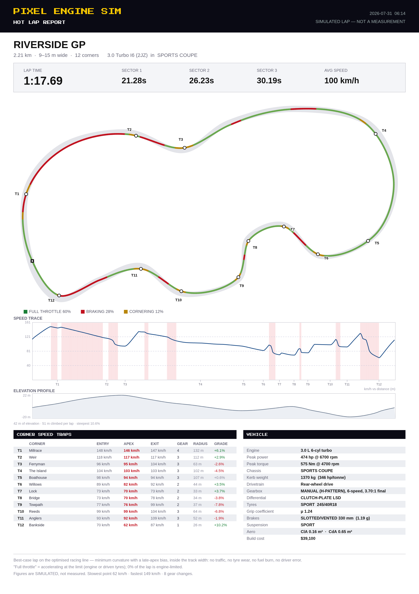

- **Dyno report (new)** — **REPORT PNG** / **REPORT PDF** (under **MORE** on the dyno) save the current pull as a
  printable A4 sheet laid out like a real dynamometer print-out: power and torque traces with the
  peaks called out, a peak-result band, the full engine specification, the conditions the run was
  made under, and a tabulated run-data list. Logged pulls are overlaid faintly for comparison.
  Both formats are generated entirely in the browser — the PDF embeds the rendered sheet as a
  JPEG via PDF's native `DCTDecode` filter, so there is no library and it still works offline.
  The sheet is clearly marked **SIMULATED — NOT A MEASUREMENT**, and prints the *design potential*
  alongside the as-tuned run so the two figures can't be mistaken for each other.

  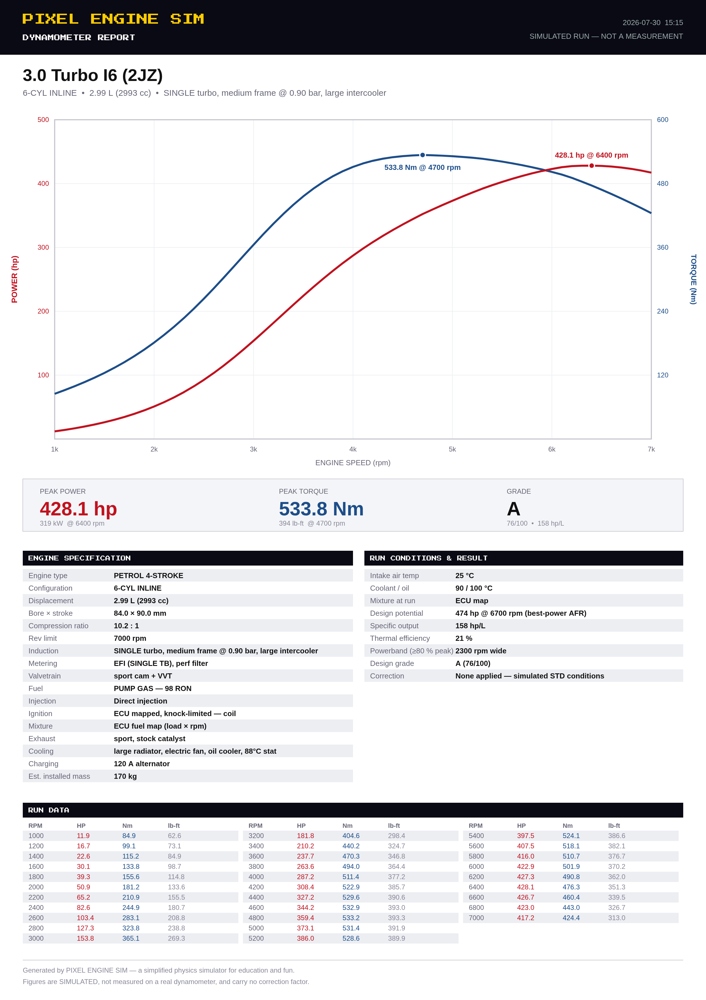

- **Test track (new)** — a **TRACK** tab that puts the finished car on a circuit and solves a lap.
  Three layouts with different characters: **Ashdown Park** (2.0 km, tight and technical),
  **Cape Speedway** (3.1 km, long straights and fast sweepers), **Riverside GP** (2.2 km,
  balanced) and the **Nordschleife** (20.4 km, 44 corners, 290 m of elevation and 505 m of climbing
  per lap — geometry and gradients derived from a recorded GPX trace, corners numbered rather than
  named because the detector can't be reliably aligned with the circuit's real corner names) — plus
  **22 real circuits** (Spa, Suzuka, Silverstone, Monza, Brands Hatch and the rest; see *Real
  circuits* below) with measured width and terrain-model elevation. You get a **lap time**, three **sector splits**, average / slowest / fastest speeds
  and the number of gear changes, plus a view of the lap from above and behind the car — the track drawn to its real, **varying**
  width,
  with an **optimised racing line** through it **coloured by what is limiting the car** — power, traction, cornering grip or braking — and a legend totalling
  how much of the lap each accounts for.

  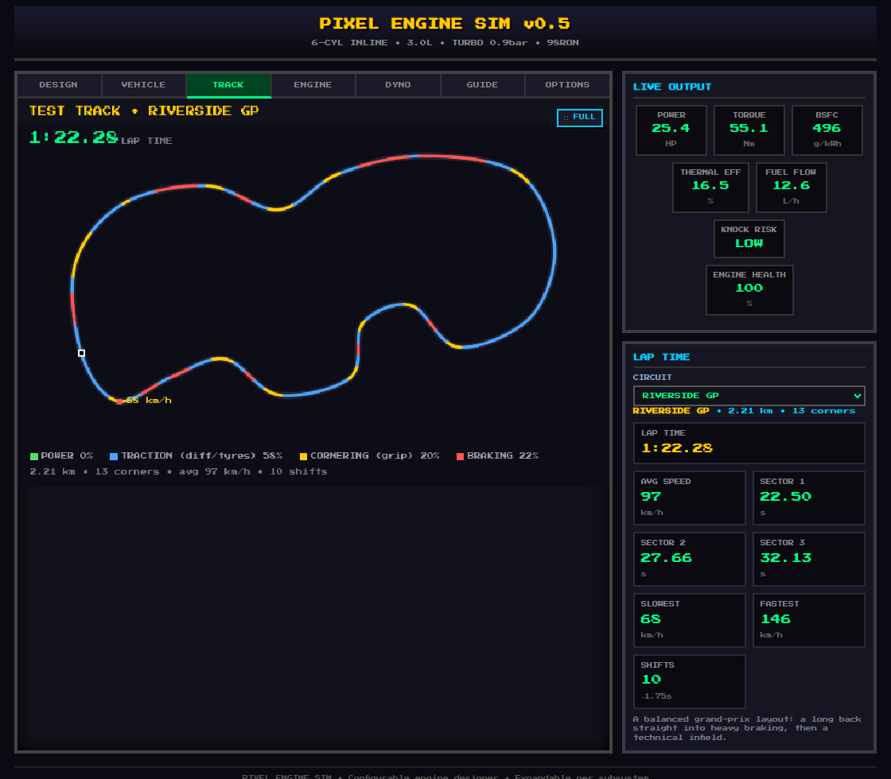

- **Race (new)** — a **RACE** tab that puts two to eight builds on the same circuit and runs them to
  a lap count, with **nobody driving**. Choose the cars (the one on the VEHICLE tab, garage builds,
  factory cars, the same car twice if you like), the circuit, the laps, qualifying or reversed grid,
  the **weather** (dry, damp, wet, rain later, drying) and air temperature, tyre warmers and a seed,
  and give **each car its own plan**: automatic stops or a set number, push / normal / fuel save, the
  tyres it starts on, and whether it changes them for rain. RACE opens as **a page of its own**
  filling the window (◀ SIM goes back, ⛶ goes properly full screen): the camera behind the leader (or the car you pick in the tower), a
  **timing tower** (gap to the leader, last and best lap with the race's fastest in purple, tyres,
  stops), and per-car telemetry with **four tyre temperatures and wear**, **fuel in the tank** and
  laps it is good for, and **front and rear brake temperature with fade**. Play it at 1–100×,
  scrub, click a car to follow it, and save the **race report** as PNG or PDF: classification, a lap
  chart, lap times with the wet shaded in, every car's stints by compound, and the key moments.
  - **Pace is the lap solver's.** Each car's lap is solved on its own racing line at five grip levels
    and three fuel loads, plus a standing start; the race reads its speed off those solves for the
    grip its tyres have and the fuel it carries at that moment. Alone on perfect tyres a car laps in
    the TRACK tab's time to within 0.1%.
  - **Tyres heat, wear and go off.** One temperature per tyre: slip work and rolling hysteresis in,
    convection out, from the loads the car puts through each corner of it. Each compound grips best in
    its own window (a slick runs hotter and narrower than a road tyre, and is useless cold); wear comes
    from the same slip work and falls off a cliff past ~70%. Lap 1 is a standing start on cold tyres.
  - **Fuel is power × BSFC.** The flow at every point is the power the lap spends there times the
    engine's own BSFC at that rpm and boost, so a thirsty engine pits sooner and a car gets lighter
    and quicker as the tank empties. Tanks are per body class.
  - **Weather.** A wet track takes grip by compound: a treaded road tyre keeps ~70% of it, a
    slick ~36%. Two race-only rain tyres, **intermediates** and **full wets**, keep more. A car
    changes compound when the time its own solved laps say it would win back, over the laps left,
    beats a pit stop, so a late shower can leave a car out on the wrong tyres on purpose. Water and a
    cool wet surface take heat out of the tyres; a sunny track adds it. Wet laps run 9–22% slower,
    the grippiest dry compounds losing most.
  - **Brakes carry their heat.** The lap solver's rotor model runs through the whole race, so
    temperatures build lap on lap past a single hot lap's and cool in the pit box. A car whose pads
    fade brakes earlier as they do: its braking zones stretch by how much less it can stop with.
  - **Racecraft and drivers.** The tow grows as the gap closes, so cars nose to tail pull each other along. A
    car with a quicker car behind may defend on the inside line (harder to pass, a slower exit), a held-up car may
    try a late-braking move that sticks or runs it wide (its odds are the two cars' grip and brakes and the two
    drivers), and the car just passed can take the place straight back. Each car has a driver: balanced,
    aggressive, smooth, rain master or rookie, each with its own aggression, consistency, tyre care and wet skill.
  - **Racecraft is a rule layer.** A faster car is held up until it has a few km/h on a straight or
    into a braking zone; slipstream, dirty air, blue flags, pit-lane loss, lap-to-lap driver
    variation and the odd mistake are rules, seeded, so the same seed replays the same race.

  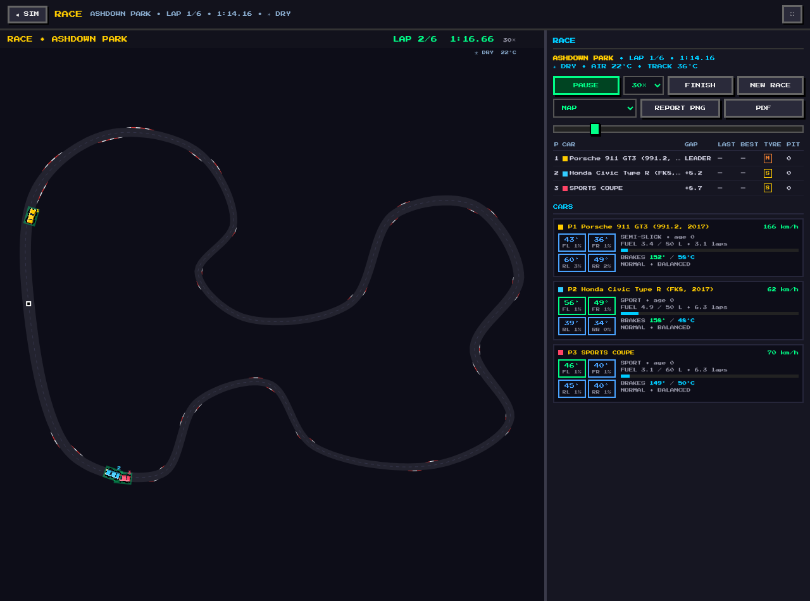

  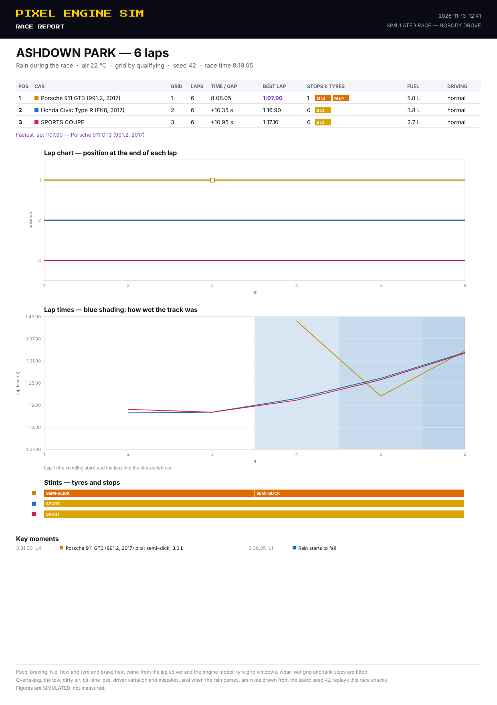

- **Animated engine cutaway** — the LIVE tab is a section through the engine you
  just designed, and everything on it moves because the simulation moved it:

  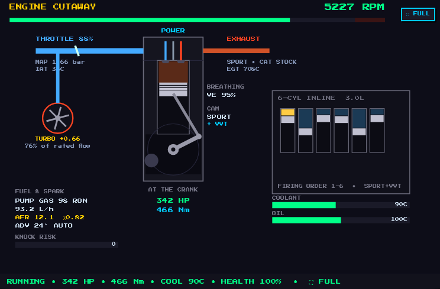

  - **Deliberately not real time.** A crank at 5000 rpm turns 83 times a *second*; drawn
    literally at 60 fps that is a strobe, not a picture. The cycle runs at a readable pace —
    about 3.3 s down to 1.1 s per full four-stroke cycle — still ranked by rpm so idle is
    visibly lazier than the limiter, and it stops dead when the engine does. The true speed is
    on the tachometer and in the note; the animation's job is to make the *cycle* legible.
  - **Proper crank-slider geometry** — `x = r(1−cosθ) + L − √(L²−r²sin²θ)`, not a sine wave. A
    connecting rod of finite length makes the piston linger at the bottom and snap through the
    top; at quarter-crank it is at 0.58 of stroke where a sine would say 0.50.
  - **Drawn to your bore/stroke ratio**, so an oversquare engine really is short and wide.
  - **The cam's own valve timing** (build 165): the events from the cam's duration and lobe separation, the
    intake phased by VVT as the model schedules it, the lift to scale, the valvetrain drawn (overhead cams on
    four-valve heads, pushrods on two), and the spark at the model's advance with the flame over its Wiebe burn. A two-stroke shows ports uncovering in the
    liner instead; a rotary shows a real two-lobe epitrochoid housing,
    `x = R·cosθ + e·cos3θ`, with the rotor turning at a third of the eccentric shaft.
  - The chamber is **colour-coded by what is in it** — fresh charge, compressed, burning, burnt —
    and the stroke is named above the head, so the cycle is watchable rather than memorised.
  - A **bank strip** draws every cylinder at its own phase, so the firing order runs visibly
    through a V12, and the firing cylinder glows.
  - Live parts stay next to the thing they describe: throttle-plate angle at the butterfly, boost
    and compressor flow at the turbo, EGT at the exhaust, and a knock bar.
  - **Turbos and superchargers drawn as they are built (build 164).** A turbo is two snail housings
    on one shaft: the exhaust manifold feeds the turbine, whose scroll narrows as the gas spirals
    in; the compressor's widens to its outlet, and the charge goes round under the engine through
    the intercooler to the throttle, coloured by its temperature. The wheels turn with the shaft
    speed the spool model integrates, the wastegate opens when the model holds its target, a
    variable-geometry turbo's vanes follow the model's schedule, and the blow-off valve vents on a
    lift. A supercharger is belted to the crank: Roots and twin-screw rotors turn with it at their
    drive ratio, a centrifugal is a compressor scroll on a 12:1 step-up.
  - **The tracts to scale (build 166).** The intake runner and the exhaust primaries at one scale, with the
    filter, throttle, plenum (or trumpets, or a carburettor) and the collector, cat and silencer. The blowdown
    pulse runs the primary and comes back as the header model times it; the readout says SCAVENGING when it lands
    in the overlap. Turbo engines get their compressor map with the live operating point.

  The subsystem numbers that used to be printed here in 7 px type live in the **LIVE OUTPUT**
  panel beside the canvas, where they are real text.
- **Canvas rendered at device resolution (new)** — the three visualisations share one canvas that
  drew on a fixed 640×420 backing store while CSS stretched it to whatever the panel was (744 px
  on a desktop, twice that again on a high-DPI screen). Every 7 px glyph landed on fractional
  pixels and smeared. The backing store is now sized to real device pixels and the context scaled,
  so the drawing code keeps its 640×420 coordinates and the output is pixel-exact — which fixes
  **DYNO** and **TRACK** at the same time.
- **In-app GUIDE, a wiki** — kept in-app so the offline PWA stays self-contained. 60 pages in 9
  sections, from *How an engine works* to *The track*, and every one climbs three levels: **LV1 ·
  REAL LIFE** (how the part works on a real car, with an 8-bit picture and no maths), **LV2 · IN THE
  GAME** (the controls and what to watch) and **LV3 · THE PHYSICS** (the equations the sim actually
  solves, their sources, and an orange note where something is still fitted). The 62 pictures are
  drawn in code on the app's pixel grid, so they are crisp at any size, cost nothing offline and
  move where moving teaches something (a piston, a pulse in a header, a turbo spooling, a wastegate
  opening); they hold still for reduced motion. A search box filters the index, pages link to each
  other, and a glossary, a known-limits page and a calibration page sit at the end.
- **Emissions** — LIVE analyser in g/s: CO₂ / O₂ from the fuel's C/H/O atoms and λ; CO / HC /
  NOx / (diesel) PM from mixture and temperature trends scaled by fuel mass, then cleaned by
  the catalytic converter *only* in a narrow window around stoich. Each species tile turns
  amber then red on the same g/kg (CO₂: g/kWh) scale the emit score uses. Run rich and CO/HC
  spike; run lean and NOx slips past. A **DIRTY** analyser is the price of a rich or decatted tune.
- **WEAR toggle** — turn damage/wear off for free experimentation (invincible engine) or on
  for consequences.
- **Dyno Curve** — full power & torque vs RPM out to your redline, with peak markers and a
  live current-RPM line.
- **Drive it (dynamic model)** — you control **THROTTLE** and **LOAD** (a dyno brake), not
  RPM directly. Opening the throttle raises manifold pressure (MAP), which makes torque,
  which spins the engine up through its **rotating inertia** (derived from displacement &
  stroke, so a big long-stroke engine revs lazily and a small one snaps up). A turbo
  spools as the revs climb; closed throttle gives engine braking; there's an idle floor
  and a rev limiter. No load + throttle = revs to the limiter; add load to hold an RPM.
- **Other runtime controls**: AFR, intake-air / coolant / oil temps.
- **Auto Thermal mode** — coolant & oil drift toward load-dependent targets over time,
  balanced against the cooling subsystem's capacity (radiator airflow scales with RPM;
  the fan provides idle cooling).
- **Engine sound model** (OPTIONS) — **SYNTH** (the default, below) or **GAS**: the cylinders, intake and
  exhaust runners and collectors simulated as lumped gas volumes with compressible flow between them,
  ported from Ange Yaghi's [engine-sim](https://github.com/ange-yaghi/engine-sim) (MIT), driven at our
  model's rpm, manifold pressure and fuelling, and heard as the exhaust-runner pressure through one of
  engine-sim's recorded exhaust impulse responses. The turbo whine, blow-off, intake roar, knock and
  crackle still come from the synth. Heavier (a V12 is about half a CPU core). Four-strokes run on
  valves; **two-strokes** on piston ports with the crankcase pumping the charge through a reed valve and the
  transfers; **rotaries** on three chambers per rotor breathing through the ports the rotor uncovers.
- **Engine sound** — plays on the **DYNO** tab from the engine controls, and on the **TRACK** tab
  from the lap replay (its recorded rpm, throttle and boost, so shifts, lifts and blow-offs are heard
  as the car goes round); other tabs are quiet. Synthesised from the **firing pulses** in an AudioWorklet: every cylinder
  fires at its slot in the real firing order and its pulse goes down its own bank's exhaust
  (one pipe for an inline engine, left and right for a V or a boxer), so engines with the same
  firing rate no longer sound alike. A cross-plane V8 fires each bank unevenly
  (1-5-4-8-6-3-7-2 → A-B-A-B-B-A-B-A), which is its burble; an inline six or a V12 fires each
  bank evenly and sounds smooth. The pulses then run the **exhaust the build has**: the primary rings
  at its quarter wave (c/4L, the same header length the breathing model tunes), as sharply as its
  path-length spread allows (a cast log manifold barely rings, a jig-cut race header rings hard), the
  system behind the collector drones at its half wave, and the silencer, the cat and a turbine take the
  top off and the level down. Diesels add a combustion knock, 2-strokes ring, rotaries are
  short and bright. **Load is in the pulses**: each is as hard as the charge it burned (manifold
  pressure × how much fuel the air carried), and a harder pulse is also raspier, so flat out sounds
  different from a cruise and not just louder; a fuel cut leaves only compressed air. The **lope**
  (a wild cam or anti-lag idles lumpy, VVT smooths it) varies the pulses cycle to cycle with the
  occasional partial burn, and fades with revs and load, since residual gas needs manifold vacuum to
  flow back. **Overrun crackle** is a carburetted engine misfiring its unburnable overrun charge into a
  pipe still hot from the pull, popping for a second or two; injection cuts the fuel and stays
  quiet, anti-lag pops on purpose, and a working cat takes the edge off the pops.
  Around the exhaust, the **rest of the car**: a turbo whines at its compressor's blade-pass
  frequency from the live shaft speed and hisses through its **blow-off valve** on a lift from
  boost, for as long as the charge volume takes to vent (no BOV on a diesel: no throttle to surge
  against), both as loud as the compressor is big; a supercharger whirrs with the crank through its
  drive ratio, mostly on boost, under the exhaust; **anti-lag** bangs and crackles on every lift; the **intake** roars at
  the runner's Helmholtz frequency with airflow, open stacks loudest; and **knock** rings at the
  chamber's first acoustic mode (Draper, 1.84 c / πB, ~6 kHz), a diesel's rattle on every pulse and
  worse cold, a petrol engine's on the cycles past its knock limit.
- **Scoring** — every build gets a graded scorecard (S–F) rating power, specific output,
  powerband width, efficiency, knock safety, drivability and **emissions**, shown on the
  design summary and the dyno.
- **Strategy / Career** — every build has a **parts cost** and a **reliability index** (a
  design estimate of how much abuse it invites), plus a **power-per-dollar** metric. Pick an
  **OBJECTIVE** on the ENGINE tab (Budget Sleeper, Power per Dollar, Eco Cruiser, Track
  Weapon, Reliability Run, Clean Machine, Specific-Output King…) — some cap your budget — and
  the challenge card ticks off each target live (✓/✗) with a PASS/FAIL verdict, mirrored on
  the dyno. Turns free design into a puzzle with real trade-offs.
- **Dyno pull logging** — snapshot the current curve and overlay several pulls on the graph
  to compare builds or tunes.
- **Garage (new)** — a saved-builds list at the bottom of the **VEHICLE** tab that keeps as
  many finished cars as you like, side by side. Name one and **SAVE TO GARAGE** stores the whole
  thing together — the chassis, every part bolted to it, *and* the engine inside, down to a
  hand-tuned fuel map. Each card carries the headline numbers it had when it was saved (power,
  weight, 0–100, top speed, lap time, total cost), so three builds can be compared without
  rebuilding any of them. **LOAD** restores a car exactly as it was; typing an existing name
  highlights that card and saving overwrites it.

  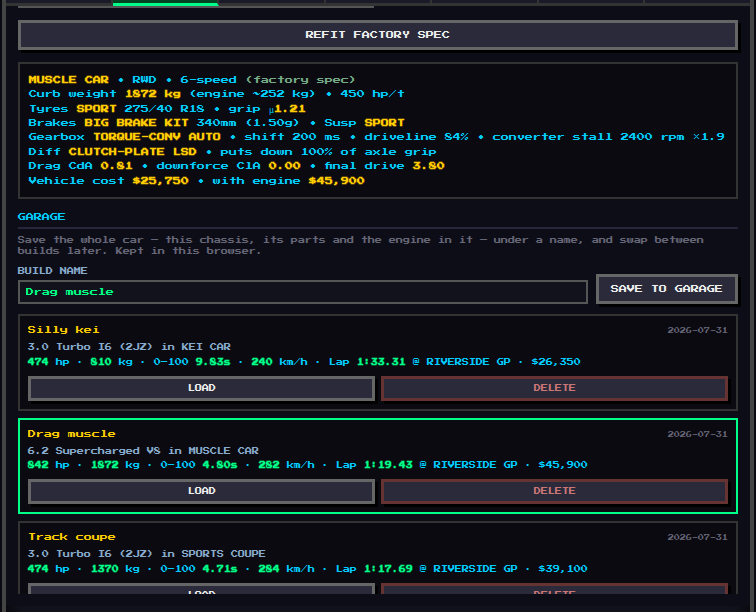

- **Pixel-art car and engine (new)** — the ENGINE tab shows your engine from outside, drawn from
  the build: its layout and bank angle, its turbos or blower, induction, headers, intercooler and
  radiator. A saved engine's GARAGE card shows the same picture.

  The VEHICLE tab shows a picture of the car, not one drawn from the parts. The car on the TRACK map
  is still drawn from the build, in its own livery: wheelbase, wheels, ride height, aero, driven
  wheels and where the engine sits.

  Each of the 100 factory cars also has a **showroom picture** (build 220): a detailed pixel-art side view
  in `assets/cars/`, at the top of the VEHICLE tab when you load that car, and on the GARAGE card of a saved
  real car. It stays however you modify the car.

  Every real car has an **order number** (build 221), 001 upward, shown before its name in the lists. A
  number is given once and never changes. **COPY FROM** takes a real car's body and parts by its number or
  name and keeps your engine: the result is a custom car, "Custom (from 012)".

  The **title screen** (the menu the sim opens on, and MENU) cycles through four workshop pictures with a slow
  pan (build 230, `assets/landing/`), with the makers' and sponsors' logos pixelated out. Since build 237 the pan is
  a browser animation, smooth on every frame, each room fades into the next, and the bench behind the menu stops
  drawing while it is covered. With "reduce motion" set, the pictures hold still.

  **CAR SHOWCASE** (build 237), the menu's fifth item, shows every factory car on one page: its showroom
  picture and number, in number order, filtered by family. Pick one to see it large with the figures its maker
  published (power, torque, mass, 0–100, top speed, driven wheels), and **DRIVE THIS CAR** loads it with its
  own engine and opens the VEHICLE tab. The figures are the presets' own; the sim's come from the physics.

  A generic chassis, or a copy, shows the picture of its **body class** (build 222): one unbranded car for
  each of the 14 classes, in `assets/cars/generic/`.

  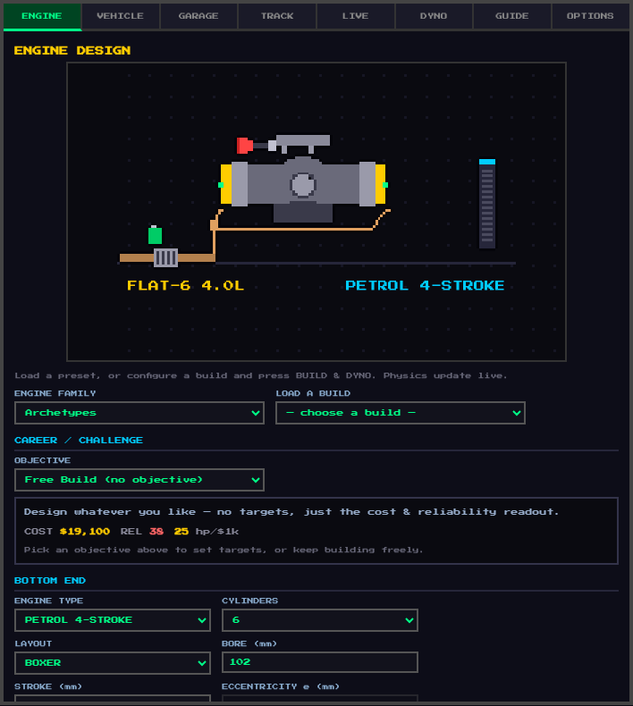

- **Save / Load / Share** — quick-save to `localStorage` (a single slot, distinct from the
  garage); **save to a named file** (with a note) and **open** one back; or **Share** a build as
  an encoded link (copied to the clipboard) that loads the exact engine when opened. All four
  paths — quicksave, garage, file and link — carry the *same* `serializeBuild()` record, so a
  build is portable between them and the formats cannot drift apart.
- **Presets**: Optimal / Max Power / Eco / Reset (adapt to the current engine).
- **Languages** — English and **Ελληνικά (Greek)**, switchable in OPTIONS and remembered
  between visits. The whole interface localises: tabs, labels, every dropdown, the design and
  vehicle summaries, the status bar, tooltips and screen-reader labels, and the challenge card
  (units, the names of real cars and circuits, and the terms Greek enthusiasts use in English, such as
  BOOST, ECU and LSD, stay as they are). The in-app GUIDE is translated in full, all 60 pages; the
  labels drawn inside its pictures and the PNG/PDF reports are still English.
- **Responsive** — a fluid layout that fills the screen in **portrait** (phones & tablets held
  upright) as well as landscape, scaling type and controls up so nothing sits in a narrow strip.
- **Installable PWA**, self-hosted font, works fully offline.

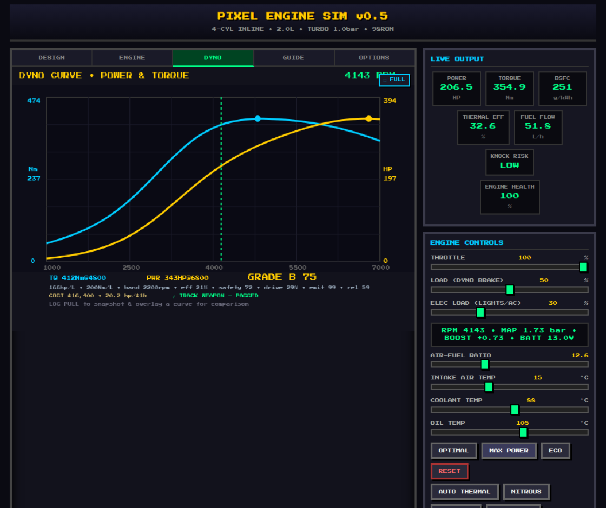

The built-in **GUIDE** is a wiki of the sim, from how a four-stroke works to the equations behind every number:

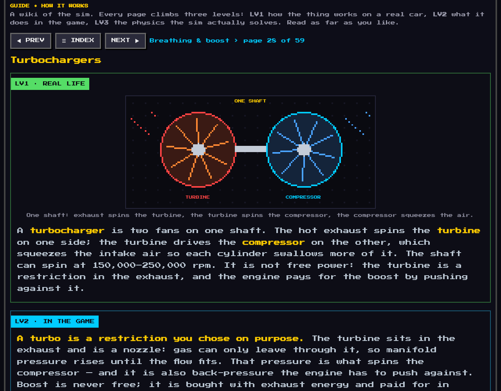

The interface is fully translatable (English / Ελληνικά) and fills the screen in portrait:

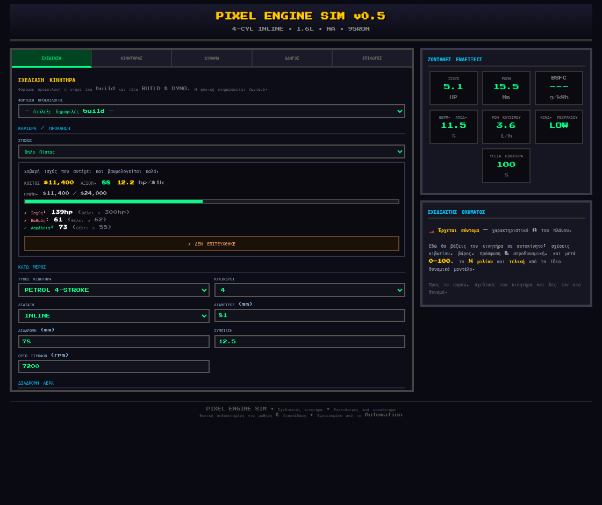

The **VEHICLE** tab drops your engine into a car and computes acceleration & top speed. Since build 247 its parts are
six cards in the same style (**CHASSIS & DRIVE**, **GEARBOX**, **WHEELS & TYRES**, **AERO & WEIGHT**, **BRAKES &
STEERING**, **SUSPENSION**; since build 250 a seventh, **CHASSIS NUMBERS**: wheelbase, front and rear track, CG height,
weight split and ballast, FACTORY or DESIGNED), with the factory cars as the sliders' ticks, a **?** on every input, and a side panel of
what the car does (0–100, top speed, 400 m, weight, grip, cost, drive force against drag) and what holds it back (the
tyres' speed rating, the limiter, grip at the launch):

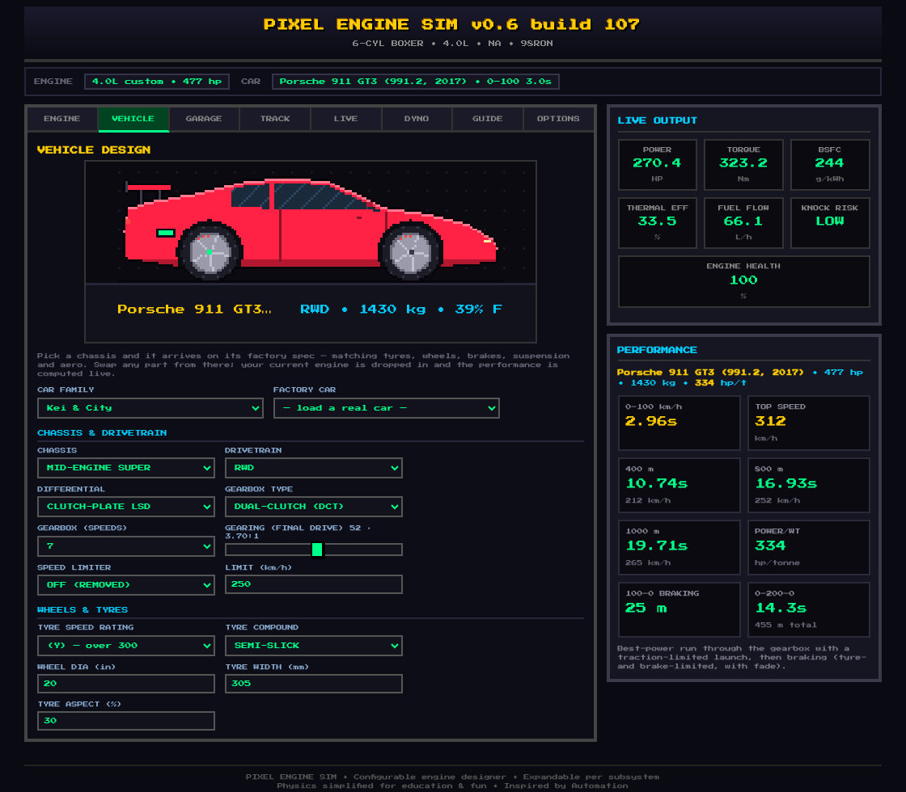

## How to Run

### Local
Serve the folder over HTTP and open `index.html`:
```bash
python3 -m http.server 8000    # then visit http://localhost:8000
```
> Opening via `file://` works too, but the PWA/offline features only activate over `http(s)`.

### GitHub Pages
This repo ships `.github/workflows/pages.yml`. Push to `main`, set **Settings → Pages →
Source: GitHub Actions**, and it deploys to
`https://<your-username>.github.io/<repo-name>/`.

## Runtime Controls

| Control          | Range         | Notes |
|------------------|---------------|-------|
| Throttle         | 0 – 100 %     | Opens the flap → MAP → torque → revs |
| Load (dyno brake)| 0 – 100 %     | Resistance that sets steady RPM; 0 = free-rev to limiter |
| Elec load        | 0 – 100 %     | Accessory electrical draw (lights/AC); can drain the battery at idle |
| Air-Fuel Ratio   | rescales/fuel | ~λ0.86 peak power, ~λ1.05 peak efficiency (range set by fuel) |
| Intake Air Temp  | -10 – 60 °C   | Colder = denser charge = more power |
| Coolant Temp     | 40 – 130 °C   | Optimal ~90 °C (auto in Auto Thermal) |
| Oil Temp         | 40 – 150 °C   | Optimal ~100 °C (auto in Auto Thermal) |

RPM and MAP are now **outputs** (shown live under the sliders), not inputs. The **Dyno
Curve** tab remains a wide-open-throttle steady-state sweep for reading the full curve.

## Physics Notes (simplified educational model)

- Engine cycle: the torque equation uses a power-stroke divisor per type — 4π for 4-stroke
  (one power stroke every two revs) and 2π for a 2-stroke and a rotary (a power event every
  rev), which is the main reason those make high specific output. Diesel is compression
  ignition (no spark, no spark-knock; limited by smoke/EGT), runs lean and unthrottled (little
  pumping loss), makes big low-end torque and the highest thermal efficiency; 2-stroke and
  rotary carry a thirst penalty (scavenging / seal losses) and rev high. Emissions follow the
  cycle too (diesel = NOx + soot with DPF/SCR aftertreatment; 2-stroke & rotary = high HC).
- Displacement derived from bore, stroke and cylinder count.
- Dynamic driveline: manifold pressure fills toward a throttle/RPM/boost target; net torque
  (combustion − pumping − friction − brake) accelerates the crank through a rotating inertia
  derived from displacement and stroke. LOAD is a dyno brake that targets a hold-RPM and only
  resists above it (so even a peaky engine can always rev up to it, rather than getting
  trapped below a torque valley); zero load free-revs to the limiter. Lifting the throttle
  gives engine braking, and injection systems cut fuel on overrun (DFCO — zero fuel flow); a
  rev limiter cuts fuel at redline; an idle floor prevents stalling.
- VE uses a broad generalized-bell breathing curve (flat plateau, gentle shoulders) so
  torque stays flat across the midrange and power keeps climbing toward redline instead of
  falling off a peaky Gaussian. Its peak shifts with bore/stroke ratio and redline; exhaust
  choice trades low-end for top-end scavenging.
- Camshaft profile shifts the VE peak and adds top-end breathing/scavenging at the cost of
  low-end VE and idle quality (a wild cam idles high and lumpy). VVT restores most of the
  low end, widening the powerband — strong bottom *and* top.
- Output is calibrated to sane ballpark figures (e.g. a 2.0 L turbo at 0.8 bar / sport
  exhaust / 98 RON makes ~255 hp & ~350 Nm; a 2.0 NA ~130 hp), with only a gentle power
  drop from peak to redline.
- Compression scales indicated work and efficiency via a relative Otto-cycle factor.
- Forced induction raises achievable MAP and heats the charge. Charge heating is the real
  thing — `T·(PR^0.283 − 1) / η_compressor` — not a per-bar constant, so it grows faster than
  boost does and grows again as compressor efficiency falls. The intercooler is rated by
  **heat-exchanger effectiveness** (none 0, small 0.62, large 0.82), the fraction of that rise
  it gives back; a large core leaves the charge coolest but its plumbing volume adds spool lag.
  At 1.8 bar this is the difference between a 164 °C charge with no intercooler (245 hp, knock
  risk 40) and 50 °C with a large one (381 hp, knock 10).
- Turbo boost spools with RPM along a logistic curve: small turbos spool early (strong
  midrange) but choke the top end, large turbos lag down low but flow more up top. Actual
  boost also lags in time (turbo lag), so it builds over ~1 s in the live Engine View.
- **Pressure has to be paid for (new).** A compressor makes boost by spinning, and shaft speed
  has to be bought with exhaust energy — turbine speed for a pressure ratio goes like
  `√(PR^0.283 − 1)`. So the spool point and the response time are functions of *the boost you
  asked for*, not fixed properties of the frame. The same small turbo on a 1.0 L:

  | boost | 50% boost at | time to 90% | charge temp | knock |
  |---|---|---|---|---|
  | 0.5 bar | 1197 rpm | 0.50 s | 33 °C | 0 |
  | 1.0 bar | 1820 rpm | 0.75 s | 40 °C | 3 |
  | 2.5 bar | 2968 rpm | 1.22 s | 58 °C | 34 |

  Previously all three columns were flat — 1820 rpm and 0.75 s at *every* boost target, and a
  small frame delivered 2.28 bar at 3000 rpm on a 2.0 L.
- **Frames have a rated flow (new)** — small 32, medium 55, large 82 lb/min, with config
  multipliers (twin ×1.85, sequential ×1.55, compound ×2.3). That is the axis a real compressor
  map is drawn against. The engine's air demand at peak power is computed against it, and past
  the rating the compressor is off its map: efficiency falls, the top end chokes harder, and the
  charge cooks. A 2.0 L asking 2.5 bar of a small frame wants **166 %** of its rated flow, runs
  49 % efficient, and makes 120 hp *less* than the medium frame while lapping slower than the
  same engine at 0.8 bar. The design summary states the flow, the efficiency and an explicit
  *off the compressor map* warning, so the limit is visible rather than merely felt.

  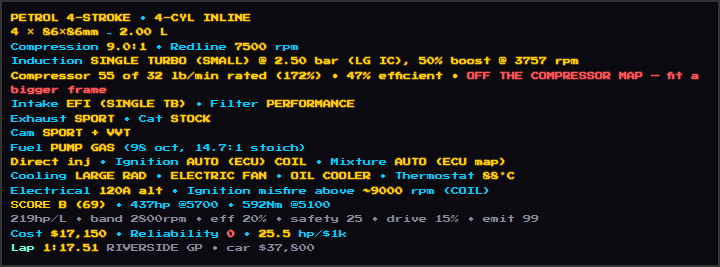

  *Known limit: spool lag — the time to build boost — is integrated on the live ENGINE bench,
  but the acceleration and lap solvers work from the steady boost available at each rpm, so
  they feel the spool point move and not the transient. A very laggy build is flattered a
  little by its 0–100 and lap times.*
- Ignition timing has a max-brake-torque (MBT) optimum that varies with RPM and load — too
  little or too much advance loses power, and advancing past MBT feeds knock (retarding pulls
  it back). *Fixed* timing is only optimal at one operating point; *Auto* tracks MBT
  everywhere and retards under knock, so it makes more power across the curve and adapts to
  fuel — full timing on race gas/E85, pulled timing on low octane or high boost.
- Fuel mixture: in *Manual* mode the AFR you set is used everywhere; in *Auto* mode a 3D ECU
  fuel map picks the target AFR from load (MAP) and RPM — near stoich at light load for economy,
  richer under load and boost (down to ~λ0.80) for power and exhaust-temperature control, like a
  real fuel map. Fuel *quantity* is always the air mass ÷ target AFR (so it already responds to
  both load and RPM); the map adds the load-varying target on top. The map is **hand-editable**
  in the design panel — select any load×RPM cell and shift its target richer/leaner (the live dyno
  reflects the change immediately); a custom map is saved with the build and can be reset to the
  factory grid at any time. Scoring and the vehicle acceleration model always evaluate at a fixed
  best-power AFR, so grades and lap-style figures stay comparable regardless of the mode or any
  hand-tuning.
- Intake system sets top-end airflow (restrictive small carbs choke up top; ITBs, sidedraft
  carbs and mechanical injection breathe best) and AFR-metering precision — EFI holds optimal
  AFR for the best efficiency, while carburetors and mechanical injection run richer and
  waste fuel (worse BSFC). The air filter adds an airflow-weighted restriction.
- Knock combines boost, compression, charge/coolant temperature, RPM, timing and mixture,
  offset by fuel octane, charge cooling and direct injection; high knock derates power.
- Emissions: major pipe species from fuel C/H/O + λ (rich side via water-gas shift); CO rises
  sharply when rich; HC is U-shaped — high rich and very lean (misfire), plus overlap, metering
  and cold running; NOx peaks slightly lean (~λ1.08) and scales with combustion temperature.
  Rates are g/s from the live fuel mass. A three-way cat needs excess O₂ to oxidise CO/HC but
  an O₂-free exhaust to reduce NOx, so only stoich cleans all three — the rating rewards a cat
  + precise stoich metering. The cat also adds a little exhaust back-pressure (a small VE loss).
- Fuel type sets energy density, stoichiometric AFR (the mixture control works in lambda,
  so the AFR slider rescales per fuel), knock rating and evaporative charge cooling. E85 and
  methanol resist knock and cool the intake charge (more power) but need much more fuel
  flow (higher BSFC), while race gas is high-octane pump gas.
- Cooling balances the heat of the fuel burned (against the fuel the engine burns at the power
  its radiator was sized for) against radiator capacity + airflow (RPM-driven) and fan, so
  free-revving on the limiter stays cool and full load at full power heats the engine; the thermostat sets the floor temperature. Overheating (>~108 °C) costs power.
- Reliability: engine health accumulates wear from detonation (the big killer), overheat,
  lean-under-boost (burnt pistons); a clean tune barely wears, and the rev limiter does not wear it. Lower health
  cuts power; zero health = catastrophic failure until rebuilt. Damage happens over tens of
  seconds of abuse — long enough to heed the warnings and back off.
- Vehicle: acceleration is integrated step-by-step — the engine's best-power torque curve is
  taken through the gearbox (auto-spaced ratios × a final drive from the gearing slider), giving
  tractive force = wheel torque ÷ rolling radius, capped by traction (μ × the driven-axle load,
  including static weight distribution, longitudinal weight transfer under acceleration, and
  aero downforce). Aero drag (½ρ·CdA·v²) and rolling resistance oppose it; the car shifts at the
  limiter, losing drive for the gearbox's shift time. In top gear there is nothing left to shift
  into, so **the rev limiter cuts drive to zero** and drag brings the car back — both the
  standing-start run and the lap solver are bound by the speed the gearing can actually reach,
  never by drag alone. The launch depends on the gearbox. A clutch
  box (manual/sequential/DCT) models a **slipping clutch**: from a standstill the engine is held
  at its launch rpm (≈55 % of the redline) while road speed brings the gearbox input up to meet
  it, and only then locks to the wheels — which is why a peaky, high-revving engine can still
  leave the line hard instead of falling into a torque hole the instant it moves. Slipping never
  adds torque; drive force is still capped by traction, so the launch stays grip-limited. A
  **torque-converter auto** instead stalls its impeller up against a slow turbine and *multiplies*
  engine torque (≈1.9× at a 2400 rpm stall), fading to 1:1 as the turbine catches up. That launch
  advantage is why an auto beats an equivalent manual on a heavy, torquey engine (6.6 diesel
  pickup, 8.61 s → 8.01 s) and loses badly on a light, peaky one whose powerband sits far above
  the stall speed (2.0 ITB screamer roadster, 4.55 s → 5.96 s) — at the cost of the worst
  driveline efficiency of the four boxes.
  The **differential** then sets how much of the driven axle's grip is usable. An axle's two
  wheels are never loaded identically (camber, torque reaction, axle wind-up, suspension
  geometry), and an *open* diff can only feed each wheel what the lighter-loaded one holds — it
  spins that wheel and throws the rest away (≈78 % usable **at launch**). A *viscous* LSD recovers
  most of it (92 %), a *clutch-plate* LSD effectively all of it, a *spool* all of it and a little
  more. That 78 % is **not a constant (new)**: most of the asymmetry an open diff is fighting is
  torque reaction — driveshaft wind-up, anti-lift geometry, torque steer — which is proportional to
  the torque actually going through the axle. In first gear under full multiplication it is at its
  worst; in a tall gear the axle sees a fraction of that torque and little more than road camber is
  left, so an open diff recovers to ≈91 %. Normalised so that at full axle torque it returns
  exactly the quoted figure, which leaves the standing start — and the whole drag-strip diff trade
  — bit-identical. A spool is unaffected, being welded.
  Because it caps traction rather than torque, a diff **only matters while the car is
  traction-limited**: on an 842 hp muscle car, open → spool is worth **0.94 s** to 100 km/h
  (5.52 → 4.58 s), while on a 48 hp kei it is worth **0.05 s** — it never troubles its tyres. Top speed is drag-limited, so the
  diff never changes it.
- **Why a front-driver runs out of grip so early.** Three factors multiply, and the first is the
  one people forget: a FWD car drives only the front axle (≈60 % of the weight standing), and
  accelerating transfers weight *off* it, down to ≈53 %. Times an open diff (0.78) times eco tyres
  (μ 0.81), the whole car is capped at **0.33 g** whatever the engine makes. At 100 km/h that
  ceiling is ~2500 N and even a 109 hp engine already wants 2700 N — so a 217 hp version of the
  same car reaches 100 km/h at essentially the same time. The fix is grip, not power: on that same
  217 hp kei, a clutch LSD alone takes 9.3 s → 7.9 s, sport tyres 6.5 s, slicks 5.5 s, AWD 4.4 s.
- **Acceleration calibration (new).** The whole model is checked against cars whose real 0–100 is
  public, with power, kerb weight, drivetrain, tyre class, diff *and gearbox* all matched first —
  so what is under test is the traction/weight-transfer/gearing model rather than the engine model:

  | car | hp | kg | drive | gearbox | real | model | error |
  |---|---|---|---|---|---|---|---|
  | VW Golf GTI (Mk8) | 245 | 1450 | fwd | DCT | 6.2 s | 6.22 s | +0.3 % |
  | Honda Civic Type R (FL5) | 329 | 1430 | fwd | manual | 5.4 s | 5.19 s | −3.8 % |
  | Toyota Supra RZ (A80) | 326 | 1570 | rwd | manual | 4.9 s | 5.02 s | +2.4 % |
  | BMW M2 (G87) | 460 | 1725 | rwd | auto | 4.1 s | 3.94 s | −3.9 % |
  | Subaru WRX STI (GD) | 280 | 1470 | awd | manual | 5.2 s | 5.06 s | −2.6 % |
  | Suzuki Alto Works | 64 | 720 | fwd | manual | 11.0 s | 11.03 s | +0.3 % |

  RMS error **2.66 %** across the set. Matching the gearbox matters more than it looks — 350 ms of
  manual shift twice is 0.7 s of the run, so quoting a DSG car's time against a modelled manual
  measures the gearbox, not the traction. *(The spool's real penalty is cornering — understeer and tyre scrub —
  which this straight-line sim doesn't model yet, so it looks strictly best; flagged in the GUIDE.)*
  Top speed is the fastest steady speed **any** gear can hold (thrust = drag + rolling
  resistance, capped by the limiter) — a peaky or over-geared car genuinely reaches its maximum
  one gear down, on the cam, rather than bogging in top. The **gearing number is the final
  drive** (0 = 4.90:1, 100 = 2.60:1): short gearing multiplies wheel torque for a quicker 0–100
  but runs each gear out of revs early; tall gearing does the reverse. The optimum is the tallest
  ratio the engine can still pull to its power peak in top gear — past that, top speed stops
  improving (the car just achieves it a gear lower) while acceleration keeps degrading. In the sim
  a 1.5 NA sedan plateaus around 200 km/h at every setting while its 0–100 slides from 10.0 s to
  13.1 s, whereas a twin-turbo V8 supercar keeps gaining, 221 → 407 km/h, all the way to 2.60:1.
  AWD puts all four tyres' grip down and launches hardest;
  FWD loses front load under acceleration. Engine mass is estimated from the spec and added to
  the chassis for curb weight and power-to-weight. Braking is the mirror image: deceleration is
  the lesser of tyre grip (μ·(weight + downforce)) and what the brakes can command (capacity by
  type/rotor size, fading as they absorb heat), with aero drag also slowing the car — so big
  brakes and sticky tyres shorten 100–0, while undersized steel brakes fade in the 0–200–0.
- **Rolling resistance rises with speed.** Hysteresis losses grow with how fast the carcass is
  deformed, so `Crr` climbs roughly with v² — checked against Michelin passenger-tyre data (0.010 at
  80 km/h, 0.013 at 160, 0.016 at 200) rather than against this simulator's own outputs. A fixed
  `Crr` understated resistance by ~60 % at the speeds a fast car actually reaches. It feeds the
  acceleration run, the top-speed scan and the lap solver alike. Each compound also carries the
  **speed rating** it is really sold in (a drag radial rates *below* a touring tyre), shown in the
  VEHICLE panel and flagged when the build out-runs it — but deliberately not used as a hidden
  top-speed cap, because several real cars stop short of their drag-limited speed for a reason
  (a manufacturer governor) that a tyre rating would only imitate.
- **Grip through slip in the 0-100, a clip on the lap.** The acceleration run pushes the car through the tyre's
  slip (build 154), with rotational inertia charged (build 107); the lap solver still caps the drive at the tyre's
  peak, which is the traction-control case.
- Racing line: nobody drives the centreline — using the full width straightens a corner and raises
  the speed you can carry. The line is solved by **minimising total curvature** within the track
  edges (projected gradient on Σ|second difference|², run on a coarse node set because the
  curvature gradient scales like ds⁴/R³ and is hopelessly ill-conditioned at 5 m sampling — worse,
  the Catmull-Rom centreline satisfies the stationarity condition exactly, so a fine-grid solve
  never leaves it). Out-in-out through corners, straightened esses and linked complexes emerge from
  the objective rather than being scripted. It is worth **5–7 % of lap time** over the centreline,
  and the gain scales cleanly with track width (Riverside: 79.7 s at 6 m wide → 75.8 s at 18 m).
- **Minimum time, for the car being driven (build 115)**: minimum curvature is symmetric — it prices a
  metre of radius at corner entry exactly like a metre at the exit — and it pays no attention to distance. On
  track exit speed is carried down whatever follows while at entry the car is braking anyway. So the
  minimum-curvature line is only the start: it is then refined for the car, a local search that moves the line
  around one point at a time and keeps each move the car's own lap solver says is quicker. Late apexes emerge
  where they pay, and each car drives its own line (cached per car): a 90 hp hatchback and an 800 hp aero car no
  longer share one. The fitted late-apex bias it replaced (3 x how open the next 90 m were) is gone.
- **Variable track width (new)**: a circuit is not a constant ribbon — it narrows through the tight
  sections and opens on the fast ones, and a 7 m corner cannot be straightened as much as a 13 m
  one no matter who is driving. Each circuit carries a width profile normalised to **mean 1**, so
  the quoted `width` is by definition the arc-length average and the old width knob still scales the
  whole circuit. Ashdown runs **8–13 m**, Cape **12–16 m**, Riverside **9–15 m**, the Nordschleife
  **8–12 m**. The racing line is clamped per point against its *own* half-width, so it is on the
  track everywhere, not merely within some nominal average. The map is drawn as a filled ribbon
  rather than a fat stroke, because a stroke can only ever be one width.

  For the three hand-built circuits the profile is authored by station. For a GPX import there is
  no survey to read, so it is **derived from the layout** — roads are built wide where they are fast
  and narrow where they are tight — and labelled in the app as modelled, not measured. The
  saturation radius is deliberately high (3 km): a 500 m sweeper through the trees is still a
  country road.
- Imported circuits: **IMPORT GPX TRACK** on the TRACK tab reads a GPX trace and turns it into a
  lappable circuit. Points are projected to metres (equirectangular about the centroid — centimetre
  error at circuit scale), **resampled to a uniform step** because GPX spacing is wildly uneven (a
  real 20 km trace came in at 2.4 m / 27.9 m / 421.8 m min/median/max, which starves the spline in
  places and over-fits it in others), and lightly smoothed so GPS jitter doesn't read as curvature
  and invent corners. Elevation is taken from the file, so an imported circuit gets its real
  gradients; a trace that doesn't quite close is bridged. A 534-point, 20.5 km trace with 290 m of
  elevation imports and solves in ~120 ms. Imported tracks persist in `localStorage` and are marked
  `*` in the list — **nothing is uploaded**; importing is something the user does with their own
  file. (The real circuits below are the only circuit data that ships, in their own file.)
  *Accuracy note: imported lap times read a little slow — the line is still an approximation of the
  minimum-time line, the width profile is modelled from the layout rather than surveyed, and the
  driver never errs. It is a consistent yardstick for comparing builds, not a lap record.*
- **Real circuits (new, build 123)**: 22 real tracks under **REAL CIRCUITS** in the circuit menu —
  COTA, Brands Hatch GP, Hungaroring, Catalunya, Hockenheim, the Indianapolis oval, Albert Park,
  Hermanos Rodríguez, Gilles Villeneuve, Monza, Nürburgring GP, Bahrain, Interlagos, Sepang, Shanghai,
  Silverstone, Sochi, Spa-Francorchamps, Red Bull Ring, Suzuka, Yas Marina and Zandvoort. No single
  open source has everything, so `tools/import-real-tracks.mjs` combines three:
  the [TUM racetrack database](https://github.com/TUMFTM/racetrack-database) gives the centreline every
  5 m and the **measured** width to each side (from satellite imagery), in a local frame with no
  geography and no height; [bacinger/f1-circuits](https://github.com/bacinger/f1-circuits) (or
  OpenStreetMap, for Brands Hatch and the Indianapolis oval) gives the same circuit in latitude and
  longitude, and a rigid fit lays one on the other (1.2–7.4 m RMS; Yas Marina 13 m, where the sources
  differ in layout); a terrain model through [OpenTopoData](https://www.opentopodata.org) (EU-DEM 25 m,
  USGS 10 m, SRTM 30 m) then gives each point its height, median-filtered and smoothed over ~60 m so
  model noise doesn't invent crests. Lengths land within 0.3 % of the official figures, and the
  rises where they are well published match: Spa 103 m (104), Red Bull Ring 68 m (65), Interlagos
  41 m (43), Suzuka 42 m (40). The generated `tracks/real-circuits.js` is kept apart from the app
  because it carries its sources' licences (TUM data LGPL-3.0, OpenStreetMap ODbL); without it the app
  simply has its four test circuits.
  *Caveats:* the layout is the one in the source data, which can predate a rebuild (Catalunya with the
  chicane, Zandvoort before 2020, Yas Marina before 2021); a terrain model measures ground, so tree
  cover and buildings leak a few metres into the street-side tracks (Albert Park, Mexico City); corners
  are numbered, not named.
- Elevation: circuits carry a height profile, and the lap is solved in three dimensions. Three
  effects, all of them real: gravity along the slope (`m·g·sinθ`, resisting a climb and adding to a
  descent — and *helping* the brakes uphill, which is why an uphill braking zone lets you brake so
  late); the weight-on-tyres reduced to `m·g·cosθ` on a slope; and **vertical curvature**, where the
  normal load changes by `m·v²·κ_v` — a crest throws the car light exactly where it is fastest, a
  compression presses it down and lets it carry far more speed (on the test circuits, ~104 km/h over
  a brow against ~140 km/h through the equivalent dip). The vertical term is capped at ±0.6 g, since
  real suspension runs out of travel. Validated on a constant-radius circle where elevation can only
  cost time: 22.55 s flat → 22.74 / 23.21 / 25.31 / 28.32 s as the profile grows, with minimum speed
  falling and maximum rising throughout. Where the hills sit matters as much as their size — rotating
  the same profile around a circuit swings the lap by ±3.8 s.
- Lap time: a quasi-steady-state solver over that racing line. Each circuit is a ring of
  control points; a closed Catmull-Rom spline through them gives a smooth, guaranteed-closed
  centreline whose sampled curvature feeds the physics **and** whose polyline draws the map, so the
  picture can never disagree with the numbers. The solver takes the cornering ceiling at every
  point — *m·v²/r = μ·(m·g + ½ρ·ClA·v²)*, which solves for v² in closed form because downforce
  scales with v² too — then runs a **backward braking pass** and a **forward traction/power pass**,
  keeping the lower speed at each point. A **friction circle** couples them: grip already spent
  turning is unavailable for accelerating or braking, so a car at the cornering limit cannot also
  deploy its power. Gearbox shift time is charged per gear change around the lap. The result is
  that circuits reward different builds — a 300 hp/1049 kg screamer beats an 842 hp/1872 kg
  muscle car around Ashdown (92.3 s vs 95.3 s) and loses to it down Cape's straights
  (85.5 s vs 84.0 s).
- Differential on track: the straight-line traction figure is only the standing case. Cornering
  transfers load off the inside wheel, so an open diff — governed by the lighter-loaded wheel —
  collapses exactly when you want power on exit, while a locked one is unaffected. That, plus the
  lateral grip a locked diff scrubs away, finally prices the spool honestly: on an 842 hp muscle
  car it is ~0.2 s **quicker** to 100 km/h than a clutch LSD and ~2.9 s **slower** around Ashdown,
  and an open diff is worst at both ends.
- Track objectives: four of the challenges set a **lap target on a named circuit** rather than an
  engine metric, and their budget covers **engine + vehicle**, so the whole car is being judged.
  Targets are calibrated against measured builds — each is reachable with about 1–7 s of margin by a
  sensible build and comfortably missed by a weak one (a 112 hp kei car fails all four). Lap time is
  also **reported on the scorecard**, but deliberately *not* folded into the letter grade: the grade
  rates the engine, and an engine's grade should not move because the tyres changed. Verified — the
  same engine holds A(76) whether it is in a kei body or a hypercar, while its Riverside lap moves
  93.2 s → 53.7 s. Lap results are cached on the engine+vehicle build (cold 6.9 ms, cached
  0.0004 ms/call), since the dyno scorecard redraws sixty times a second.
- Strategy: each part carries a rough build cost, summed into a total (so budget challenges
  and power-per-dollar have meaning); a design reliability index estimates durability from
  knock the ECU cannot hold off, boost or specific-output stress (the larger, not both), mean
  piston speed above 25 m/s, high-strung choices (anti-lag, nitrous) and cooling adequacy for the
  power made, where a real engine's stock radiator is sized for its own rated power. These are design-time estimates, not the
  live wear model (which still plays out as you drive).
- Electrical: the alternator (output rising with RPM) charges the battery when it
  out-supplies demand and drains it otherwise; system voltage tracks state of charge. Low
  voltage weakens the spark, and each ignition type has a dwell/misfire RPM limit, so a
  distributor or a flat battery loses top-end power. The alternator also costs a little
  parasitic crank power, most noticeable at idle.
- Standard 4-stroke BMEP → Torque → Power conversion throughout.

Numbers are calibrated to a realistic ballpark but this is not a high-fidelity thermodynamic
model — it's tuned for fun, learning and rapid experimentation (the "light Automation"
philosophy).

## Project Structure

**Working on the code (people and coding agents):** read [`AGENTS.md`](AGENTS.md) first. It describes how a change
becomes a build and a pull request (branching, stamping, tests, the CHANGELOG), so work from different tools never
conflicts. Cursor picks it up through `.cursor/rules/development.mdc`. Its section 10 covers keeping an agent's
context small, which is most of what a pull request costs to make.

```
.
├── index.html                     # Complete single-file app (HTML + CSS + JS) — BUILT from src/, committed
├── src/                           # The source of index.html — edit here
│   ├── shell.html                 #   the page, with an @include line where each part goes, in order
│   ├── css/app.css                #   the styles
│   ├── html/guide.html            #   the in-app guide
│   └── js/*.js                    #   the script, cut along its sections (physics, vehicle, lap, race, sound, UI…);
│                                  #   js/powertrain.js is what the vehicle, lap and race see of the engine
├── CHANGELOG.md                   # Release history; every commit carries a build number
├── favicon.svg / manifest.webmanifest / sw.js   # PWA (icon, manifest, offline SW)
├── assets/                        # Self-hosted font + PWA icons
├── docs/                          # README screenshots
├── tests/                         # Headless Playwright suite — see tests/README.md
│   ├── run.mjs                    #   node tests/run.mjs   (reports by exit code)
│   └── proto/                     #   parked models, not run by the suite — see tests/proto/README.md
├── tools/build.mjs                # Joins src/ into index.html; --check verifies the committed file
├── tools/stamp.mjs                # Stamps + verifies the build number
├── tools/split-i18n.mjs          # One translation per line in src/js/i18n.js (keeps diffs small)
├── tools/fingerprint.mjs          # Every car's 0-100, laps and a race, exactly; --compare proves a refactor moved nothing
├── plans/                         # Proposals not yet built — plans/hybrid-electric/
├── .gitattributes / .ignore       # Keep the generated index.html out of git diffs and out of searches
└── .github/workflows/             # pages.yml: auto-deploy to GitHub Pages · check.yml: index.html is src/ joined
```

**One file shipped, many edited.** `index.html` opens straight from `file://` with no server, no
build step and no dependencies, works offline, and is a single artefact to share or archive. ES
modules would cost all of that (they are blocked from `file://`), so the page stays one classic
script. At 1.6 MB one *source* file had outgrown its editor, so since build 176 the source lives in
`src/`, cut along the seams that were marked inside the file, and `tools/build.mjs` joins it back
byte for byte: no transforms, no minifying, the page served is the page reviewed.

```sh
node tools/build.mjs            # write index.html from src/
node tools/build.mjs --check    # fail if the committed index.html is not exactly src/ joined
```

Edit `src/`, never `index.html`; run the build; commit both. `index.html` stays committed because
GitHub Pages, the tests and `tools/stamp.mjs` all read it directly. `tests/run.mjs` and the Check
workflow refuse an `index.html` that is out of step with `src/`. A new part is a new file in `src/`
plus an `@include` line in `src/shell.html` where it belongs; a file nothing includes fails the build.

**Versioning.** `MAJOR.MINOR` plus a unique build number per commit — a counter in the file that
only ever increases, so it survives squash-merging (a commit *count* does not: squashing three
commits into one makes it go backwards):

```sh
node tools/stamp.mjs            # bump the build number in src/shell.html, index.html and README
node tools/stamp.mjs --check    # verify it is consistent and ahead of origin/main
```

## Roadmap / Future Expansion

### The original feature plan — all shipped

1. ~~Engine presets / example gallery~~ ✅ — a **LOAD A PRESET** dropdown with popular
   archetypes (1.6 sport, kei turbo, hot-hatch, ITB screamer, RS5-turbo, 2JZ six, muscle V8,
   blown V8, V12 supercar, eco turbo, diesels, rotaries, two-stroke).
2. ~~**(D) Forced-induction & tuning depth**~~ ✅ — turbo configs (twin/sequential/compound),
   supercharger types (roots/screw/centrifugal), anti-lag, nitrous, an **editable 3D ECU fuel
   map** (tap a load×rpm cell, − LEAN / + RICH, RESET MAP), and pressure-ratio-aware spool with
   compressor flow limits. *Ignition is covered by the Auto (MBT-tracking, knock-limited) timing
   model rather than a hand-editable spark map — see below.*
3. ~~**(E) Emissions & sound**~~ ✅ — engine-out CO / HC / NOx vs mixture & combustion
   temperature, a **catalytic converter** with a stoich-window three-way conversion model, a live
   analyser readout, an emissions score, and a character-driven **lope/burble** on the note.
4. ~~**(C) Strategy layer**~~ ✅ — per-part costs, build budgets, a design reliability index and
   power-per-dollar, plus objective-based challenges with live pass/fail — including four that
   judge the **whole car against the clock** on a circuit.
5. ~~**(B) New engine types**~~ ✅ — diesel (compression ignition), rotary/Wankel and 2-stroke,
   each with its own firing frequency, fuelling, efficiency, emissions and sound.
6. ~~**(A) Vehicle / drivetrain layer**~~ ✅ — chassis, drivetrain, gearbox types, differential
   types, tyres, aero, weight, brakes and suspension → acceleration, top speed, braking and the
   0–200–0 test, with **per-chassis factory fitment**; a **test track** (four test circuits and 22 real ones, a
   friction-circle lap solver with a late-apex racing line, variable width and 3D elevation,
   sector splits and a limit-coloured map); lap time feeding the **challenge system and
   scorecard**; and a **garage** holding any number of named chassis+engine combos.

### Known limits — the honest list

These are modelled approximations that are *stated* rather than hidden, each one measured and
documented in the GUIDE at the point where it matters:

- **Fuel on track is a flat-out driver's.** The engines' lap-average BSFC is a real engine's under hard use, and
  mid-size cars match owners' track figures (~35–40 L/100 km); big-power cars burn 20–40% more than owners report,
  and a small NA car ~20% less, because the lap is at the limit and owners mostly are not.
- **Tyre temperatures are checked, with two gaps.** Race tyres land in the measured ranges, but an eco tyre on a
  light car runs cool (45–60 °C) and a fast circuit reads a little cooler than a short one; no track data was
  found to settle either.
- **Brake temperatures are a flat-out driver's.** The lap brakes at the limit into every corner, so a heavy,
  fast car on a long fast circuit (a Hellcat or an E46 M3 at Spa) runs its rotors to 750–900 °C and fades.
  Measured track-day figures are lower (450–600 °C rotor core, DBA) because most drivers brake earlier and
  softer; light cars and small brakes land inside the measured range.
- **Balance is a limit, not a motion.**
  - **What is modelled (build 157):** each axle's grip is its own, so cars understeer or oversteer.
  - **What is not:** yaw inertia, slip-angle build-up and transient load transfer. A car is never caught out by
    lift-off oversteer, and it never slides or spins. Chicanes are a little optimistic, about 1–3% by the usual
    comparison of quasi-steady and transient lap sims.
  - **Unpublished inputs:** the cars' factory roll balance and their real tyre load sensitivity per axle are not
    published. Every car starts at NEUTRAL roll balance, though a real road car's factory setup understeers a
    little more.
- **The race's racecraft is rules, not physics.** Overtaking, the tow, dirty air, pit-lane loss and
  driver error are rules with fitted numbers. The cars share one racing line rather than fighting for
  space on it, and the tyre model's heat, grip-window, wear and wet-grip constants are fitted to the
  usual published ranges, not derived. When the rain comes and how fast a line dries are rules drawn
  from the seed, not a forecast.
- **The turbine housing is a choice, not matched to the engine.** A/R comes from the frame (TIGHT / STOCK /
  LOOSE per size class, scaled with the maker's wheel where it is set), with nothing about the engine
  entering. Re-measured in build 151, the mismatch this was parked for has mostly closed on its own: exhaust
  flow per mm² of throat at rated power spans 1.9× across the real turbo presets (it was 4×), boost
  thresholds against the prototype's anchors are 775 rpm RMS (was ~1940; the proposed matching reached
  ~700), and on the presets whose makers quote a torque plateau the 90%-boost point is ~620 rpm RMS from
  the plateau's start. The throat convention, the compressor island, pulse energy, packaging-short turbo
  manifolds and the makers' wheels did it. Left: the turbines run generous at rated power (exhaust over
  intake pressure ~1.1, where real petrol turbos run ~1.5-2), so matching to back-pressure would spool them
  earlier still; and VGT rings are the size class's, not the engine's (test49's diesel step). See
  `tests/proto/README.md`.
- **A turbo cannot fail from overspeed.** The shaft has a tip-speed limit and the model respects it
  as a *cap*, but nothing breaks. A grossly over-flowed frame therefore ends up running steadily at
  an expansion ratio that would have destroyed it — a 2.0 four at 2.5 bar on a small frame reaches
  7.4 bar of exhaust manifold pressure and simply becomes gutless, where the real outcome is a
  scrapped cartridge.
- **A TRACK lap is a single best-case hot lap** — no tyre wear, no fuel burn, no traffic, no driver error, the
  brakes after one preparation lap. The RACE tab adds those, as rules where they are rules (above).
- **Imported circuits have modelled width, not surveyed width**, derived from the layout.
- **Engine braking stops at the limiter.** Since build 149 the engine brakes the car through the braking
  zones (its own overrun torque, in the gear the driver has worked down to). On the power at the rev limiter
  the drive is cut to zero but nothing drags back, so a steep descent can carry a car a km/h or so past the
  speed its top gear allows.
- **Known gaps the tests name:** the ported engines still use a hand-set exhaust share, so the Renesis (~842 °C)
  and the 500cc two-stroke (~764 °C) read cool; each is budgeted by name in test46/47 at a floor it may not fall
  below. Boosted low-rpm torque against the makers: the RS3 is ~46% short at 1700 rpm (its real compressor wheel is
  not published; the preset uses the 71 mm upper bound) and the EcoBoost ~44% at 1400 (no published wheel either).
  Older turbo engines with no ECU torque limit (Supra, STI, Evo) read 8–14% over the makers in the mid-range.
- **Power at the rev limiter.** test46 names the archetypes allowed to peak there: the 1.6 Sport NA I4 (a plateau,
  ~1 hp over its last 400 rpm: the missing top-end fade test60 also names for the 4A-GE and the F140), the 2.0
  Turbo Diesel I4 (a plateau; a real TDI's late fall is its torque-limit calibration, which ECU TORQUE LIMIT can
  now set) and the 2.0 Turbo Hot-Hatch. A boosted engine with no ECU boost taper holds full boost to the limiter
  by its calibration (build 131) and is not counted. Any naturally-aspirated preset joining the list fails.
- **The whole suite passes** (56 tests, build 150), each re-baselined check carrying its reason in the test and
  the changelog.
- **The VE bell is gone from every poppet-valve petrol engine, and kept for the rest.** It took three
  attempts. The third (builds 82–84) found the bell had been covering for two errors: the trapping
  calculation closed every intake valve 16–24° early, and the intake ram put its tuning peak 22–57%
  too high in rpm against Engelman's published ratio, so every runner rang at the redline. With both
  fixed, test41 improves (4.02% → 3.34%) and test48's power error halves (15.8% → 8.6%). Diesels
  followed in build 88, once their torque came from fuel and their burn from time. Rotaries and
  two-strokes still use the fitted bell, and `CAM.ampMul` still scales their VE by cam grade (on poppet-valve
  engines the integrated intake stroke, builds 121-122, carries the filling and the cam).
  The S2000 and S54 in test48 now carry their factory high-rpm intake and header; on the app's
  mid-range defaults they read 23–35% short, so check those two hardware calls if you know the cars.
- **Without traction control, flat out after the launch.** Since build 154 the tyre pushes through slip and spins
  past its peak when the engine has more than it can take. With traction control the ECU holds the peak; without
  it the driver holds it through the launch in first gear (build 155), and from the first upshift the run is flat
  out, so a car with the power spins in second where a tester would ease off. The driver's feel past the launch
  is not modelled.

### Next: v1.0 — every number derived, not fitted

v1.0 is every powertrain (piston, rotary, two-stroke, diesel, electric, hybrid) and the car running on numbers that
come from geometry, a physical law and a sourced input, each real car within 10% of its published figures or named
with the reason it is not. It is also the base a driving game can be built on: the car stepped in time from a
driver's inputs, on four wheels.

- **The route:** [`plans/road-to-v1.md`](plans/road-to-v1.md), phases A to H, with the owner's decisions.
- **What is still fitted:** [`plans/fitted-register.json`](plans/fitted-register.json), every fitted number left, what
  it stands in for and the part that retires it. `tests/test166.mjs` lets the list only shrink.
- **How a part is built:** [`plans/parts-design-space.md`](plans/parts-design-space.md).
- **What was converted already** (builds 70 to 258, and the inertia investigation):
  [`plans/v1-history.md`](plans/v1-history.md).

## License

MIT – free to use, modify, and share. Credit appreciated but not required. See [LICENSE](LICENSE).

---

**PIXEL ENGINE SIM** – Built for tinkerers who love engines and pixel art.
