# PIXEL ENGINE SIM v0.7 build 213

**A lightweight, 8-bit style internal combustion engine *designer* & simulator** inspired by *Automation*.

**▶ Play it live: [ipaliog-a11y.github.io/Engine_simulator](https://ipaliog-a11y.github.io/Engine_simulator/)** — redeployed automatically on every merge to `main`.

Design an engine from the ground up — cylinders, bore & stroke, compression, forced
induction, exhaust, fuel octane, injection and ignition — then run it on the dyno and
watch the physics respond. Web-based, fully offline-capable, installable as a PWA.

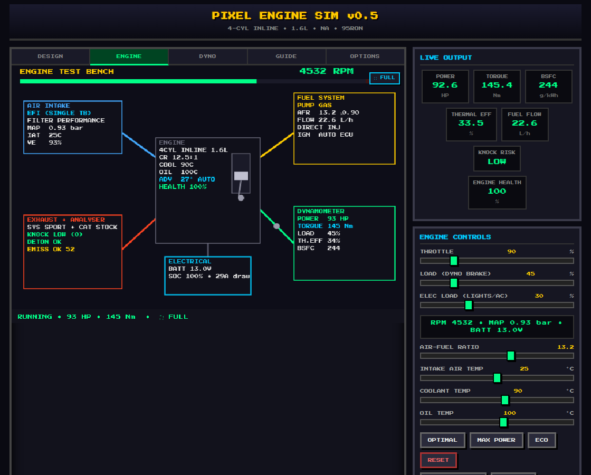

## Features

### Engine Designer (new in v0.3)
Load one of **16 preset builds** from the dropdown — petrol, diesel, rotary and 2-stroke
(1.6 sport, kei turbo, hot-hatch, ITB
screamer, 2JZ six, muscle V8, blown V8, V12 supercar…), or configure your own on the
**ENGINE** tab and press **BUILD & DYNO**. Every parameter feeds the physics:

- **Engine type / cycle** — **petrol 4-stroke**, **diesel (compression-ignition)**,
  **2-stroke**, or **rotary (Wankel)**. Each reshapes the physics: a power stroke every rev
  (2-stroke & rotary) doubles the firing frequency for high specific output; diesel runs lean
  and unthrottled with no spark-knock, big low-end torque and the best efficiency; 2-stroke
  and rotary are thirsty and HC-heavy; rotaries rev sky-high and turbine-smooth. Switching type
  retargets the compression / redline / AFR ranges and disables what doesn't apply.
- **Bottom end** — cylinder count (1–12; rotors 1–3 for rotary), layout (inline / V / boxer),
  bore, stroke, compression ratio, redline. Bore × stroke × cylinders sets the displacement.
- **Air path** — naturally aspirated / turbo / supercharger, boost target, **intercooler size**
  (none / small / large core — a bigger core cools the charge more but adds a little spool lag),
  turbo size, **turbo configuration** (single / twin / sequential / compound), **turbine**
  (fixed housing / **variable geometry** — vanes shut to spool, open at the top), **anti-lag**,
  **supercharger type** (roots / twin-screw / centrifugal), **nitrous** (small / big shot),
  exhaust (stock / sport / race) and a **catalytic converter** (none/decat / sport / stock).
  Twin/sequential/compound turbos spool earlier and flatter; PD superchargers make boost from
  idle while centrifugals build it with rpm²; anti-lag keeps the turbo lit (at a wear cost);
  nitrous is a big power adder from a bottle. A cat cleans the exhaust but adds a little
  back-pressure; deleting it frees a few hp at the cost of emissions.
- **Induction (metering)** — intake system (1/2/4-bbl carburetor, sidedraft carbs,
  mechanical injection, single-throttle EFI, or individual throttle bodies) and air filter
  (open stacks → restrictive). These set top-end breathing, AFR-metering precision (EFI is
  most efficient; carbs waste fuel), throttle response and idle quality.
- **Valvetrain (derived physics)** — cam profile (stock / sport / race), variable valve timing,
  **valves per cylinder** (2 / 4 / 5), **valve material** (steel / titanium) and **valve springs**
  (stock / performance / race). Nothing here is a lookup multiplier: the intake valve diameter your
  bore can physically fit, what that valve weighs, where it **floats**, and how badly the port
  chokes are all derived from geometry and mechanics. Four valves give 22% more intake area than two
  for the same bore, and five give *less than four* — which is why the industry abandoned them. The
  panel shows the **valve float rpm**, and flags it red when it falls below your redline, because
  then the engine cannot use the rev range it claims. A
  wilder cam moves the powerband up and adds top-end at the cost of low-end torque and idle
  quality; VVT recovers the bottom end for a broad powerband.
- **Electrical** — alternator size (60 / 120 / 180 A). With a live **ELEC LOAD** control
  (lights/AC), a small alternator plus heavy load at idle drains the battery — low system
  voltage then weakens the spark. Ignition type sets a dwell/misfire RPM limit (a
  distributor falls off up top; coil-on-plug holds to redline).
- **Fuel & spark** — fuel type (pump gas / race gas / E85 / methanol), fuel octane (RON,
  pump gas only), injector type (port / direct), ignition type (distributor / wasted spark /
  coil-on-plug), **ignition control** (*Fixed* — a locked advance you dial in — or *Auto*, an
  ECU that tracks MBT timing and retards just enough to stay off knock), and the **fuel mixture**:
  *Manual* (one AFR you set everywhere) or *Auto*, a **3D ECU fuel map** that targets near-stoich
  at light load and enriches under load & boost for power/EGT — just like a real fuel map (the
  default on fuel-injected builds; a live **load×RPM heat-grid** shows the target AFR in every
  cell with a marker on the current operating point, and the map is **editable** — tap a cell and
  nudge it richer/leaner to hand-tune the mixture, or reset to the factory grid). Carbs/mechanical
  injection stay manual. Each
  fuel has its own energy density, stoich AFR, knock rating and charge-cooling — alcohols resist
  knock and cool the charge (more power headroom) but burn far more fuel.
- **Cooling** — radiator size (small / stock / large), cooling fan (none / mechanical /
  electric), oil cooler, and thermostat opening temperature.
- **Reliability / wear** — the engine has a live **health** that falls under abuse:
  sustained detonation, overheating, lean-under-boost, and over-rev all wear it (a clean
  tune barely ages). A worn engine makes less power; at zero health it lets go and must be
  rebuilt (BUILD & DYNO or RESET). This puts real stakes on every design and tune choice.

These couple realistically: octane, compression, boost, intake temperature and ignition
advance all feed a **knock model**, and direct injection / higher octane buy back knock
margin so you can run more boost or timing. Get it wrong and the ECU derates power. The
**cooling subsystem** sets running temperatures in Auto Thermal mode — an under-sized
radiator with no fan will heat-soak and overheat under load (and at idle), which in turn
saps power; a large radiator, electric fan and oil cooler keep it cool.

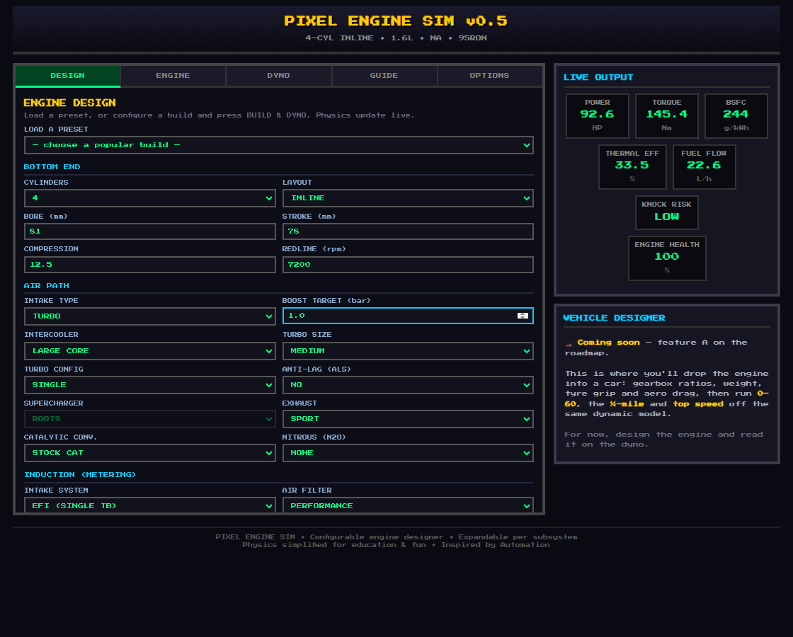

### Electric drive (in progress — the plan is in `plans/hybrid-electric/`)
Pick **ELECTRIC (BATTERY)** as the engine type and the ENGINE tab trades the combustion sections for **MOTOR**
(rotor diameter and stack, poles, turns per phase, magnet grade and retention, cooling, top speed), **INVERTER**
(silicon IGBT or SiC, current rating) and **BATTERY** (chemistry, cells in series, capacity, technology year). Torque,
the knee where the voltage runs out, the top speed, every loss and the heat are derived from those
(`src/js/electric.js`, checked against the measured Tesla Model 3 motor and ORNL's 2012 Leaf). The LIVE bench runs the
drive against the dyno brake with the pack sagging and the winding heating until the controller derates it; the DYNO
draws torque, power and efficiency at the pack's charge and the magnets' heat. On the road (build 180) an electric car
runs one reduction (matched to its top speed, GEARING biases it), takes energy back braking through the same path as an
engine's overrun, and pays for its heat over a lap: round the Nordschleife the battery management holds the pack near
55 °C and cuts the drive, and an air-cooled motor is cut far more. The TRACK tab shows the motor, the pack and the
energy. In a race (build 181) an electric car runs on its pack's usable energy, beside engines in the same field, with
no charging in the pit lane: its energy manager plans the power that lasts the distance and corrects it lap by lap, the
pack and the motor heat from lap to lap, and a car whose pack cannot last retires OUT OF CHARGE. MOTOR TYPE (build 182)
offers an induction motor beside the magnet one: no magnets, a copper-cage rotor magnetised by the stator's own current,
less efficient at its best and hotter in the rotor, but with no drag at all when it is not driving; built from the
Tesla Model S 60's published geometry it gives 430 Nm, 259 kW (225 published) and a knee at 5700 rpm. A car can carry
more than one motor (build 183): two at the rear, one per wheel, and one at the front, which makes it all-wheel drive.
Three Teslas are factory cars, matched on their hardware: the Model 3 RWD (0-100 6.18 s against 6.1), the Model Y Long
Range (dual motor, an induction front) and the Model S Plaid (three motors, 2.52 s against the 2.52-2.56 s measured).
The VEHICLE tab gives an electric car's consumption over the WLTP cycle (build 184), driven second by second through the
same drive: 120, 141 and 166 Wh/km from the pack for the three Teslas against their homologated 117, 138 and 158.

**Hybrids** (from build 186): any engine can carry a HYBRID system. PARALLEL (P2) puts a motor on the gearbox's input
shaft with a small pack of hybrid cells, designed in the same MOTOR / INVERTER / BATTERY fields; its torque adds to the
engine's in the 0-100, the lap and the race, it regenerates braking, and over a lap it sustains its charge. DEPLOY
FULL gives all the hardware can, ECO only fills the engine's curve (the Hyundai Ioniq Hybrid's calibration, checked
against MotorWeek's instrumented run). Every combustion car also gets its WLTP fuel (build 187): the same cycle,
each second in the gear that burns least, the fuel off the engine's own map, a cold start the engine warms out of: the
GR Yaris 7.85 L/100 km against 8.2, the Civic Type R 8.24 against 8.2-8.8. A hybrid's cycle is run by its energy
manager (build 188): each second electric only, the engine with the motor helping or charging, or regeneration,
whichever costs least with the pack's energy priced so it ends the cycle where it started. The Ioniq Hybrid: 5.05
L/100 km against Hyundai's 4.4-5.2. An ATKINSON cam closes the intake late.
POWER-SPLIT (eCVT, build 189) is Toyota's planetary: MG1 holds the engine at the speed it wants, MG2 drives the
wheels through one reduction, no gearbox. The 2016 Prius, its engine matched to its 72 kW: 0-100 in 11.2 s against
10.6, and 4.44 L/100 km on the WLTP cycle at the real engine's efficiency against Toyota's 4.14.
SERIES (build 193) drives the wheels with the motor alone and lets the engine only charge: the Nissan Qashqai
e-POWER runs 0-100 in 7.4 s against Nissan's 7.9. PLUG-IN (build 194) starts the pack full: WLTP then runs the regulation's
plug-in procedure, and the BMW 330e gives a 55 km electric range and 1.7 L/100 km weighted against BMW's 59-66 km and
1.6-1.9. A hybrid can carry a FRONT MOTOR on its own axle (build 195): the Porsche 918 Spyder runs 0-200 in 7.4 s
against Porsche's 7.2.
In a race (build 196) a plug-in starts on a full pack and spreads its own charge over the distance, and the HYBRID
TUNE's DEPLOY LIMIT and HARVEST LIMIT set a racing class's energy a lap.
Build 199 adds 50 real combustion cars from a research pack (`research/vehicles-batch-1/`): performance SUVs, track
cars, pickups, the first V6s, classics from the 1960s to the 1980s and more kei cars and hot hatches.
The VEHICLE tab's G-G DIAGRAM (build 200) draws how hard the car can corner, brake and accelerate at 60, 120 and
180 km/h, from the lap's own physics, with every point of a lap over it.
The PARTS tab (build 205) is a part designer: pick a type of part, then its options. The first is the exhaust (header
construction, primary diameter and length, the pipes after the collector, the silencer), previewed on the engine you
have built and saved to a library whose parts appear in the ENGINE tab's EXHAUST choices. The second is the intake
manifold (build 206): runner length and bore, and a variable length with a flap. The third is the air filter (build 210):
its media and housing, whose pressure drop at the flow the engine draws is now what any filter costs.
An electric car is heard (build 198): its motor's whine, the inverter's switching and the reduction's gears, each at
the frequency its build gives it, on the bench and on the lap replay.
On the LIVE bench (build 190) a hybrid runs with its motor and pack: a HYBRID panel draws the power flowing between
engine, motors, pack and brake, gauges the charge, and offers the drive modes (AUTO, EV, HOLD, CHARGE, SPORT, ENGINE
ONLY, MANUAL). Its VIEW selector also shows the power-split's lever diagram and the engine's BSFC map with the point
the controller holds it at (build 191). The ENGINE tab's HYBRID TUNE (build 192) sets how the motor helps (ASSIST, an
assist map over speed and pedal), regeneration, load-point shifting, electric-driving limits and the charge window.

### Simulation & live tuning
- **Live outputs**: Power (HP), Torque (Nm), BMEP, Volumetric Efficiency, Thermal
  Efficiency, BSFC, Fuel Flow, Knock Risk, Engine Health.
- **Ten tabs** — **ENGINE** (build the engine), **VEHICLE** (drop it in a car & read its
  performance), **PARTS** (design a part and fit it), **GARAGE** (the saved builds), **TRACK** (lap it round a circuit), **RACE** (race
  it against other builds), **LIVE** (the engine running: cutaway, the
  whole bank firing in its real order, and the controls), **DYNO** (power/torque curve,
  scorecard and a static result sheet with run data), **GUIDE** (a wiki: 60 pages in 9 sections, each climbing from real life to the game to the physics, with 8-bit pictures drawn in code, search and cross-links) and **OPTIONS** (sound,
  wear and **language**). The right column is context-aware: runtime Engine Controls while
  driving/on the dyno, the live **Performance** panel on VEHICLE, the **Lap Time** panel on
  TRACK and the race's setup, timing tower and telemetry on RACE.
- **Vehicle & performance (new)** — pick a **chassis** (13 archetypes, each with its own weight,
  size, drivetrain and grip) and it arrives on its **factory spec**: the tyres, wheels, brakes,
  suspension, aero and gearbox that car would really wear, so a kei car turns up on skinny eco
  tyres and small steel discs while a hypercar gets wide semi-slicks, carbon-ceramics and a
  wing/diffuser package. Every part stays editable from there, and **REFIT FACTORY SPEC** puts it
  all back; the summary marks the car *(factory spec)* or *(modified)*. Tune the
  **drivetrain** (FWD/RWD/AWD), the **differential** (open / viscous LSD / clutch-plate LSD /
  spool — how much of the driven axle's grip you can actually put down), the **gearbox** — **type** (manual / sequential / DCT /
  torque-converter auto, each with its own shift time, driveline loss and ratio spacing; the auto
  adds converter stall & torque multiplication off the line), 4–8 speeds, and a
  **final-drive slider**, 4.90:1 short → 2.60:1 tall, with the ratio shown next to the number —
  **tyres** (compound + width/profile/wheel diameter → grip &
  rolling radius), **aero** (front/rear/floor downforce vs drag), **brakes** (type + rotor size →
  stopping power & fade resistance), **suspension** (the setup's ride frequency and camber, each axle's
  springs and anti-roll bar from soft to stiff, and each axle's own geometry: strut, double wishbone, multi-link,
  twist beam or solid axle) and **weight reduction**.
  Your current engine is dropped in and the sim computes **0–100 km/h**, **400 / 800 / 1000 m**
  (time + trap speed), **top speed**, **100–0 braking** and the **0–200–0** test live — a
  traction-limited launch and a tyre/brake-limited stop (with fade), weight transfer, downforce,
  aero drag and rolling resistance. Vehicle cost and power-to-weight are shown too.
- **Hot lap report (new)** — **LAP REPORT PNG / PDF** on the TRACK tab saves the lap as a printable
  telemetry sheet: the circuit map with **full-throttle** and **braking** sections picked out and
  every corner tagged, a **speed trace** against distance with braking zones shaded, an **elevation
  profile** on the same axis, lap and sector times, the full car specification, and a **speed trap at
  every corner** — entry, apex and exit speed, gear, radius and gradient. Corners are detected from the racing line, numbered T1…Tn and named per
  circuit (Riverside GP runs Millrace, Weir, Ferryman, The Island…). The same corner list drives
  the on-screen corner count, so the app and the sheet can never disagree.

  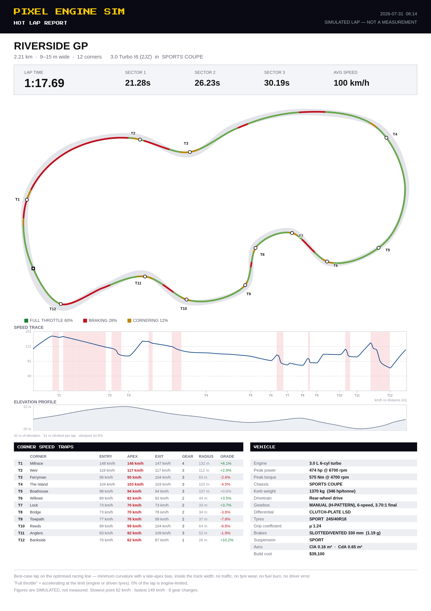

- **Dyno report (new)** — **REPORT PNG** / **REPORT PDF** on the dyno save the current pull as a
  printable A4 sheet laid out like a real dynamometer print-out: power and torque traces with the
  peaks called out, a peak-result band, the full engine specification, the conditions the run was
  made under, and a tabulated run-data list. Logged pulls are overlaid faintly for comparison.
  Both formats are generated entirely in the browser — the PDF embeds the rendered sheet as a
  JPEG via PDF's native `DCTDecode` filter, so there is no library and it still works offline.
  The sheet is clearly marked **SIMULATED — NOT A MEASUREMENT**, and prints the *design potential*
  alongside the as-tuned run so the two figures can't be mistaken for each other.

  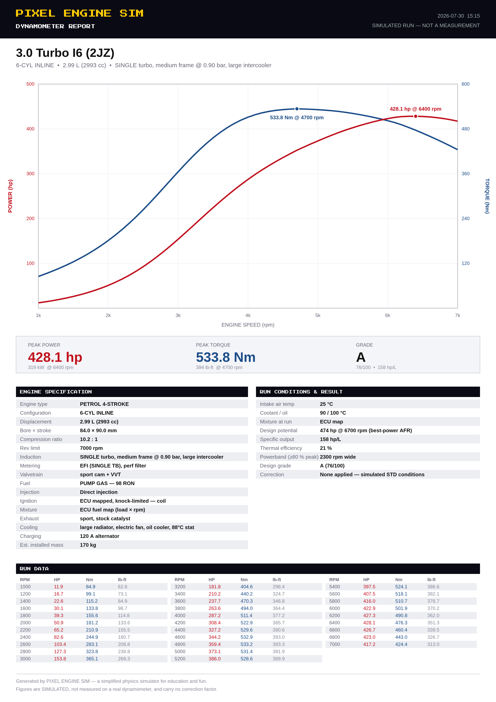

- **Test track (new)** — a **TRACK** tab that puts the finished car on a circuit and solves a lap.
  Three layouts with different characters: **Ashdown Park** (2.0 km, tight and technical),
  **Cape Speedway** (3.1 km, long straights and fast sweepers), **Riverside GP** (2.2 km,
  balanced) and the **Nordschleife** (20.4 km, 44 corners, 290 m of elevation and 505 m of climbing
  per lap — geometry and gradients derived from a recorded GPX trace, corners numbered rather than
  named because the detector can't be reliably aligned with the circuit's real corner names) — plus
  **22 real circuits** (Spa, Suzuka, Silverstone, Monza, Brands Hatch and the rest; see *Real
  circuits* below) with measured width and terrain-model elevation. You get a **lap time**, three **sector splits**, average / slowest / fastest speeds
  and the number of gear changes, plus a top-down pixel map — the track drawn to its real, **varying**
  width,
  with an **optimised racing line** through it **coloured by what is limiting the car** — power, traction, cornering grip or braking — and a legend totalling
  how much of the lap each accounts for.

  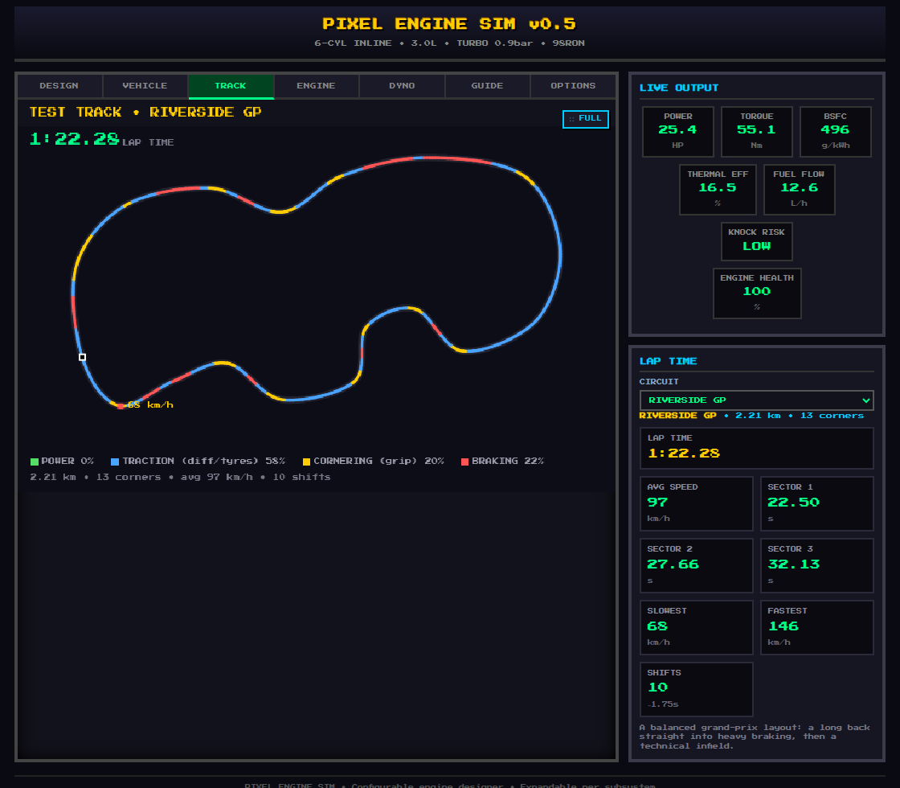

- **Race (new)** — a **RACE** tab that puts two to eight builds on the same circuit and runs them to
  a lap count, with **nobody driving**. Choose the cars (the one on the VEHICLE tab, garage builds,
  factory cars, the same car twice if you like), the circuit, the laps, qualifying or reversed grid,
  the **weather** (dry, damp, wet, rain later, drying) and air temperature, tyre warmers and a seed,
  and give **each car its own plan**: automatic stops or a set number, push / normal / fuel save, the
  tyres it starts on, and whether it changes them for rain. RACE opens as **a page of its own**
  filling the window (◀ SIM goes back, ⛶ goes properly full screen): every car on the map, a
  **timing tower** (gap to the leader, last and best lap with the race's fastest in purple, tyres,
  stops), and per-car telemetry with **four tyre temperatures and wear**, **fuel in the tank** and
  laps it is good for, and **front and rear brake temperature with fade**. Play it at 1–100×,
  scrub, click a car to follow it, and save the **race report** as PNG or PDF: classification, a lap
  chart, lap times with the wet shaded in, every car's stints by compound, and the key moments.
  - **Pace is the lap solver's.** Each car's lap is solved on its own racing line at five grip levels
    and three fuel loads, plus a standing start; the race reads its speed off those solves for the
    grip its tyres have and the fuel it carries at that moment. Alone on perfect tyres a car laps in
    the TRACK tab's time to within 0.1%.
  - **Tyres heat, wear and go off.** One temperature per tyre: slip work and rolling hysteresis in,
    convection out, from the loads the car puts through each corner of it. Each compound grips best in
    its own window (a slick runs hotter and narrower than a road tyre, and is useless cold); wear comes
    from the same slip work and falls off a cliff past ~70%. Lap 1 is a standing start on cold tyres.
  - **Fuel is power × BSFC.** The flow at every point is the power the lap spends there times the
    engine's own BSFC at that rpm and boost, so a thirsty engine pits sooner and a car gets lighter
    and quicker as the tank empties. Tanks are per body class.
  - **Weather.** A wet track takes grip by compound: a treaded road tyre keeps ~70% of it, a
    slick ~36%. Two race-only rain tyres, **intermediates** and **full wets**, keep more. A car
    changes compound when the time its own solved laps say it would win back, over the laps left,
    beats a pit stop, so a late shower can leave a car out on the wrong tyres on purpose. Water and a
    cool wet surface take heat out of the tyres; a sunny track adds it. Wet laps run 9–22% slower,
    the grippiest dry compounds losing most.
  - **Brakes carry their heat.** The lap solver's rotor model runs through the whole race, so
    temperatures build lap on lap past a single hot lap's and cool in the pit box. A car whose pads
    fade brakes earlier as they do: its braking zones stretch by how much less it can stop with.
  - **Racecraft and drivers.** The tow grows as the gap closes, so cars nose to tail pull each other along. A
    car with a quicker car behind may defend on the inside line (harder to pass, a slower exit), a held-up car may
    try a late-braking move that sticks or runs it wide (its odds are the two cars' grip and brakes and the two
    drivers), and the car just passed can take the place straight back. Each car has a driver: balanced,
    aggressive, smooth, rain master or rookie, each with its own aggression, consistency, tyre care and wet skill.
  - **Racecraft is a rule layer.** A faster car is held up until it has a few km/h on a straight or
    into a braking zone; slipstream, dirty air, blue flags, pit-lane loss, lap-to-lap driver
    variation and the odd mistake are rules, seeded, so the same seed replays the same race.

  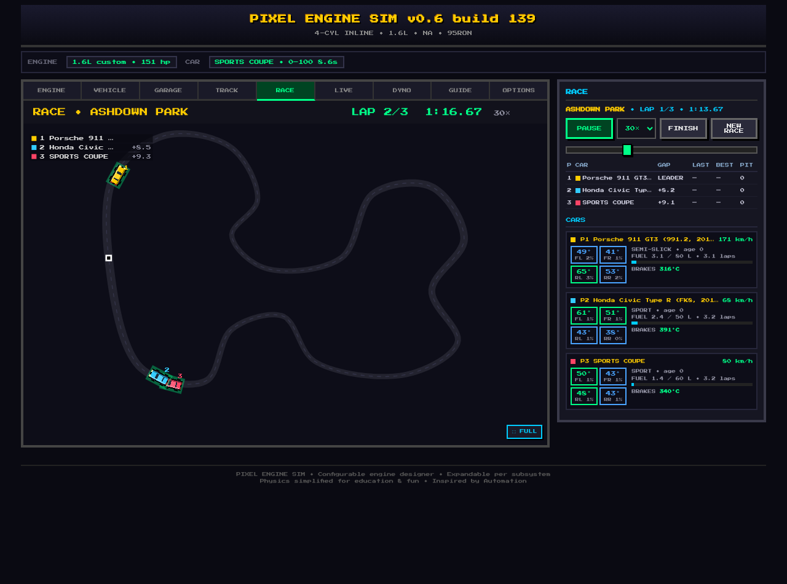

  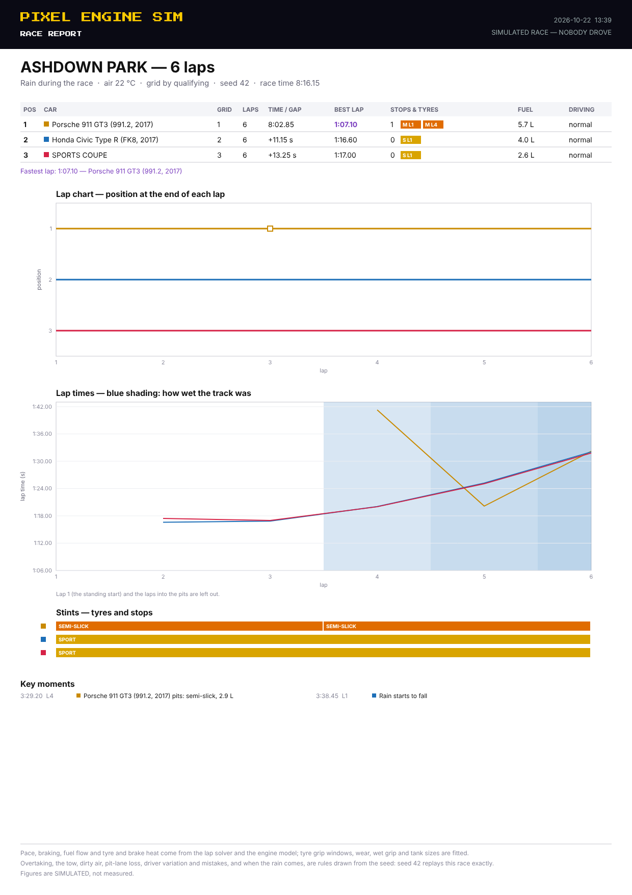

- **Animated engine cutaway** — the LIVE tab is a section through the engine you
  just designed, and everything on it moves because the simulation moved it:

  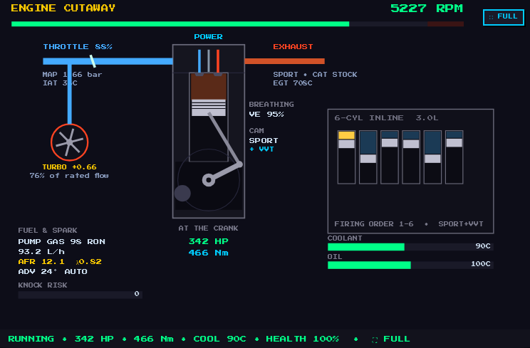

  - **Deliberately not real time.** A crank at 5000 rpm turns 83 times a *second*; drawn
    literally at 60 fps that is a strobe, not a picture. The cycle runs at a readable pace —
    about 3.3 s down to 1.1 s per full four-stroke cycle — still ranked by rpm so idle is
    visibly lazier than the limiter, and it stops dead when the engine does. The true speed is
    on the tachometer and in the note; the animation's job is to make the *cycle* legible.
  - **Proper crank-slider geometry** — `x = r(1−cosθ) + L − √(L²−r²sin²θ)`, not a sine wave. A
    connecting rod of finite length makes the piston linger at the bottom and snap through the
    top; at quarter-crank it is at 0.58 of stroke where a sine would say 0.50.
  - **Drawn to your bore/stroke ratio**, so an oversquare engine really is short and wide.
  - **The cam's own valve timing** (build 165): the events from the cam's duration and lobe separation, the
    intake phased by VVT as the model schedules it, the lift to scale, the valvetrain drawn (overhead cams on
    four-valve heads, pushrods on two), and the spark at the model's advance with the flame over its Wiebe burn. A two-stroke shows ports uncovering in the
    liner instead; a rotary shows a real two-lobe epitrochoid housing,
    `x = R·cosθ + e·cos3θ`, with the rotor turning at a third of the eccentric shaft.
  - The chamber is **colour-coded by what is in it** — fresh charge, compressed, burning, burnt —
    and the stroke is named above the head, so the cycle is watchable rather than memorised.
  - A **bank strip** draws every cylinder at its own phase, so the firing order runs visibly
    through a V12, and the firing cylinder glows.
  - Live parts stay next to the thing they describe: throttle-plate angle at the butterfly, boost
    and compressor flow at the turbo, EGT at the exhaust, and a knock bar.
  - **Turbos and superchargers drawn as they are built (build 164).** A turbo is two snail housings
    on one shaft: the exhaust manifold feeds the turbine, whose scroll narrows as the gas spirals
    in; the compressor's widens to its outlet, and the charge goes round under the engine through
    the intercooler to the throttle, coloured by its temperature. The wheels turn with the shaft
    speed the spool model integrates, the wastegate opens when the model holds its target, a
    variable-geometry turbo's vanes follow the model's schedule, and the blow-off valve vents on a
    lift. A supercharger is belted to the crank: Roots and twin-screw rotors turn with it at their
    drive ratio, a centrifugal is a compressor scroll on a 12:1 step-up.
  - **The tracts to scale (build 166).** The intake runner and the exhaust primaries at one scale, with the
    filter, throttle, plenum (or trumpets, or a carburettor) and the collector, cat and silencer. The blowdown
    pulse runs the primary and comes back as the header model times it; the readout says SCAVENGING when it lands
    in the overlap. Turbo engines get their compressor map with the live operating point.

  The subsystem numbers that used to be printed here in 7 px type live in the **LIVE OUTPUT**
  panel beside the canvas, where they are real text.
- **Canvas rendered at device resolution (new)** — the three visualisations share one canvas that
  drew on a fixed 640×420 backing store while CSS stretched it to whatever the panel was (744 px
  on a desktop, twice that again on a high-DPI screen). Every 7 px glyph landed on fractional
  pixels and smeared. The backing store is now sized to real device pixels and the context scaled,
  so the drawing code keeps its 640×420 coordinates and the output is pixel-exact — which fixes
  **DYNO** and **TRACK** at the same time.
- **In-app GUIDE, a wiki** — kept in-app so the offline PWA stays self-contained. 60 pages in 9
  sections, from *How an engine works* to *The track*, and every one climbs three levels: **LV1 ·
  REAL LIFE** (how the part works on a real car, with an 8-bit picture and no maths), **LV2 · IN THE
  GAME** (the controls and what to watch) and **LV3 · THE PHYSICS** (the equations the sim actually
  solves, their sources, and an orange note where something is still fitted). The 62 pictures are
  drawn in code on the app's pixel grid, so they are crisp at any size, cost nothing offline and
  move where moving teaches something (a piston, a pulse in a header, a turbo spooling, a wastegate
  opening); they hold still for reduced motion. A search box filters the index, pages link to each
  other, and a glossary, a known-limits page and a calibration page sit at the end.
- **Emissions** — engine-out CO / HC / NOx computed from the mixture (λ) and combustion
  temperature, then cleaned by the catalytic converter *only* in a narrow window around
  stoich: run rich and CO/HC spike (no O₂ to burn them); run lean and NOx slips past (a cat
  can't reduce it with excess O₂). A **DIRTY** analyser is the price of chasing power on a rich
  or decatted tune.
- **WEAR toggle** — turn damage/wear off for free experimentation (invincible engine) or on
  for consequences.
- **Dyno Curve** — full power & torque vs RPM out to your redline, with peak markers and a
  live current-RPM line.
- **Drive it (dynamic model)** — you control **THROTTLE** and **LOAD** (a dyno brake), not
  RPM directly. Opening the throttle raises manifold pressure (MAP), which makes torque,
  which spins the engine up through its **rotating inertia** (derived from displacement &
  stroke, so a big long-stroke engine revs lazily and a small one snaps up). A turbo
  spools as the revs climb; closed throttle gives engine braking; there's an idle floor
  and a rev limiter. No load + throttle = revs to the limiter; add load to hold an RPM.
- **Other runtime controls**: AFR, intake-air / coolant / oil temps.
- **Auto Thermal mode** — coolant & oil drift toward load-dependent targets over time,
  balanced against the cooling subsystem's capacity (radiator airflow scales with RPM;
  the fan provides idle cooling).
- **Engine sound model** (OPTIONS) — **SYNTH** (the default, below) or **GAS**: the cylinders, intake and
  exhaust runners and collectors simulated as lumped gas volumes with compressible flow between them,
  ported from Ange Yaghi's [engine-sim](https://github.com/ange-yaghi/engine-sim) (MIT), driven at our
  model's rpm, manifold pressure and fuelling, and heard as the exhaust-runner pressure through one of
  engine-sim's recorded exhaust impulse responses. The turbo whine, blow-off, intake roar, knock and
  crackle still come from the synth. Heavier (a V12 is about half a CPU core). Four-strokes run on
  valves; **two-strokes** on piston ports with the crankcase pumping the charge through a reed valve and the
  transfers; **rotaries** on three chambers per rotor breathing through the ports the rotor uncovers.
- **Engine sound** — plays on the **DYNO** tab from the engine controls, and on the **TRACK** tab
  from the lap replay (its recorded rpm, throttle and boost, so shifts, lifts and blow-offs are heard
  as the car goes round); other tabs are quiet. Synthesised from the **firing pulses** in an AudioWorklet: every cylinder
  fires at its slot in the real firing order and its pulse goes down its own bank's exhaust
  (one pipe for an inline engine, left and right for a V or a boxer), so engines with the same
  firing rate no longer sound alike. A cross-plane V8 fires each bank unevenly
  (1-5-4-8-6-3-7-2 → A-B-A-B-B-A-B-A), which is its burble; an inline six or a V12 fires each
  bank evenly and sounds smooth. The pulses then run the **exhaust the build has**: the primary rings
  at its quarter wave (c/4L, the same header length the breathing model tunes), as sharply as its
  path-length spread allows (a cast log manifold barely rings, a jig-cut race header rings hard), the
  system behind the collector drones at its half wave, and the silencer, the cat and a turbine take the
  top off and the level down. Diesels add a combustion knock, 2-strokes ring, rotaries are
  short and bright. **Load is in the pulses**: each is as hard as the charge it burned (manifold
  pressure × how much fuel the air carried), and a harder pulse is also raspier, so flat out sounds
  different from a cruise and not just louder; a fuel cut leaves only compressed air. The **lope**
  (a wild cam or anti-lag idles lumpy, VVT smooths it) varies the pulses cycle to cycle with the
  occasional partial burn, and fades with revs and load, since residual gas needs manifold vacuum to
  flow back. **Overrun crackle** is a carburetted engine misfiring its unburnable overrun charge into a
  pipe still hot from the pull, popping for a second or two; injection cuts the fuel and stays
  quiet, anti-lag pops on purpose, and a working cat takes the edge off the pops.
  Around the exhaust, the **rest of the car**: a turbo whines at its compressor's blade-pass
  frequency from the live shaft speed and hisses through its **blow-off valve** on a lift from
  boost, for as long as the charge volume takes to vent (no BOV on a diesel: no throttle to surge
  against), both as loud as the compressor is big; a supercharger whirrs with the crank through its
  drive ratio, mostly on boost, under the exhaust; **anti-lag** bangs and crackles on every lift; the **intake** roars at
  the runner's Helmholtz frequency with airflow, open stacks loudest; and **knock** rings at the
  chamber's first acoustic mode (Draper, 1.84 c / πB, ~6 kHz), a diesel's rattle on every pulse and
  worse cold, a petrol engine's on the cycles past its knock limit.
- **Scoring** — every build gets a graded scorecard (S–F) rating power, specific output,
  powerband width, efficiency, knock safety, drivability and **emissions**, shown on the
  design summary and the dyno.
- **Strategy / Career** — every build has a **parts cost** and a **reliability index** (a
  design estimate of how much abuse it invites), plus a **power-per-dollar** metric. Pick an
  **OBJECTIVE** on the ENGINE tab (Budget Sleeper, Power per Dollar, Eco Cruiser, Track
  Weapon, Reliability Run, Clean Machine, Specific-Output King…) — some cap your budget — and
  the challenge card ticks off each target live (✓/✗) with a PASS/FAIL verdict, mirrored on
  the dyno. Turns free design into a puzzle with real trade-offs.
- **Dyno pull logging** — snapshot the current curve and overlay several pulls on the graph
  to compare builds or tunes.
- **Garage (new)** — a saved-builds list at the bottom of the **VEHICLE** tab that keeps as
  many finished cars as you like, side by side. Name one and **SAVE TO GARAGE** stores the whole
  thing together — the chassis, every part bolted to it, *and* the engine inside, down to a
  hand-tuned fuel map. Each card carries the headline numbers it had when it was saved (power,
  weight, 0–100, top speed, lap time, total cost), so three builds can be compared without
  rebuilding any of them. **LOAD** restores a car exactly as it was; typing an existing name
  highlights that card and saving overwrites it.

  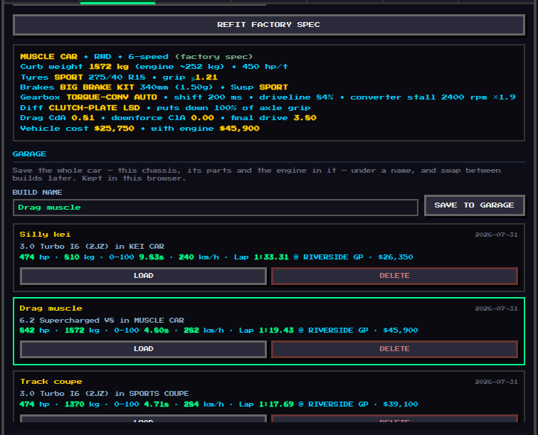

- **Pixel-art car and engine (new)** — the VEHICLE tab shows your car side on and the ENGINE tab
  shows your engine from outside, both drawn from the build:
  - the car's wheelbase, wheels, ride height, aero parts, driven wheels and engine position
  - the engine's layout and bank angle, its turbos or blower, induction, headers, intercooler and
    radiator

  Garage cards carry the same pictures, and the car runs the TRACK map in its own livery.

  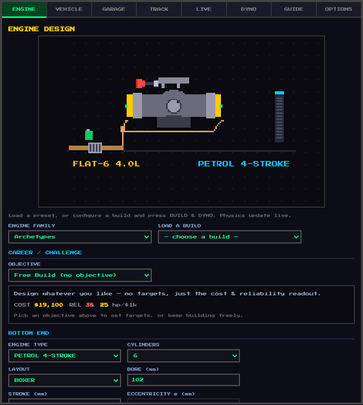

- **Save / Load / Share** — quick-save to `localStorage` (a single slot, distinct from the
  garage); **save to a named file** (with a note) and **open** one back; or **Share** a build as
  an encoded link (copied to the clipboard) that loads the exact engine when opened. All four
  paths — quicksave, garage, file and link — carry the *same* `serializeBuild()` record, so a
  build is portable between them and the formats cannot drift apart.
- **Presets**: Optimal / Max Power / Eco / Reset (adapt to the current engine).
- **Languages** — English and **Ελληνικά (Greek)**, switchable in OPTIONS and remembered
  between visits. The whole interface localises: tabs, labels, every dropdown, the design and
  vehicle summaries, the status bar, tooltips and screen-reader labels, and the challenge card
  (units, the names of real cars and circuits, and the terms Greek enthusiasts use in English, such as
  BOOST, ECU and LSD, stay as they are). The in-app GUIDE is translated in full, all 60 pages; the
  labels drawn inside its pictures and the PNG/PDF reports are still English.
- **Responsive** — a fluid layout that fills the screen in **portrait** (phones & tablets held
  upright) as well as landscape, scaling type and controls up so nothing sits in a narrow strip.
- **Installable PWA**, self-hosted font, works fully offline.

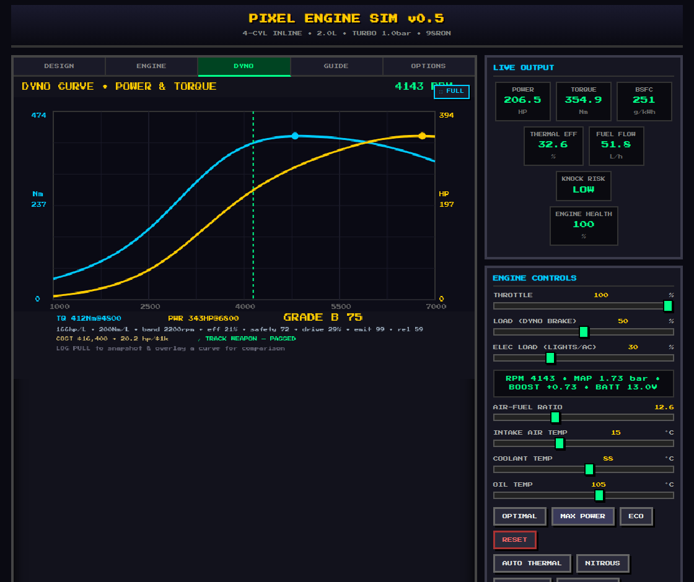

The built-in **GUIDE** is a wiki of the sim, from how a four-stroke works to the equations behind every number:

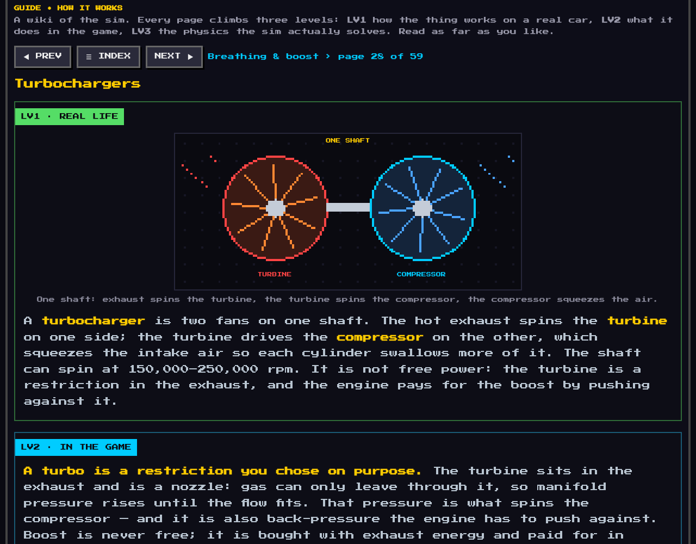

The interface is fully translatable (English / Ελληνικά) and fills the screen in portrait:

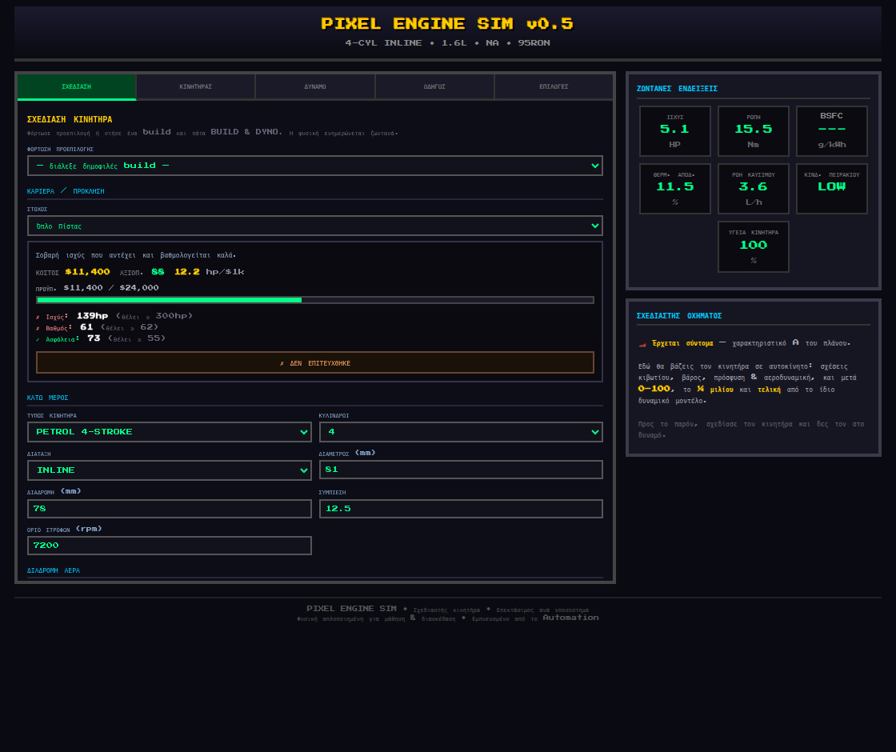

The **VEHICLE** tab drops your engine into a car and computes acceleration & top speed:

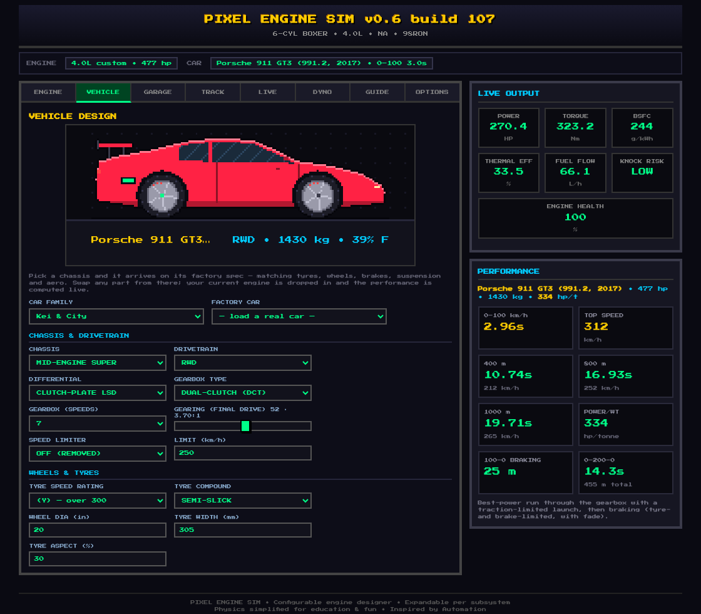

## How to Run

### Local
Serve the folder over HTTP and open `index.html`:
```bash
python3 -m http.server 8000    # then visit http://localhost:8000
```
> Opening via `file://` works too, but the PWA/offline features only activate over `http(s)`.

### GitHub Pages
This repo ships `.github/workflows/pages.yml`. Push to `main`, set **Settings → Pages →
Source: GitHub Actions**, and it deploys to
`https://<your-username>.github.io/<repo-name>/`.

## Runtime Controls

| Control          | Range         | Notes |
|------------------|---------------|-------|
| Throttle         | 0 – 100 %     | Opens the flap → MAP → torque → revs |
| Load (dyno brake)| 0 – 100 %     | Resistance that sets steady RPM; 0 = free-rev to limiter |
| Elec load        | 0 – 100 %     | Accessory electrical draw (lights/AC); can drain the battery at idle |
| Air-Fuel Ratio   | rescales/fuel | ~λ0.86 peak power, ~λ1.05 peak efficiency (range set by fuel) |
| Intake Air Temp  | -10 – 60 °C   | Colder = denser charge = more power |
| Coolant Temp     | 40 – 130 °C   | Optimal ~90 °C (auto in Auto Thermal) |
| Oil Temp         | 40 – 150 °C   | Optimal ~100 °C (auto in Auto Thermal) |

RPM and MAP are now **outputs** (shown live under the sliders), not inputs. The **Dyno
Curve** tab remains a wide-open-throttle steady-state sweep for reading the full curve.

## Physics Notes (simplified educational model)

- Engine cycle: the torque equation uses a power-stroke divisor per type — 4π for 4-stroke
  (one power stroke every two revs) and 2π for a 2-stroke and a rotary (a power event every
  rev), which is the main reason those make high specific output. Diesel is compression
  ignition (no spark, no spark-knock; limited by smoke/EGT), runs lean and unthrottled (little
  pumping loss), makes big low-end torque and the highest thermal efficiency; 2-stroke and
  rotary carry a thirst penalty (scavenging / seal losses) and rev high. Emissions follow the
  cycle too (diesel = NOx + soot with DPF/SCR aftertreatment; 2-stroke & rotary = high HC).
- Displacement derived from bore, stroke and cylinder count.
- Dynamic driveline: manifold pressure fills toward a throttle/RPM/boost target; net torque
  (combustion − pumping − friction − brake) accelerates the crank through a rotating inertia
  derived from displacement and stroke. LOAD is a dyno brake that targets a hold-RPM and only
  resists above it (so even a peaky engine can always rev up to it, rather than getting
  trapped below a torque valley); zero load free-revs to the limiter. Lifting the throttle
  gives engine braking, and injection systems cut fuel on overrun (DFCO — zero fuel flow); a
  rev limiter cuts fuel at redline; an idle floor prevents stalling.
- VE uses a broad generalized-bell breathing curve (flat plateau, gentle shoulders) so
  torque stays flat across the midrange and power keeps climbing toward redline instead of
  falling off a peaky Gaussian. Its peak shifts with bore/stroke ratio and redline; exhaust
  choice trades low-end for top-end scavenging.
- Camshaft profile shifts the VE peak and adds top-end breathing/scavenging at the cost of
  low-end VE and idle quality (a wild cam idles high and lumpy). VVT restores most of the
  low end, widening the powerband — strong bottom *and* top.
- Output is calibrated to sane ballpark figures (e.g. a 2.0 L turbo at 0.8 bar / sport
  exhaust / 98 RON makes ~255 hp & ~350 Nm; a 2.0 NA ~130 hp), with only a gentle power
  drop from peak to redline.
- Compression scales indicated work and efficiency via a relative Otto-cycle factor.
- Forced induction raises achievable MAP and heats the charge. Charge heating is the real
  thing — `T·(PR^0.283 − 1) / η_compressor` — not a per-bar constant, so it grows faster than
  boost does and grows again as compressor efficiency falls. The intercooler is rated by
  **heat-exchanger effectiveness** (none 0, small 0.62, large 0.82), the fraction of that rise
  it gives back; a large core leaves the charge coolest but its plumbing volume adds spool lag.
  At 1.8 bar this is the difference between a 164 °C charge with no intercooler (245 hp, knock
  risk 40) and 50 °C with a large one (381 hp, knock 10).
- Turbo boost spools with RPM along a logistic curve: small turbos spool early (strong
  midrange) but choke the top end, large turbos lag down low but flow more up top. Actual
  boost also lags in time (turbo lag), so it builds over ~1 s in the live Engine View.
- **Pressure has to be paid for (new).** A compressor makes boost by spinning, and shaft speed
  has to be bought with exhaust energy — turbine speed for a pressure ratio goes like
  `√(PR^0.283 − 1)`. So the spool point and the response time are functions of *the boost you
  asked for*, not fixed properties of the frame. The same small turbo on a 1.0 L:

  | boost | 50% boost at | time to 90% | charge temp | knock |
  |---|---|---|---|---|
  | 0.5 bar | 1197 rpm | 0.50 s | 33 °C | 0 |
  | 1.0 bar | 1820 rpm | 0.75 s | 40 °C | 3 |
  | 2.5 bar | 2968 rpm | 1.22 s | 58 °C | 34 |

  Previously all three columns were flat — 1820 rpm and 0.75 s at *every* boost target, and a
  small frame delivered 2.28 bar at 3000 rpm on a 2.0 L.
- **Frames have a rated flow (new)** — small 32, medium 55, large 82 lb/min, with config
  multipliers (twin ×1.85, sequential ×1.55, compound ×2.3). That is the axis a real compressor
  map is drawn against. The engine's air demand at peak power is computed against it, and past
  the rating the compressor is off its map: efficiency falls, the top end chokes harder, and the
  charge cooks. A 2.0 L asking 2.5 bar of a small frame wants **166 %** of its rated flow, runs
  49 % efficient, and makes 120 hp *less* than the medium frame while lapping slower than the
  same engine at 0.8 bar. The design summary states the flow, the efficiency and an explicit
  *off the compressor map* warning, so the limit is visible rather than merely felt.

  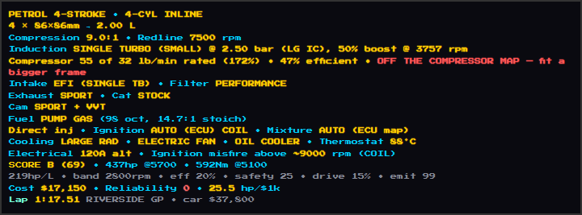

  *Known limit: spool lag — the time to build boost — is integrated on the live ENGINE bench,
  but the acceleration and lap solvers work from the steady boost available at each rpm, so
  they feel the spool point move and not the transient. A very laggy build is flattered a
  little by its 0–100 and lap times.*
- Ignition timing has a max-brake-torque (MBT) optimum that varies with RPM and load — too
  little or too much advance loses power, and advancing past MBT feeds knock (retarding pulls
  it back). *Fixed* timing is only optimal at one operating point; *Auto* tracks MBT
  everywhere and retards under knock, so it makes more power across the curve and adapts to
  fuel — full timing on race gas/E85, pulled timing on low octane or high boost.
- Fuel mixture: in *Manual* mode the AFR you set is used everywhere; in *Auto* mode a 3D ECU
  fuel map picks the target AFR from load (MAP) and RPM — near stoich at light load for economy,
  richer under load and boost (down to ~λ0.80) for power and exhaust-temperature control, like a
  real fuel map. Fuel *quantity* is always the air mass ÷ target AFR (so it already responds to
  both load and RPM); the map adds the load-varying target on top. The map is **hand-editable**
  in the design panel — select any load×RPM cell and shift its target richer/leaner (the live dyno
  reflects the change immediately); a custom map is saved with the build and can be reset to the
  factory grid at any time. Scoring and the vehicle acceleration model always evaluate at a fixed
  best-power AFR, so grades and lap-style figures stay comparable regardless of the mode or any
  hand-tuning.
- Intake system sets top-end airflow (restrictive small carbs choke up top; ITBs, sidedraft
  carbs and mechanical injection breathe best) and AFR-metering precision — EFI holds optimal
  AFR for the best efficiency, while carburetors and mechanical injection run richer and
  waste fuel (worse BSFC). The air filter adds an airflow-weighted restriction.
- Knock combines boost, compression, charge/coolant temperature, RPM, timing and mixture,
  offset by fuel octane, charge cooling and direct injection; high knock derates power.
- Emissions: CO rises sharply when rich (incomplete combustion); HC is U-shaped — high rich
  (excess fuel) and very lean (misfire), plus cam-overlap scavenging, imprecise metering and
  a cold engine; NOx is thermal, peaking slightly lean (~λ1.08) and scaling with combustion
  temperature (load, compression, spark advance, hot charge). A three-way cat needs excess O₂
  to oxidise CO/HC but an O₂-free exhaust to reduce NOx, so only a stoich mixture cleans all
  three at once — the rating rewards a cat + precise stoich metering and punishes rich/lean/
  decatted running. The cat also adds a little exhaust back-pressure (a small top-end VE loss).
- Fuel type sets energy density, stoichiometric AFR (the mixture control works in lambda,
  so the AFR slider rescales per fuel), knock rating and evaporative charge cooling. E85 and
  methanol resist knock and cool the intake charge (more power) but need much more fuel
  flow (higher BSFC), while race gas is high-octane pump gas.
- Cooling balances load-generated heat against radiator capacity + airflow (RPM-driven)
  and fan; the thermostat sets the floor temperature. Overheating (>~108 °C) costs power.
- Reliability: engine health accumulates wear from detonation (the big killer), overheat,
  lean-under-boost (burnt pistons) and over-rev; a clean tune barely wears. Lower health
  cuts power; zero health = catastrophic failure until rebuilt. Damage happens over tens of
  seconds of abuse — long enough to heed the warnings and back off.
- Vehicle: acceleration is integrated step-by-step — the engine's best-power torque curve is
  taken through the gearbox (auto-spaced ratios × a final drive from the gearing slider), giving
  tractive force = wheel torque ÷ rolling radius, capped by traction (μ × the driven-axle load,
  including static weight distribution, longitudinal weight transfer under acceleration, and
  aero downforce). Aero drag (½ρ·CdA·v²) and rolling resistance oppose it; the car shifts at the
  limiter, losing drive for the gearbox's shift time. In top gear there is nothing left to shift
  into, so **the rev limiter cuts drive to zero** and drag brings the car back — both the
  standing-start run and the lap solver are bound by the speed the gearing can actually reach,
  never by drag alone. The launch depends on the gearbox. A clutch
  box (manual/sequential/DCT) models a **slipping clutch**: from a standstill the engine is held
  at its launch rpm (≈55 % of the redline) while road speed brings the gearbox input up to meet
  it, and only then locks to the wheels — which is why a peaky, high-revving engine can still
  leave the line hard instead of falling into a torque hole the instant it moves. Slipping never
  adds torque; drive force is still capped by traction, so the launch stays grip-limited. A
  **torque-converter auto** instead stalls its impeller up against a slow turbine and *multiplies*
  engine torque (≈1.9× at a 2400 rpm stall), fading to 1:1 as the turbine catches up. That launch
  advantage is why an auto beats an equivalent manual on a heavy, torquey engine (6.6 diesel
  pickup, 8.61 s → 8.01 s) and loses badly on a light, peaky one whose powerband sits far above
  the stall speed (2.0 ITB screamer roadster, 4.55 s → 5.96 s) — at the cost of the worst
  driveline efficiency of the four boxes.
  The **differential** then sets how much of the driven axle's grip is usable. An axle's two
  wheels are never loaded identically (camber, torque reaction, axle wind-up, suspension
  geometry), and an *open* diff can only feed each wheel what the lighter-loaded one holds — it
  spins that wheel and throws the rest away (≈78 % usable **at launch**). A *viscous* LSD recovers
  most of it (92 %), a *clutch-plate* LSD effectively all of it, a *spool* all of it and a little
  more. That 78 % is **not a constant (new)**: most of the asymmetry an open diff is fighting is
  torque reaction — driveshaft wind-up, anti-lift geometry, torque steer — which is proportional to
  the torque actually going through the axle. In first gear under full multiplication it is at its
  worst; in a tall gear the axle sees a fraction of that torque and little more than road camber is
  left, so an open diff recovers to ≈91 %. Normalised so that at full axle torque it returns
  exactly the quoted figure, which leaves the standing start — and the whole drag-strip diff trade
  — bit-identical. A spool is unaffected, being welded.
  Because it caps traction rather than torque, a diff **only matters while the car is
  traction-limited**: on an 842 hp muscle car, open → spool is worth **0.94 s** to 100 km/h
  (5.52 → 4.58 s), while on a 48 hp kei it is worth **0.05 s** — it never troubles its tyres. Top speed is drag-limited, so the
  diff never changes it.
- **Why a front-driver runs out of grip so early.** Three factors multiply, and the first is the
  one people forget: a FWD car drives only the front axle (≈60 % of the weight standing), and
  accelerating transfers weight *off* it, down to ≈53 %. Times an open diff (0.78) times eco tyres
  (μ 0.81), the whole car is capped at **0.33 g** whatever the engine makes. At 100 km/h that
  ceiling is ~2500 N and even a 109 hp engine already wants 2700 N — so a 217 hp version of the
  same car reaches 100 km/h at essentially the same time. The fix is grip, not power: on that same
  217 hp kei, a clutch LSD alone takes 9.3 s → 7.9 s, sport tyres 6.5 s, slicks 5.5 s, AWD 4.4 s.
- **Acceleration calibration (new).** The whole model is checked against cars whose real 0–100 is
  public, with power, kerb weight, drivetrain, tyre class, diff *and gearbox* all matched first —
  so what is under test is the traction/weight-transfer/gearing model rather than the engine model:

  | car | hp | kg | drive | gearbox | real | model | error |
  |---|---|---|---|---|---|---|---|
  | VW Golf GTI (Mk8) | 245 | 1450 | fwd | DCT | 6.2 s | 6.22 s | +0.3 % |
  | Honda Civic Type R (FL5) | 329 | 1430 | fwd | manual | 5.4 s | 5.19 s | −3.8 % |
  | Toyota Supra RZ (A80) | 326 | 1570 | rwd | manual | 4.9 s | 5.02 s | +2.4 % |
  | BMW M2 (G87) | 460 | 1725 | rwd | auto | 4.1 s | 3.94 s | −3.9 % |
  | Subaru WRX STI (GD) | 280 | 1470 | awd | manual | 5.2 s | 5.06 s | −2.6 % |
  | Suzuki Alto Works | 64 | 720 | fwd | manual | 11.0 s | 11.03 s | +0.3 % |

  RMS error **2.66 %** across the set. Matching the gearbox matters more than it looks — 350 ms of
  manual shift twice is 0.7 s of the run, so quoting a DSG car's time against a modelled manual
  measures the gearbox, not the traction. *(The spool's real penalty is cornering — understeer and tyre scrub —
  which this straight-line sim doesn't model yet, so it looks strictly best; flagged in the GUIDE.)*
  Top speed is the fastest steady speed **any** gear can hold (thrust = drag + rolling
  resistance, capped by the limiter) — a peaky or over-geared car genuinely reaches its maximum
  one gear down, on the cam, rather than bogging in top. The **gearing number is the final
  drive** (0 = 4.90:1, 100 = 2.60:1): short gearing multiplies wheel torque for a quicker 0–100
  but runs each gear out of revs early; tall gearing does the reverse. The optimum is the tallest
  ratio the engine can still pull to its power peak in top gear — past that, top speed stops
  improving (the car just achieves it a gear lower) while acceleration keeps degrading. In the sim
  a 1.5 NA sedan plateaus around 200 km/h at every setting while its 0–100 slides from 10.0 s to
  13.1 s, whereas a twin-turbo V8 supercar keeps gaining, 221 → 407 km/h, all the way to 2.60:1.
  AWD puts all four tyres' grip down and launches hardest;
  FWD loses front load under acceleration. Engine mass is estimated from the spec and added to
  the chassis for curb weight and power-to-weight. Braking is the mirror image: deceleration is
  the lesser of tyre grip (μ·(weight + downforce)) and what the brakes can command (capacity by
  type/rotor size, fading as they absorb heat), with aero drag also slowing the car — so big
  brakes and sticky tyres shorten 100–0, while undersized steel brakes fade in the 0–200–0.
- **Rolling resistance rises with speed.** Hysteresis losses grow with how fast the carcass is
  deformed, so `Crr` climbs roughly with v² — checked against Michelin passenger-tyre data (0.010 at
  80 km/h, 0.013 at 160, 0.016 at 200) rather than against this simulator's own outputs. A fixed
  `Crr` understated resistance by ~60 % at the speeds a fast car actually reaches. It feeds the
  acceleration run, the top-speed scan and the lap solver alike. Each compound also carries the
  **speed rating** it is really sold in (a drag radial rates *below* a touring tyre), shown in the
  VEHICLE panel and flagged when the build out-runs it — but deliberately not used as a hidden
  top-speed cap, because several real cars stop short of their drag-limited speed for a reason
  (a manufacturer governor) that a tyre rating would only imitate.
- **Grip through slip in the 0-100, a clip on the lap.** The acceleration run pushes the car through the tyre's
  slip (build 154), with rotational inertia charged (build 107); the lap solver still caps the drive at the tyre's
  peak, which is the traction-control case.
- Racing line: nobody drives the centreline — using the full width straightens a corner and raises
  the speed you can carry. The line is solved by **minimising total curvature** within the track
  edges (projected gradient on Σ|second difference|², run on a coarse node set because the
  curvature gradient scales like ds⁴/R³ and is hopelessly ill-conditioned at 5 m sampling — worse,
  the Catmull-Rom centreline satisfies the stationarity condition exactly, so a fine-grid solve
  never leaves it). Out-in-out through corners, straightened esses and linked complexes emerge from
  the objective rather than being scripted. It is worth **5–7 % of lap time** over the centreline,
  and the gain scales cleanly with track width (Riverside: 79.7 s at 6 m wide → 75.8 s at 18 m).
- **Minimum time, for the car being driven (build 115)**: minimum curvature is symmetric — it prices a
  metre of radius at corner entry exactly like a metre at the exit — and it pays no attention to distance. On
  track exit speed is carried down whatever follows while at entry the car is braking anyway. So the
  minimum-curvature line is only the start: it is then refined for the car, a local search that moves the line
  around one point at a time and keeps each move the car's own lap solver says is quicker. Late apexes emerge
  where they pay, and each car drives its own line (cached per car): a 90 hp hatchback and an 800 hp aero car no
  longer share one. The fitted late-apex bias it replaced (3 x how open the next 90 m were) is gone.
- **Variable track width (new)**: a circuit is not a constant ribbon — it narrows through the tight
  sections and opens on the fast ones, and a 7 m corner cannot be straightened as much as a 13 m
  one no matter who is driving. Each circuit carries a width profile normalised to **mean 1**, so
  the quoted `width` is by definition the arc-length average and the old width knob still scales the
  whole circuit. Ashdown runs **8–13 m**, Cape **12–16 m**, Riverside **9–15 m**, the Nordschleife
  **8–12 m**. The racing line is clamped per point against its *own* half-width, so it is on the
  track everywhere, not merely within some nominal average. The map is drawn as a filled ribbon
  rather than a fat stroke, because a stroke can only ever be one width.

  For the three hand-built circuits the profile is authored by station. For a GPX import there is
  no survey to read, so it is **derived from the layout** — roads are built wide where they are fast
  and narrow where they are tight — and labelled in the app as modelled, not measured. The
  saturation radius is deliberately high (3 km): a 500 m sweeper through the trees is still a
  country road.
- Imported circuits: **IMPORT GPX TRACK** on the TRACK tab reads a GPX trace and turns it into a
  lappable circuit. Points are projected to metres (equirectangular about the centroid — centimetre
  error at circuit scale), **resampled to a uniform step** because GPX spacing is wildly uneven (a
  real 20 km trace came in at 2.4 m / 27.9 m / 421.8 m min/median/max, which starves the spline in
  places and over-fits it in others), and lightly smoothed so GPS jitter doesn't read as curvature
  and invent corners. Elevation is taken from the file, so an imported circuit gets its real
  gradients; a trace that doesn't quite close is bridged. A 534-point, 20.5 km trace with 290 m of
  elevation imports and solves in ~120 ms. Imported tracks persist in `localStorage` and are marked
  `*` in the list — **nothing is uploaded**; importing is something the user does with their own
  file. (The real circuits below are the only circuit data that ships, in their own file.)
  *Accuracy note: imported lap times read a little slow — the line is still an approximation of the
  minimum-time line, the width profile is modelled from the layout rather than surveyed, and the
  driver never errs. It is a consistent yardstick for comparing builds, not a lap record.*
- **Real circuits (new, build 123)**: 22 real tracks under **REAL CIRCUITS** in the circuit menu —
  COTA, Brands Hatch GP, Hungaroring, Catalunya, Hockenheim, the Indianapolis oval, Albert Park,
  Hermanos Rodríguez, Gilles Villeneuve, Monza, Nürburgring GP, Bahrain, Interlagos, Sepang, Shanghai,
  Silverstone, Sochi, Spa-Francorchamps, Red Bull Ring, Suzuka, Yas Marina and Zandvoort. No single
  open source has everything, so `tools/import-real-tracks.mjs` combines three:
  the [TUM racetrack database](https://github.com/TUMFTM/racetrack-database) gives the centreline every
  5 m and the **measured** width to each side (from satellite imagery), in a local frame with no
  geography and no height; [bacinger/f1-circuits](https://github.com/bacinger/f1-circuits) (or
  OpenStreetMap, for Brands Hatch and the Indianapolis oval) gives the same circuit in latitude and
  longitude, and a rigid fit lays one on the other (1.2–7.4 m RMS; Yas Marina 13 m, where the sources
  differ in layout); a terrain model through [OpenTopoData](https://www.opentopodata.org) (EU-DEM 25 m,
  USGS 10 m, SRTM 30 m) then gives each point its height, median-filtered and smoothed over ~60 m so
  model noise doesn't invent crests. Lengths land within 0.3 % of the official figures, and the
  rises where they are well published match: Spa 103 m (104), Red Bull Ring 68 m (65), Interlagos
  41 m (43), Suzuka 42 m (40). The generated `tracks/real-circuits.js` is kept apart from the app
  because it carries its sources' licences (TUM data LGPL-3.0, OpenStreetMap ODbL); without it the app
  simply has its four test circuits.
  *Caveats:* the layout is the one in the source data, which can predate a rebuild (Catalunya with the
  chicane, Zandvoort before 2020, Yas Marina before 2021); a terrain model measures ground, so tree
  cover and buildings leak a few metres into the street-side tracks (Albert Park, Mexico City); corners
  are numbered, not named.
- Elevation: circuits carry a height profile, and the lap is solved in three dimensions. Three
  effects, all of them real: gravity along the slope (`m·g·sinθ`, resisting a climb and adding to a
  descent — and *helping* the brakes uphill, which is why an uphill braking zone lets you brake so
  late); the weight-on-tyres reduced to `m·g·cosθ` on a slope; and **vertical curvature**, where the
  normal load changes by `m·v²·κ_v` — a crest throws the car light exactly where it is fastest, a
  compression presses it down and lets it carry far more speed (on the test circuits, ~104 km/h over
  a brow against ~140 km/h through the equivalent dip). The vertical term is capped at ±0.6 g, since
  real suspension runs out of travel. Validated on a constant-radius circle where elevation can only
  cost time: 22.55 s flat → 22.74 / 23.21 / 25.31 / 28.32 s as the profile grows, with minimum speed
  falling and maximum rising throughout. Where the hills sit matters as much as their size — rotating
  the same profile around a circuit swings the lap by ±3.8 s.
- Lap time: a quasi-steady-state solver over that racing line. Each circuit is a ring of
  control points; a closed Catmull-Rom spline through them gives a smooth, guaranteed-closed
  centreline whose sampled curvature feeds the physics **and** whose polyline draws the map, so the
  picture can never disagree with the numbers. The solver takes the cornering ceiling at every
  point — *m·v²/r = μ·(m·g + ½ρ·ClA·v²)*, which solves for v² in closed form because downforce
  scales with v² too — then runs a **backward braking pass** and a **forward traction/power pass**,
  keeping the lower speed at each point. A **friction circle** couples them: grip already spent
  turning is unavailable for accelerating or braking, so a car at the cornering limit cannot also
  deploy its power. Gearbox shift time is charged per gear change around the lap. The result is
  that circuits reward different builds — a 300 hp/1049 kg screamer beats an 842 hp/1872 kg
  muscle car around Ashdown (92.3 s vs 95.3 s) and loses to it down Cape's straights
  (85.5 s vs 84.0 s).
- Differential on track: the straight-line traction figure is only the standing case. Cornering
  transfers load off the inside wheel, so an open diff — governed by the lighter-loaded wheel —
  collapses exactly when you want power on exit, while a locked one is unaffected. That, plus the
  lateral grip a locked diff scrubs away, finally prices the spool honestly: on an 842 hp muscle
  car it is ~0.2 s **quicker** to 100 km/h than a clutch LSD and ~2.9 s **slower** around Ashdown,
  and an open diff is worst at both ends.
- Track objectives: four of the challenges set a **lap target on a named circuit** rather than an
  engine metric, and their budget covers **engine + vehicle**, so the whole car is being judged.
  Targets are calibrated against measured builds — each is reachable with about 1–7 s of margin by a
  sensible build and comfortably missed by a weak one (a 112 hp kei car fails all four). Lap time is
  also **reported on the scorecard**, but deliberately *not* folded into the letter grade: the grade
  rates the engine, and an engine's grade should not move because the tyres changed. Verified — the
  same engine holds A(76) whether it is in a kei body or a hypercar, while its Riverside lap moves
  93.2 s → 53.7 s. Lap results are cached on the engine+vehicle build (cold 6.9 ms, cached
  0.0004 ms/call), since the dyno scorecard redraws sixty times a second.
- Strategy: each part carries a rough build cost, summed into a total (so budget challenges
  and power-per-dollar have meaning); a design reliability index estimates durability from
  knock margin, boost/specific-output stress, high-strung choices (anti-lag, nitrous, sky-high
  redline) and cooling adequacy for the power made. These are design-time estimates, not the
  live wear model (which still plays out as you drive).
- Electrical: the alternator (output rising with RPM) charges the battery when it
  out-supplies demand and drains it otherwise; system voltage tracks state of charge. Low
  voltage weakens the spark, and each ignition type has a dwell/misfire RPM limit, so a
  distributor or a flat battery loses top-end power. The alternator also costs a little
  parasitic crank power, most noticeable at idle.
- Standard 4-stroke BMEP → Torque → Power conversion throughout.

Numbers are calibrated to a realistic ballpark but this is not a high-fidelity thermodynamic
model — it's tuned for fun, learning and rapid experimentation (the "light Automation"
philosophy).

## Project Structure

```
.
├── index.html                     # Complete single-file app (HTML + CSS + JS) — BUILT from src/, committed
├── src/                           # The source of index.html — edit here
│   ├── shell.html                 #   the page, with an @include line where each part goes, in order
│   ├── css/app.css                #   the styles
│   ├── html/guide.html            #   the in-app guide
│   └── js/*.js                    #   the script, cut along its sections (physics, vehicle, lap, race, sound, UI…);
│                                  #   js/powertrain.js is what the vehicle, lap and race see of the engine
├── CHANGELOG.md                   # Release history; every commit carries a build number
├── favicon.svg / manifest.webmanifest / sw.js   # PWA (icon, manifest, offline SW)
├── assets/                        # Self-hosted font + PWA icons
├── docs/                          # README screenshots
├── tests/                         # Headless Playwright suite — see tests/README.md
│   ├── run.mjs                    #   node tests/run.mjs   (reports by exit code)
│   └── proto/                     #   parked models, not run by the suite — see tests/proto/README.md
├── tools/build.mjs                # Joins src/ into index.html; --check verifies the committed file
├── tools/stamp.mjs                # Stamps + verifies the build number
├── tools/fingerprint.mjs          # Every car's 0-100, laps and a race, exactly; --compare proves a refactor moved nothing
├── plans/                         # Proposals not yet built — plans/hybrid-electric/
└── .github/workflows/             # pages.yml: auto-deploy to GitHub Pages · check.yml: index.html is src/ joined
```

**One file shipped, many edited.** `index.html` opens straight from `file://` with no server, no
build step and no dependencies, works offline, and is a single artefact to share or archive. ES
modules would cost all of that (they are blocked from `file://`), so the page stays one classic
script. At 1.6 MB one *source* file had outgrown its editor, so since build 176 the source lives in
`src/`, cut along the seams that were marked inside the file, and `tools/build.mjs` joins it back
byte for byte: no transforms, no minifying, the page served is the page reviewed.

```sh
node tools/build.mjs            # write index.html from src/
node tools/build.mjs --check    # fail if the committed index.html is not exactly src/ joined
```

Edit `src/`, never `index.html`; run the build; commit both. `index.html` stays committed because
GitHub Pages, the tests and `tools/stamp.mjs` all read it directly. `tests/run.mjs` and the Check
workflow refuse an `index.html` that is out of step with `src/`. A new part is a new file in `src/`
plus an `@include` line in `src/shell.html` where it belongs; a file nothing includes fails the build.

**Versioning.** `MAJOR.MINOR` plus a unique build number per commit — a counter in the file that
only ever increases, so it survives squash-merging (a commit *count* does not: squashing three
commits into one makes it go backwards):

```sh
node tools/stamp.mjs            # bump the build number in src/shell.html, index.html and README
node tools/stamp.mjs --check    # verify it is consistent and ahead of origin/main
```

## Roadmap / Future Expansion

### The original feature plan — all shipped

1. ~~Engine presets / example gallery~~ ✅ — a **LOAD A PRESET** dropdown with popular
   archetypes (1.6 sport, kei turbo, hot-hatch, ITB screamer, RS5-turbo, 2JZ six, muscle V8,
   blown V8, V12 supercar, eco turbo, diesels, rotaries, two-stroke).
2. ~~**(D) Forced-induction & tuning depth**~~ ✅ — turbo configs (twin/sequential/compound),
   supercharger types (roots/screw/centrifugal), anti-lag, nitrous, an **editable 3D ECU fuel
   map** (tap a load×rpm cell, − LEAN / + RICH, RESET MAP), and pressure-ratio-aware spool with
   compressor flow limits. *Ignition is covered by the Auto (MBT-tracking, knock-limited) timing
   model rather than a hand-editable spark map — see below.*
3. ~~**(E) Emissions & sound**~~ ✅ — engine-out CO / HC / NOx vs mixture & combustion
   temperature, a **catalytic converter** with a stoich-window three-way conversion model, a live
   analyser readout, an emissions score, and a character-driven **lope/burble** on the note.
4. ~~**(C) Strategy layer**~~ ✅ — per-part costs, build budgets, a design reliability index and
   power-per-dollar, plus objective-based challenges with live pass/fail — including four that
   judge the **whole car against the clock** on a circuit.
5. ~~**(B) New engine types**~~ ✅ — diesel (compression ignition), rotary/Wankel and 2-stroke,
   each with its own firing frequency, fuelling, efficiency, emissions and sound.
6. ~~**(A) Vehicle / drivetrain layer**~~ ✅ — chassis, drivetrain, gearbox types, differential
   types, tyres, aero, weight, brakes and suspension → acceleration, top speed, braking and the
   0–200–0 test, with **per-chassis factory fitment**; a **test track** (four test circuits and 22 real ones, a
   friction-circle lap solver with a late-apex racing line, variable width and 3D elevation,
   sector splits and a limit-coloured map); lap time feeding the **challenge system and
   scorecard**; and a **garage** holding any number of named chassis+engine combos.

### Known limits — the honest list

These are modelled approximations that are *stated* rather than hidden, each one measured and
documented in the GUIDE at the point where it matters:

- **Fuel on track is a flat-out driver's.** The engines' lap-average BSFC is a real engine's under hard use, and
  mid-size cars match owners' track figures (~35–40 L/100 km); big-power cars burn 20–40% more than owners report,
  and a small NA car ~20% less, because the lap is at the limit and owners mostly are not.
- **Tyre temperatures are checked, with two gaps.** Race tyres land in the measured ranges, but an eco tyre on a
  light car runs cool (45–60 °C) and a fast circuit reads a little cooler than a short one; no track data was
  found to settle either.
- **Brake temperatures are a flat-out driver's.** The lap brakes at the limit into every corner, so a heavy,
  fast car on a long fast circuit (a Hellcat or an E46 M3 at Spa) runs its rotors to 750–900 °C and fades.
  Measured track-day figures are lower (450–600 °C rotor core, DBA) because most drivers brake earlier and
  softer; light cars and small brakes land inside the measured range.
- **Balance is a limit, not a motion.**
  - **What is modelled (build 157):** each axle's grip is its own, so cars understeer or oversteer.
  - **What is not:** yaw inertia, slip-angle build-up and transient load transfer. A car is never caught out by
    lift-off oversteer, and it never slides or spins. Chicanes are a little optimistic, about 1–3% by the usual
    comparison of quasi-steady and transient lap sims.
  - **Unpublished inputs:** the cars' factory roll balance and their real tyre load sensitivity per axle are not
    published. Every car starts at NEUTRAL roll balance, though a real road car's factory setup understeers a
    little more.
- **The race's racecraft is rules, not physics.** Overtaking, the tow, dirty air, pit-lane loss and
  driver error are rules with fitted numbers. The cars share one racing line rather than fighting for
  space on it, and the tyre model's heat, grip-window, wear and wet-grip constants are fitted to the
  usual published ranges, not derived. When the rain comes and how fast a line dries are rules drawn
  from the seed, not a forecast.
- **The turbine housing is a choice, not matched to the engine.** A/R comes from the frame (TIGHT / STOCK /
  LOOSE per size class, scaled with the maker's wheel where it is set), with nothing about the engine
  entering. Re-measured in build 151, the mismatch this was parked for has mostly closed on its own: exhaust
  flow per mm² of throat at rated power spans 1.9× across the real turbo presets (it was 4×), boost
  thresholds against the prototype's anchors are 775 rpm RMS (was ~1940; the proposed matching reached
  ~700), and on the presets whose makers quote a torque plateau the 90%-boost point is ~620 rpm RMS from
  the plateau's start. The throat convention, the compressor island, pulse energy, packaging-short turbo
  manifolds and the makers' wheels did it. Left: the turbines run generous at rated power (exhaust over
  intake pressure ~1.1, where real petrol turbos run ~1.5-2), so matching to back-pressure would spool them
  earlier still; and VGT rings are the size class's, not the engine's (test49's diesel step). See
  `tests/proto/README.md`.
- **A turbo cannot fail from overspeed.** The shaft has a tip-speed limit and the model respects it
  as a *cap*, but nothing breaks. A grossly over-flowed frame therefore ends up running steadily at
  an expansion ratio that would have destroyed it — a 2.0 four at 2.5 bar on a small frame reaches
  7.4 bar of exhaust manifold pressure and simply becomes gutless, where the real outcome is a
  scrapped cartridge.
- **A TRACK lap is a single best-case hot lap** — no tyre wear, no fuel burn, no traffic, no driver error, the
  brakes after one preparation lap. The RACE tab adds those, as rules where they are rules (above).
- **Imported circuits have modelled width, not surveyed width**, derived from the layout.
- **Engine braking stops at the limiter.** Since build 149 the engine brakes the car through the braking
  zones (its own overrun torque, in the gear the driver has worked down to). On the power at the rev limiter
  the drive is cut to zero but nothing drags back, so a steep descent can carry a car a km/h or so past the
  speed its top gear allows.
- **Known gaps the tests name:** the ported engines still use a hand-set exhaust share, so the Renesis (~842 °C)
  and the 500cc two-stroke (~764 °C) read cool; each is budgeted by name in test46/47 at a floor it may not fall
  below. Boosted low-rpm torque against the makers: the RS3 is ~46% short at 1700 rpm (its real compressor wheel is
  not published; the preset uses the 71 mm upper bound) and the EcoBoost ~44% at 1400 (no published wheel either).
  Older turbo engines with no ECU torque limit (Supra, STI, Evo) read 8–14% over the makers in the mid-range.
- **Power at the rev limiter.** test46 names the archetypes allowed to peak there: the 1.6 Sport NA I4 (a plateau,
  ~1 hp over its last 400 rpm: the missing top-end fade test60 also names for the 4A-GE and the F140), the 2.0
  Turbo Diesel I4 (a plateau; a real TDI's late fall is its torque-limit calibration, which ECU TORQUE LIMIT can
  now set) and the 2.0 Turbo Hot-Hatch. A boosted engine with no ECU boost taper holds full boost to the limiter
  by its calibration (build 131) and is not counted. Any naturally-aspirated preset joining the list fails.
- **The whole suite passes** (56 tests, build 150), each re-baselined check carrying its reason in the test and
  the changelog.
- **The VE bell is gone from every poppet-valve petrol engine, and kept for the rest.** It took three
  attempts. The third (builds 82–84) found the bell had been covering for two errors: the trapping
  calculation closed every intake valve 16–24° early, and the intake ram put its tuning peak 22–57%
  too high in rpm against Engelman's published ratio, so every runner rang at the redline. With both
  fixed, test41 improves (4.02% → 3.34%) and test48's power error halves (15.8% → 8.6%). Diesels
  followed in build 88, once their torque came from fuel and their burn from time. Rotaries and
  two-strokes still use the fitted bell, and `CAM.ampMul` still scales their VE by cam grade (on poppet-valve
  engines the integrated intake stroke, builds 121-122, carries the filling and the cam).
  The S2000 and S54 in test48 now carry their factory high-rpm intake and header; on the app's
  mid-range defaults they read 23–35% short, so check those two hardware calls if you know the cars.
- **Without traction control, flat out after the launch.** Since build 154 the tyre pushes through slip and spins
  past its peak when the engine has more than it can take. With traction control the ECU holds the peak; without
  it the driver holds it through the launch in first gear (build 155), and from the first upshift the run is flat
  out, so a car with the power spins in second where a tester would ease off. The driver's feel past the launch
  is not modelled.

### Next: v1.0 — every number derived, not fitted

This is the current direction, and it is a change of principle rather than a feature list.

Parts of the model reach their accuracy through **lumped coefficients that were tuned until the
outputs matched reality** — `CAM{peakShift, ampMul, scav}`, `EXHAUST{topGain, lowLoss}`,
`TURBO{spool, flow}`, `IMEP_K` (retired from torque in build 95), `DIFF_ASYM0`, `KVCAP`. (Since retired:
`peakShift`, `scav`, `topGain`, `lowLoss` in the gas-dynamics conversion; `ampMul` survives only on the ported
engines.) They work, and they are honest
approximations, but they are fitted rather than derived: they encode *the answer* instead of the
mechanism that produces it.

v1.0 replaces them component by component with quantities derived from geometry and physical law,
and **accepts whatever accuracy that produces** rather than tuning back toward a target. A
first-principles model will very likely score worse at first — the present 2.66% RMS exists partly
*because* coefficients were fitted to produce it. The rule is that any regression must be
explainable, traceable to a component not yet modelled, and every component added must improve the
score.

Planned order, each validated against `tests/test41.mjs`, `tests/aero.mjs` and `tests/test43.mjs`:

#### The working queue — what is actually being built next

The five conversions above are the *structure*. This is the current running order, which changes as
measurement finds things. Each item is one PR.

| # | item | state | why it is in this position |
|---|---|---|---|
| 1 | Exhaust pumping work (PMEP) | ✅ build 70 | The missing **constraint**. Without it a tighter turbine housing cost nothing at the top end, so housing sizing could not be derived at all. |
| 2 | Residual-gas knock | ✅ build 75 | Back-pressure now brings on knock, so the petrol/diesel housing split falls out of physics. |
| — | Variable-geometry turbine | ✅ build 80 | The diesel spool gap was a VGT gap, not pulse energy. |
| — | Shift at the torque crossover | ✅ build 81 | Every car used to upshift at the redline; 0–100 RMS 24.4% → 10.2%. |
| — | Exhaust pulse energy | ✅ build 90 | The turbine fed by blowdown pulses, from cam timing and cylinder state; the prerequisite housing sizing kept running into. Small on presets with long tuned primaries. |
| 3 | Turbine housing sizing | ✅ build 91, as a choice | Not derivable: which side of the spool/top-end compromise to take is design intent, and every objective tried decided it silently (sweep time gave the GTI 287 hp vs 220). Shipped as TURBINE A/R (tight/stock/loose per frame), plus the real physics found on the way: turbo manifolds are packaging-short, not tuned headers. (The Alto's frame-size gap closed in build 136: the maker's wheel can be set, and it takes an RHF3-size 40 mm.) |
| — | Real-engine presets | ✅ build 96 | 28 real engines in 8 categories with the maker's figures; test60 reports the model against them (RMS 15.8% power). Exposed: NA engines breathe as well at 1000 rpm as at 4000; rotary displacement uses the piston formula. Vehicles next. |
| — | Real-car presets | ✅ build 97 | 26 real cars, each with its own body (curb mass, Cd, area, wheelbase, weight split) over its chassis class, paired with its factory engine; test61 reports them against the maker (0-100 RMS 13.9%, top speed 5.1%). Rotaries wait for the displacement fix; no vehicle speed governor yet. |
| — | Wall heat in the work | ✅ build 98 | The extra wall heat at low speed now comes out of the work as well as the exhaust, in the share set by when the walls take it (a Woschni flux over a traced cycle, κ ≈ 0.25 spark, 0.36 diesel). NA torque peaks move off 1000 rpm (Coyote 4700, real 4600). Next: derive the base exhaust share. |
| — | Speed limiter | ✅ build 99 | A removable road-speed governor (on/off + km/h); real cars arrive with their factory one. It holds the car at its set speed in the run and on track; removed, the car runs to its free top speed. Top-speed RMS over all 26 real cars 4.0%. |
| — | Rotary geometry | ✅ build 100 | Wankel displacement 3√3·e·R·W with an eccentricity input (was the piston formula on R and W: 804 cc for a 1308 cc 13B); ported engines draw a charge every turn in every flow rate; the rotary's thirst factor 1.48, which offset the half-rate air, is 1. Real 13B-REW and Renesis presets, RX-7 FD and RX-8 cars. Still fitted: the rotary's 0.70 IMEP factor (Renesis reads −31%). |
| — | Exhaust energy balance | ✅ build 101 | Exhaust share = 1 − work − wall (Woschni, traced) − port (Caton–Heywood) − unburned fuel, replacing "roughly a third". Mass-averaged gas drives the turbine and the vane limit; reported EGT is the thermocouple (time-averaged) reading. NA 818–938 C, turbo petrols 880–1048 C. Next: turbo manifold heat loss; the turbine throat convention. |
| — | UI pass 1 | ✅ build 102 | Compact form grid; family → build pickers for engines and cars; a strip showing the loaded engine and car; tyre rating warning refreshes, and (Y) has no ceiling. Next: garage tab, live timing. |
| — | Garage tab | ✅ build 103 | Saved cars and saved engines in their own tab, with VIEW / LOAD / DELETE; an engine loads into the current car; older saves appear as cars. Next: live timing. |
| — | Live timing | ✅ build 104 | The solved lap replayed in real time on the track map: car and trail, live clock and sector splits, speed/gear/rpm, throttle and brake, g-meter; 1×/2×/4×, pause, restart. Read off the lap solver's own recording. |
| — | Dynamics consistency | ✅ build 105 | Lap load transfer, aero balance by part, brake fade on the lap, diff scrub only in corners, engine swaps move the weight split. Next from the review: rotating inertia with launch energy, tyre load sensitivity. |
| — | Spinning parts | ✅ build 107 | Effective mass from engine (clutch-sized flywheel) and wheel inertia through the gearing; the clutch launch draws on the flywheel. 0-100 honestly slower (test48 6.2%). Next: brake temperatures, tyre load sensitivity, the manual shift time. |
| — | Brake temperature | ✅ build 108 | Rotor thermal model (mass from size, iron or carbon-ceramic, convective and radiative cooling, pad onset temperatures) replaces the fitted fade budget; live F/R temperatures with colour and fade on the track. Next: tyre load sensitivity. |
| — | Tyre grip from load | ✅ build 109 | Load sensitivity (tyre rating from its volume), lateral load transfer over the track width, roll and static camber; the chassis, suspension and width grip multipliers are gone. Challenge targets re-set. Next: compound μ vs skidpad data, brake build-up time. |
| — | Brake cooling | ✅ build 110 | Rotor faces at the car's speed, vented rotors pump air through their vanes as the wheel turns, big-brake/carbon kits add a front brake duct, radiation from the outside only (Limpert). A 911 GT3 rotor cools 600→300 C in ~100 s at 150 km/h, half the old time. |
| — | Tyre grip on asphalt | ✅ build 111 | Compound mu is the lateral figure on road asphalt (skidpads: sport cars 0.90-0.98 g, GT3 1.11 g); braking and traction take 1.15 of it (friction ellipse, RCVD). Next: brake pressure build-up time, the manual shift time. |
| — | Analog gauges | ✅ build 112 | Live timing can switch to analog instruments: rev counter, speedometer, and a boost gauge (manifold pressure vs atmosphere) on turbo and supercharged engines, also shown in the digital set. |
| — | Brakes from the hydraulics | ✅ build 113 | Brake torque from line pressure, caliper pistons, pad mu and rotor radius (no fitted peak g); 0.2 s pressure build-up in the stop; heavy-duty truck brakes. 100-0: small cars 38-40 m, GT3 31 m. Next: the manual shift time. |
| — | Lap brakes at the limit | ✅ build 114 | Braking-pass bug fixed: grip for braking is read at the speed being solved, not the cornering ceiling. Laps 6-22% faster; 911 GT3 Nordschleife 7:25 (real 7:12.7). |
| — | Minimum-time racing line | ✅ build 115 | Each car drives its own minimum-time line (local search with the lap solver's physics), minus its width, on a centripetal-spline centreline; late apexes emerge, the fitted bias is gone. GPS traces de-noised within 2.5 m. |
| — | Engine breathing | ✅ build 116 | Valve overlap sees a turbo's boost; overlap curtain from the cam; exhaust-wave friction from the boundary layers. Evo IX 290/286 hp. Open: turbo boost taper at high rpm, Z06/4A-GE/rotaries short. |
| — | Brake split, shifts on track | ✅ build 117 | Brake heat shared by the calipers' hydraulic split until ABS holds the saturated axle (fronts now hotter on the GT3/Huracan); upshifts on the power cut the drive in the lap solve, downshifts free. |
| — | Turbo lag on track | ✅ build 118 | The turbo's shaft is run along the lap (lift, braking and shifts bleed boost); the drive uses the boost actually built, and the replay gauge shows it. 0-0.08 s a lap. |
| — | Tyre cornering drag | ✅ build 119 | Slip-angle drag (m ay)^2/(CC N), cornering coefficient 0.2/deg (Gillespie): a resistance in every cornering step, used by the line optimiser too. |
| — | Faster turbo lap walk | ✅ build 120 | The lap's turbo shaft starts settled at the fastest point and steps at 10 ms (laps unchanged within 0.01 s): a turbo Nordschleife solve 1.36 -> 0.27 s. Lap per Dollar target 70 s. |
| — | Intake stroke integrated; gear held into braking | ✅ build 121 | The runner's air column, the valve curtain and the cylinder integrated from TDC to IVC: late-IVC loss, the charge's momentum and the tuning in one (NA power RMS ~10% -> ~6%). Real runner types on the compact-manifold presets. The driver holds a gear into the braking zone when shifting would cost time. Open: boosted engines high at the top; NA top-end fade. |
| — | Charge heating; valve flow from Taylor | ✅ build 122 | The intake stroke obeys the first law: flow work, the hot residual and Woschni's wall heat during induction. The flat 0.95 VE ceiling and the cam bonus retired where it applies; the curtain's discharge coefficient averages Taylor's 0.42. NA power RMS ~7%. Open: boosted engines high at the top; NA top-end fade. |
| — | Real circuits | ✅ build 123 | 22 real tracks (TUM centreline and measured width, georeferenced to f1-circuits/OSM, elevation from EU-DEM/USGS/SRTM): lengths within 0.3 %, Spa rises 103 m (real 104). test65. |
| — | Live steering and power | ✅ build 130 | Live timing shows the steering wheel (road-wheel angle atan(wheelbase/r) on the racing line, times a new STEERING RATIO input on VEHICLE, default 15:1) and the engine's power now, as hp/kW and a bar against the peak of the curve the lap drives. test70. |
| — | Knock from the end gas; ECU boost taper | ✅ build 131 | Knock is the end gas's autoignition (Livengood-Wu with Douaud-Eyzat, unadjusted) on the model's own cycle; spark cost from the Wiebe phasing. BOOST TAPER FROM / BOOST AT LIMITER as ECU tune inputs, with reliability; factory presets calibrated to the maker's rating. Next: low-rpm turbo spool, then the turbine throat convention and real wheel sizes. |
| — | Octane index; end-gas wall heat | ✅ build 132 | The fuel's resistance is Kalghatgi's octane index OI = RON - K S, K from the gas's own temperature at 15 bar; the end gas and bulk lose Woschni wall heat. Boosted low-rpm torque within ~10% of the makers' on most presets; factory tapers re-solved. Next: the RS3's spool, then the turbine throat convention and real wheel sizes. |
| — | Turbine throat; compressor island; real wheels | ✅ build 133 | The turbine throat at the volute centroid, as A/R defines it; the compressor's efficiency island scales with tip speed (constant flow coefficient), so low-rpm spool comes from the map, not a floor. The makers' compressor wheels on the GR Yaris, FK8, Supra and Evo; the RS3 on the 71 mm bound. Open: the RS3's real wheel; TwinAir/EcoBoost low-rpm knock. |
| — | Knock from the trapped charge | ✅ build 134 | The end gas is compressed from the intake valve's closing, on the charge the intake stroke trapped (the torque's own), not a full cylinder from BDC: less low-rpm retard, NA peaks unchanged. Next: the small turbos' wheels and an intercooler whose effectiveness follows its flow. |
| — | Brakes on a hot lap | ✅ build 135 | The rotors take one preparation lap before the hot lap, not a race stint's settled temperature; matches the tyres, which are taken at their working temperature. |
| — | Intercooler vs flow; small turbos' wheels | ✅ build 136 | The intercooler's effectiveness rises as the charge flow falls (NTU, the charge side's film coefficient by Dittus-Boelter); the TwinAir on its TD02's 40 mm wheel, the Alto on an RHF3-size one. Small-engine low-rpm torque within ~5-11% of the makers'. Open: the EcoBoost's wheel; an ECU torque limit for the mid-range. |
| — | ECU torque limit | ✅ build 138 | ECU TORQUE LIMIT (Nm) as a tune input: the boost target is held to the calibrated torque. Presets whose makers quote a torque plateau carry it (GTI, FK8, GR Yaris, EcoBoost, RS3, TDI, N57). |
| — | Full-screen track view | ✅ build 143 | ⛶ in TRACK's live timing: the lap, its live instruments and the replay controls fill the screen in landscape, the view turning itself on a phone held upright where the browser cannot lock the orientation. test75. |
| — | Brakes against the real world | ✅ build 144 | Vented fronts on every brake type, the rotor's hat in its mass, and vane heat transfer of at least the measured 0.076 W/m²K per rpm: street brakes on fast circuits ran 200–350 °C hot. Light cars now land in the measured 300–650 °C; heavy fast cars driven flat out still reach 750–900 °C and fade. test76. |
| — | Tyres against the real world | ✅ build 145 | Race tyre temperatures checked against makers' windows and pit-lane pyrometer guidance (road sport 66–88 °C in the pits, semi-slicks 70–100 °C, pits read 10–20 °C under the track): consistent, no change; test77 pins it. |
| — | Fuel against the real world | ✅ build 146 | Track fuel checked against owners' and magazine figures and against the engines themselves: at the limit the lap-average BSFC is 265–325 g/kWh and an E46 M3 or Civic Type R burns ~40 L/100 km (owners ~35); big-power cars 20–40% over owners' figures, from pace. No change; test78. |
| — | Racecraft and drivers | ✅ build 147 | A tow that grows as the gap closes (~2% at 10 m, under 1% at 40 m), defending (the inside line: harder to pass, a slower exit), late-braking moves that stick or run wide by the two cars' grip and brakes and the drivers, switchbacks, and a driver per car: balanced, aggressive, smooth, rain master, rookie. test79. |
| — | Supercar category | ✅ build 148 | Exotic becomes Supercar: four popular supercars from each decade since the 90s (F355, Diablo VT, McLaren F1, 993 Turbo; Enzo, Carrera GT, Ford GT, Murciélago LP640; 458 Italia, Huracán, 720S, 812 Superfast; 992 Turbo S, Huracán STO, Corvette Z06 C8, 750S), each on its factory engine and grouped by decade in the pickers. The 2020s are the combustion-only cars, as the model has no electric motor. Against the makers: power within 13%, top speed within 7%; the 720S, Z06 C8, 750S and 812 are slow off the line (grip-limited launches on road tyres). test80. |
| — | Downshifts and engine braking | ✅ build 149 | Through the braking zones the driver goes down one gear at a time, each taking the gearbox's shift time and only inside the limiter, never below the corner's gear; in gear the engine's own overrun torque brakes the car (cooler rotors; quicker only where the brakes are the limit). The live engine's lift-off braking is the engine's own. Next: braking split between the axles. |
| — | Braking split between the axles | ✅ build 150 | Each axle stops with its own grip (load transfer, aero balance, cornering), its hydraulic share of the brakes (ABS/EBD at an axle's grip) and, on the driven axle, the engine's braking, held to what those tyres can carry (drag-torque control); the rotors' heat follows the split. Where the engine's braking is trimmed, a car without that control would step out. |
| — | README cleanup | ✅ build 151 | Known limits, racing line and working queue brought up to date with the code; the lap report's footer too. Turbine housing matching re-measured and not built: the mismatch it was parked for has mostly closed (spread 4× → 1.9×, spool RMS ~1940 → 775 rpm). |
| — | The driver's foot | ✅ build 152 | The lap's throttle is a pedal a driver could work: fully off in 0.10 s, fully on in 0.25 s, steady through a corner, never backed off once driving out of one, flat through a spark-cut shift (DCT, sequential, auto) and lifted for an H-pattern one. The turbo shaft runs on that pedal, so a flat shift keeps the boost. Full-off-full stabs inside 0.4 s on a Spa lap: 94 → 2 (720S), 104 → 1 (992 Turbo S), 14 → 1 (GR Yaris); lap times within 0.02%. test82. |
| — | Tyre review | ✅ build 153 | Each car's factory tyre class checked against its own skidpad and braking: the 720S and 750S (bespoke P Zero Corsas) move to SEMI; the rest are on the right class, and their launch gap is the launch. Next: the launch model. |
| — | Launch through tyre slip; traction control | ✅ build 154 | The driven wheels turn at their own speed and the tyre pushes through slip (peak at ~10%, 0.82 in a full slide); TRACTION CONTROL holds the peak, without it the run is flat out and the tyres spin; the launch rpm is the tester's best of five. Presets carry their real equipment. |
| — | Driver's launch; best launch rpm | ✅ build 155 | The fastest launch is ~10% slip on every car (a sweep of slip targets); without traction control the driver holds it in first gear, then flat out from the first upshift. Every car launches at its best of five rpm. 0-100 RMS 16.1% → 14.7%. |
| — | Axle balance | ✅ build 157 | Each axle has its own lateral grip: its weight and downforce share, its share of the load transfer (ROLL BALANCE, the anti-roll bars), its own tyres (FRONT WIDTH; the factory front widths of 23 staggered cars), and the side force for the mass it carries. The car corners as hard as the axle that runs out first: front-heavy cars understeer, rear-engined 911s oversteer, braking into a corner unloads the rear. TRACK shows the balance. Laps 0-1.2% slower. test85. |
| — | Live cutaway: forced induction | ✅ build 164 | Stage 1 of 3 of the cutaway's detail: the turbo as two scrolls on one shaft in the exhaust-to-intake loop, turned by the model's shaft speed, with the wastegate, VGT vanes, intercooler and blow-off valve the model has; the superchargers belted to the crank. Next: the head, then the tracts and live gauges. |
| — | Live cutaway: the head | ✅ build 165 | Stage 2 of 3: valve events from the cam's duration, LSA and the phaser's scheduled advance; overhead cams (4V) or pushrods (2V) drawn to the lift; the spark at the model's advance, the flame over the model's Wiebe burn, knock in the end gas; injection; valve float past the float speed. Next: the tracts and live gauges. |
| — | Live cutaway: tracts and gauges | ✅ build 166 | Stage 3 of 3: runner and primaries to scale; filter, throttle, plenum, trumpets, carburettors, the variable flap; collector, cat, silencer; the blowdown pulse and its tuned return (SCAVENGING when it lands in the overlap); the compressor map with the live operating point; a boost bar; flow that packs with the mass flow. |
| — | Lap results held safely | ✅ build 167 | A V8 bug (Maglev on-stack replacement, fixed in Chrome 152) let a lap result take the next lap's numbers; simulateLap and simulateAccel copy their results out of the loop-heavy solvers before anyone holds them. |
| — | VGT vane ring geometry | ✅ build 168 | The ring's throat from its own radius (1.22 x the wheel tip) and nozzle height (0.07 x the wheel), not the fixed housing's A/R; the vanes' end-clearance loss charged (5 points shut, 1 open). EA288 expansion ratio at the limiter 3.6 -> 2.4. |
| — | Gear spacing and real gearboxes | ✅ build 169 | Ratios from the textbook's progressive design fitted to 30 published gearboxes (span grows with the gear count; CLOSE RATIO / STANDARD / WIDE RATIO are their quartiles); 33 real cars run their published ratios and final drive, the rest their family's average; custom ratios and final drive in the model; up to 10 speeds. |
| — | GEAR RATIOS window | ✅ build 170 | Spacing buttons, a slider per gear and the final drive, the model's 0-100 / top speed / lap live, and two graphs: rpm against speed with the 0-100 run's own shift points, and wheel force per gear against the ideal, drag and grip. |
| — | Powershift gearboxes | ✅ build 171 | Dual-clutch and automatic boxes keep the drive through an upshift (clutch to clutch); only a manual and a sequential cut it. 0-100 error across the real cars 10.6% -> 9.4%; the M2 21.6% -> 3.9%. The 6.6 V8 diesel archetype gets the large turbo frame. |
| — | Diesel governor | ✅ build 172 | Full-pedal fuel falls from the maker's rated speed to zero torque at the governed maximum, the boost target with it. Diesels peak at their rated speeds (Duramax 445 hp at 2800, as rated); tapers re-solved gentler; the Cummins 546 -> 471 hp (rated 400), its remaining gap the diesel BMEP ceiling. |
| — | Suspension geometry per axle | ✅ build 173 | Stage 1 of 3. FRONT and REAR GEOMETRY: strut, double wishbone, multi-link, twist beam, solid axle. Camber recovery (t/2)/fvsa from each axle's own track (was 50% for every car); roll centres split the load transfer (each axle's mass at its own roll centre, the rest by the roll stiffness); each axle's transfer over its own track. The 42 real cars carry their published geometry and front/rear tracks. Laps −0.3% to +0.6%. test94. |
| — | Springs and anti-roll bars | ✅ build 174 | Stage 2 of 3. FRONT/REAR SPRINGS and FRONT/REAR ANTI-ROLL BAR, SOFT −2 to STIFF +2 about the kit (no spring rates). Springs from the kit's ride frequency (1.0 / 1.25 / 1.6 / 2.0 Hz), K = m_axle (2πf)² t²/4, bars 55% of that at STANDARD; roll = m g (h − z_axis) / (K_F + K_R), so each car rolls by its own CG, track and roll centres (a typical car gets the old 6 / 4 / 2.5 / 1.5 deg/g back); the stiffness split replaces ROLL BALANCE. Laps −0.3% to +1.0%. test95. |
| — | Dampers | ⏸ on hold | Stage 3 of 3. The lap solver treats each point as a steady corner, where dampers do nothing; they need a transient term (turn-in, exit) or a roughness figure per circuit first. |
| — | Spark torque from fuel | ✅ build 95 | `IMEP_K` replaced by Heywood's 0.8 × fuel-air cycle efficiency; each fuel's LHV/AFR_st enters. Spark torque −2.7%, full-load BSFC 280 g/kWh (real 270–300). Rotary/two-stroke type factors still fitted. |
| — | `turboChoke` (boost taper) | ✅ build 94 | Retired. Turbine efficiency from blade speed ratio U/C, per-point compressor efficiency, a continuous rich-knock slope in place of a step, and sequential turbos staged as two turbines. Calibration improved on every measure. |
| — | Rotary exhaust heat | ✅ build 92 | The slow, late Wankel burn (130° ES, CA50 37.5° ATDC) leaves ~10% of the expansion work undone, and that heat now reaches the exhaust: 13B 775 → 942 °C, off the limiter. |
| — | Rotary spool | ✅ build 100 | The 13B reached boost near 8500 rpm (real ~3000). Not pulse energy after all: air flow counted one charge per two turns, a four-stroke's, and a rotor fills a chamber every turn. With the rate right it spools at ~2400 rpm. |
| 4 | VE bell (`vePeakRpm`) | ✅ build 84 / 88 | Retired for poppet-valve petrol engines after two hidden errors were fixed (IVC geometry, Engelman tuning ratio), and for diesels in build 88. Still fitted for ported engines. |
| 5 | Launch model | ✅ build 154 | The slip-ratio tyre model is in: driven wheels on their own equation, the tyre through slip, traction control as equipment, the launch rpm chosen as a tester does. Rotational inertia went in with build 107. Costs ~2% on 0-100, as the parked model measured. |
| 6 | Combustion (conversion 5) | ✅ diesel build 88, spark build 95 | Diesel: torque from fuel, fixed-time Wiebe burn, wall heat, turbine-temperature fuel cap, signed gas exchange. Spark: torque from fuel (Heywood's 0.8 x fuel-air cycle efficiency, build 95); `IMEP_K` only scales the dyno brake's reference. Still fitted: the rotary's and two-stroke's type factors (`typeImep`). |
| 7 | Ground `test46`'s invented bands | 🔶 partly | Sourced: stock back-pressure 0.28–0.55 bar at WOT (was a cap of 0.85, the model's 0.33 sat inside all along), the peak-ram ceiling (tuned intakes past 115–125% VE, SAE 921727, Cranfield) and the long-tube header ceiling (30–36 in). Still the author's, and now labelled so in the test: the ram floor, scavenging, race-cam trapping, the shortest header, system pipe sizes and most exhaust-temperature bands (the measured studies, SAE 790308 and 901503, are paywalled). |

Also carried, and labelled in place rather than quietly: the ported engines' knock score (rotaries and two-strokes
keep the points score with KNOCK_RICH; four-strokes have run the end-gas autoignition integral since build 131), and
the `ci` factor on the intake half of the
pumping loop (which compensates for `mapTarget()` giving diesels a throttle plate they should not
have — the real fix is re-plumbing diesel load through fuelling).


1. ~~**Valvetrain and port flow**~~ ✅ — valve area and count, spring rate and valve mass, cam lift
   and duration; port choking from Taylor's inlet Mach index, valve float from the inertia/spring
   balance. Presets peaking at the exact rev limiter went **4 → 2**, and the two that were fixed are
   both big-bore two-valve engines that now roll off for a stated reason. Calibration unchanged at
   2.66% RMS. The two that remain are four-valve high-revvers that are genuinely neither choked nor
   float-limited — their peak is set by intake wave tuning, which is step 3.
2. **Tyre** — ◐ *partly done.* ✅ Speed-dependent rolling resistance (top-speed RMS against real
   cars 9.3% → 6.5%) and a tyre speed rating you choose, shown and flagged when exceeded but
   deliberately *not* used to cap top speed. ⬜ **Parked:** the slip-ratio curve in place of the hard
   `min(driveF, μ·N)` grip clip. It was built and it works; wiring it in exposed a *different*
   missing physics — rotational inertia — and the two have to be fixed together. Written up below.
3. **Gas dynamics** — ◐ *first round done.* ✅ Intake ram as a **Helmholtz resonance** (runner as
   neck, cylinder as volume — the textbook treatment), exhaust scavenging as a **reflection comb**
   whose rarefaction must arrive during overlap, back-pressure from Darcy-Weisbach through a system
   pipe sized off the engine's own flow, overlap derived from duration and LSA, late-IVC trapping,
   and exhaust gas temperature from the energy balance. **Five fitted numbers retired:**
   `CAM{peakShift, scav, lowLoss}` and `EXHAUST{topGain, lowLoss}`. New input: intake runner length,
   including VARIABLE — a variable-length manifold is two lengths and a flap, which is all a DISA or
   a VarioRam is. **Presets peaking at the exact rev limiter: 2 → 0**, which is what this conversion
   existed to fix. (Two behavioural tests that then disagreed with the derived curve shape were left failing
   rather than weakened; both have since been settled, and the suite has passed in full since build 93.) Details below.
   Exhaust was folded in here rather than being its own step, and that turned out to be the whole
   game: `EXHAUST.topGain` and `CAM.scav` really are two knobs for one event, and deriving either
   alone would have left the other double-counting it.
4. **Turbo** — compressor and turbine maps instead of the lumped `{spool, choke, k, flow}` table.
   ◐ **Parts 1–4 shipped.** ✅ The turbine as a nozzle (frames are wheels, A/R is real geometry, the
   wastegate closes the power balance, residual gas becomes a pressure ratio — calibration 3.38% →
   **3.20%**, the first conversion to improve it); the compressor efficiency island; the shaft
   equation of motion integrated as energy; and lag reaching the acceleration solver through a 2-D
   rpm × boost torque grid, because boost is a state with history and a 1-D curve cannot describe a
   turbo mid-spool. The turbine housing is settled as a builder's choice (TURBINE A/R, build 91):
   which side of the spool/top-end compromise to take is design intent, not physics. The two
   transient losses are derived as of build 93 (Petroff bearings, charge-system fill, boost as a
   state), and the boost-taper stand-in `turboChoke` is retired (build 94). Working model at
   `tests/proto/turbo.mjs`. 22 fitted numbers go:
   `TURBO{spool50, width, choke, k, flow}` × 3 frames, `TURBO_CONFIG{...}` × 4, `TURBO_PR_REF` and
   `SPOOL_PR_EXP`.

   #### What the investigation established

   **A frame size is a wheel diameter.** "Small / medium / large with a flow rating" is a
   description of a compressor wheel, and real turbos are *named* by it — a GT2871R has a 71 mm
   exducer. Everything follows from that diameter:

   | quantity | derived from | check against real frames |
   |---|---|---|
   | flow rating | inducer choking, `ṁ = blockage·ρ·A·c` | +9% to +33% vs quoted, and the sign is right: makers quote usable flow at the island edge, not hard choke |
   | boost | Euler, `PR = (1 + η·σ·U²/(cp·T01))^(γ/(γ−1))` | GT2871R ~2 bar near its speed limit ✓ |
   | max shaft speed | the wheel's own tip-speed limit, ~520 m/s for cast aluminium | 140k for a 71 mm wheel ✓ |
   | wheel inertia | mass × radius², so `D⁵` in a similar family | a 108 mm frame is 8× a 71 mm one |
   | spool | `J·ω·dω/dt = P_turbine − P_compressor` | see below |

   **Spool needs no spool constant.** Solving the shaft balance on a 2.0 L at a 1.0 bar wastegate
   reproduces the whole familiar ordering: the small frame is wastegating from 1500 rpm and then
   *falls off* to 0.88 bar by 6500 as it runs out of wheel; the 71 mm reaches full boost by 3000, the
   82 mm by 4000, the 108 mm not until 6500. The small frame's high-rpm drop-off is precisely what
   `TURBO.choke` was standing in for, and it emerges rather than being asserted.

   **`test40`'s over-flow penalty lands on its own.** Asking a 49 mm frame for more and more boost on
   a 2.0 L at 5000 rpm: at 1.0 bar it runs 84% of choke flow at 58% efficiency; past that it
   saturates at 1.41 bar however high the wastegate is set, running 102% of choke at **39%
   efficiency** and heating the charge by **+230 K**. No penalty term required.

   #### The error that mattered most

   The first transient model gave "no spool" for every frame at every rpm — net shaft power stuck at
   0.01 kW. The cause was a modelling error, not a numerical one: **the turbine's expansion ratio was
   set equal to the compressor's pressure ratio.** That makes spool impossible by construction — a
   slow shaft makes no boost, so it gets no expansion, so it gets no power, so it stays slow, and a
   turbo could never start from rest.

   A turbine is a **nozzle of fixed effective area**. Exhaust cannot leave the manifold except
   through it, so manifold pressure rises until the flow fits: `ṁ = A_eff·f(PR_t)`. Expansion ratio
   comes from *mass flow and area*, not from what the compressor is doing, and even a stationary
   shaft has full manifold pressure available to start it turning. That is also exactly what a
   turbo's **A/R** spec means, and why people agonise over it: a small A/R is a small nozzle, so more
   expansion, faster spool, more back-pressure up top. It has been buried inside `spool50` all along.

   With the turbine as a nozzle, time to 90% boost on a 2.0 L comes out 61 ms / 23 ms / 14 ms at
   3000–5000 rpm for the small frame (real: 200–400 ms, so still optimistic), 635/531/760 ms for the
   71 mm (real 0.3–0.8 s ✓), 683/597 ms for the 82 mm above 4000, and never for the 108 mm — which is
   correct, it is a 4-litre-plus frame.

   #### A defect this found in conversion 3

   Real boosted engines run **0.5–1.5 bar of exhaust manifold back-pressure, dominated by the
   turbine**. Conversion 3 models only the pipe, so every turbo engine in the app is currently
   missing most of its back-pressure — and therefore most of its residual-gas VE loss. The derived
   turbine nozzle supplies exactly that number (0.29 bar for the 71 mm frame at 5000 rpm against
   0.07 bar of pipe), so conversion 4 should feed conversion 3 rather than sit beside it.

   #### Part 3 investigated: the shaft equation of motion

   The last piece, and the one that finally retires `spool50`, `spoolWidth` and `spoolK` — three
   fitted numbers standing in for one ODE. Working model at `tests/proto/shaft.mjs`. Four questions
   had to be settled first:

   **1. The singularity is real, and avoidable.** `dω/dt = P/(J·ω)` blows up as ω → 0: at 500 shaft
   rpm a 5 kW imbalance gives 3×10⁶ rad/s², which no explicit integrator survives. Integrating
   **energy** instead removes it completely — `E = ½Jω²`, so `dE/dt = P_net` and `ω = √(2E/J)`, with
   no division by ω anywhere. A stationary shaft simply has `E = 0` and gains energy. This is the
   formulation to build.

   **2. It is not stiff.** Time to 90% boost converges across two decades of step size — small frame
   at 3000 rpm gives 100 / 70 / 60 / 59 ms at dt = 0.02 / 0.005 / 0.001 / 0.0002. The acceleration
   integrator's existing **dt = 0.005 runs about 18% fast**; dt = 0.001 is converged. Either
   sub-step the shaft or accept a known bias, but it does not need a smaller vehicle step.

   **3. The architecture is the real cost.** Both `simulateAccel` and the lap solver call
   `buildTorqueCurve()` **once** and interpolate `tqAt(rpm)`. With a shaft ODE, torque is a function
   of *(rpm, boost)* and boost is a state variable, so a 1-D precomputed curve stops being valid.
   The cheap fix is a 2-D grid over rpm × boost built once and bilinearly interpolated, rather than
   recomputing VE — which now carries two wave solves and a nozzle bisection — at every step of
   every run. This is the same class of change the slip model needed, and the reason both were left
   until the physics under them was settled.

   **4. It answers `test40`.** Spool-up to 90% boost on a 2.0 L at 0.8 bar, engine held at speed:

   | frame | 2000 rpm | 2500 rpm | 3000 rpm | 4000 rpm |
   |---|---|---|---|---|
   | small (54 mm) | 428 ms | 120 ms | 58 ms | 26 ms |
   | medium (71 mm) | not spooled | not spooled | not spooled | 270 ms |
   | large (86 mm) | not spooled | not spooled | not spooled | not spooled |

   The small frame is lit before the large one has started. A 0–100 run that *integrates* this must
   favour it, which is exactly `test40`'s remaining assertion and exactly what a steady
   boost-per-rpm curve can never show.

   **A harness trap, recorded because it read as a physics result.** The first convergence check ran
   the medium frame at 3000 rpm and reported "never" at every step size, which looks like divergence
   and is not: that combination genuinely never reaches 0.8 bar, as the table above shows. A
   convergence check has to be run on a case that converges. Reading that null as instability would
   have been the same error as reading a value off a clamp — the fourth time this class of mistake
   has appeared in these conversions.

   #### Known gaps before building

   - **Peak PR comes out identical (4.44) for every frame**, because one tip-speed limit sets them
     all. Real frames spread 2.6–3.8: bigger wheels use stronger alloys and more backsweep. That is a
     materials fact the model does not carry.
   - The small frame's transient is **~4× too fast**. Bearing drag and heat soak into the housing are
     both missing, and both slow a real turbo down.
   - Turbo *configurations* (twin / sequential / compound) are not yet derived — twin is two smaller
     wheels, sequential is a staged handover, compound is series stages. Each is expressible as
     geometry rather than as a multiplier, but none of it is prototyped.

   #### Two numerical traps hit on the way, both recorded because they looked plausible

   Relaxed fixed-point iteration on the boost/flow feedback **does not converge** and fails quietly —
   `balance` switches discontinuously between stalled, balanced and speed-limited, so the iterate
   orbits and whatever value it stopped on gets returned. It produced a table where asking for
   1.5 bar made 0.91, asking for 2.0 made 0.62 and asking for 2.5 made 2.27. Replaced with a
   bracketed bisection on the residual. Separately, an early spool table read a suspiciously uniform
   0.34 bar for three different frames because they were all pinned on the solver's `lo = 5000`
   floor — the same class of artifact as patching a script-scope `const` or reading a value off a
   clamp. A frame that cannot balance above the bracket is *not spooled*, and now says so.
5. **Combustion** — a real cycle with heat release, replacing `IMEP_K` and friends. Biggest prize,
   biggest risk, so it goes last.

#### The inertia investigation — what happened when the slip model was wired in

This is recorded in full, failures included, because the *result* is a defect found in the shipped
model and the *method* is the decision rule this whole rewrite runs on.

**The model.** Slip ratio `s = (ωr − v)/v` becomes a state variable, and grip follows a Pacejka-lite
curve `μ = μ_peak · sin(C · atan(B·s))` with `B = tan(π/2C)/s_opt` placing the peak exactly at the
compound's `s_opt` and `C = 1.4` giving a full-slide plateau at 0.81 of peak (measured tyres: 0.75–0.85).
The driven wheels get their own equation of motion, `I_eff · dω/dt = T_axle − F·r`, with
`I_eff = I_wheels + I_engine · ratio²`. Prototyped standalone in `slip.mjs` first, because the slip
dynamics are far stiffer than the vehicle dynamics: it converges at the app's existing `dt = 0.005 s`,
and it makes short gearing genuinely cost time on a powerful car — which the hard clip could never do,
since a clipped launch is identical at every final drive.

**And it made the calibration worse.** Real-car 0–100 RMS went **2.66 % → 7.79 %**, past the suite's
5 % threshold. Every car came out *slow*, mean bias **+5.7 %**.

Under the rule stated above that is not automatically a rejection — a regression is allowed if it is
explainable and traceable to something not yet modelled. So the point was to find out which.

| experiment | RMS | mean bias | what it says |
|---|---|---|---|
| shipped model (hard clip, no rotational inertia) | 2.66 % | — | the baseline being defended |
| slip curve + `I_eng` 0.15, wheels full | 7.78 % | +6.10 % | the regression |
| slip curve + `I_eng` 0.15, wheel inertia ×0.65 | 7.22 % | +5.66 % | wheels are not the driver |
| slip curve + `I_eng` **0.00** | 5.37 % | +4.34 % | slip alone still costs 2.7 pp |
| hard clip + rotational inertia as effective mass | 16.27 % | — | inertia alone is far worse |

That last pair is the useful one, and it corrected a conclusion I had drawn too early. Inertia
*alone* costs 16.27 %, inertia *plus* slip costs 7.78 % — so slip is recovering about half of it, and
it is tempting to call the slip model sound and blame inertia entirely. Setting `I_eng` to literally
zero kills that: the slip model on its own still gives **5.37 %** against the baseline's 2.66 %. The
regression splits roughly in half — **≈2.7 pp from the slip dynamics themselves, ≈2.4 pp from engine
inertia**. Both are real, and neither excuses the other.

**Three hypotheses for the residual, all eliminated.**

- **Driveline efficiency.** If the cars are slow because too much torque is being lost, `driveEff`
  should be too pessimistic. Getting the bias to zero needs **0.972** for an RWD manual; real
  measured driveline efficiency is 0.88–0.93. Rejected — it would be a fitted coefficient wearing a
  physical name, which is exactly what v1.0 exists to remove.
- **Engine inertia magnitude.** Perhaps `I_engine` is simply too large. Zeroing the bias needs
  **≈0.03 kg·m²**; a real four-cylinder crank, flywheel and clutch pack is **0.10–0.20 kg·m²**.
  Rejected for the same reason.
- **Tyre grip.** The obvious remaining candidate: the μ curve is too stingy. It is **backwards** —
  reducing grip made things monotonically worse (μ ×1.00 → 7.22 %, ×0.94 → 9.08 %, ×0.85 → 14.10 %)
  because the cars are already too slow, not too fast. Rejected, and it was a useful correction to
  a prediction I had made with some confidence in the wrong direction.

**The signal that survives.** The AWD Subaru WRX sits at **+5.9 %** and barely moves — +5.9, +5.9,
+6.1 — across a 15 % swing in grip. Whatever is slowing it down is not traction, because a
four-wheel-drive car on that much grip is not traction-limited at all. Work out the reflected
inertia instead: `I_eng × ratio²` in first is ≈21.6 kg·m², which over `r²` is ≈190 kg of apparent
mass on a 1470 kg car — **+13 % effective mass in first gear, ≈+5 % on the 0–100 run.** That is the
+5.9 % almost exactly.

**So the inertia term is not wrong. The old model was giving every car a free ~6 % by never charging
rotational inertia at all**, and the 2.66 % calibration was reached with that discount baked in. Two
compensating errors read as accuracy: no inertia (too fast) against a hard grip clip that lets a car
put down its full torque from a standstill (also too fast) against real cars that do neither.
Removing one without the other is what produced the regression.

**Not shipped.** Both halves were reverted; `main` carries neither. The standalone model is kept at
**`tests/proto/slip.mjs`** — it runs on its own with `node`, and it is the spec to build from when
the work resumes rather than something to reconstruct from this write-up. The browser harnesses that
produced the sweep tables are *not* kept: they patched copies of `index.html` on a scratch disk and
hard-coded absolute paths to them.

The fix is not a coefficient, it is the **launch model**: the current clutch holds the engine at a
fixed launch rpm and hands the wheels whatever torque grip allows, which is a kinematic assertion,
not a mechanism. It should be a **torque-capacity limit** — the clutch transmits what its clamp load
and friction radius can carry, the engine accelerates on the difference, and slip ends when the
speeds meet. With that in place the slip curve and the inertia term can go in together and the whole
set be recalibrated once. That is the next piece of step 2.

**Two test failures worth remembering, both the same mistake.** Twice a sweep was set up by
monkey-patching a value that is a `const` at script scope — first `crrAt` while proving `Crr(v)`
reaches the solver, then `I_ENGINE` in the first inertia sweep. Neither patch does anything, and the
second one silently produced *identical* numbers for `I` = 0.15, 0.10 and 0.06, which I read as
"inertia is not the driver" and reported as such before catching it. Patch the **use site**, never
the declaration; and a sweep whose rows do not differ is a broken harness, not a null result.

**Deferred behind this:** **rim material and weight.** It is genuinely relevant once inertia counts —
unsprung rotating mass is charged twice, once translating and once spinning, so forged vs cast is
worth 1–2 % on 0–100. Adding it while the inertia term itself is still being reworked would just
make the rework harder to read.

Also queued: a **UI redesign** for the DESIGN and VEHICLE tabs, which are already crowded and will
get more so as derived physics adds inputs. Progressive disclosure — headline inputs by default, a
detail expander per subsystem — after the first conversion lands, when the final input set is known.

Greek translation **resumed in build 161**: the interface is complete and `tests/test87.mjs` sweeps every
tab in Greek, so new English text fails a test instead of shipping. The GUIDE followed in build 162; a guide
block, title or picture caption with no Greek now fails the same test.
- **Charge the acceleration and lap solvers for spool lag**, closing the first limit above. It
  needs a transient pass rather than the current per-rpm steady solve.
- **A hand-editable ignition map**, to match the fuel map editor — the last piece of item 2.
- **Tyre wear and fuel burn over a stint**, turning the single best-case lap into a run.
- **V/boxer geometry in the large cutaway.** The bank strip already lays cylinders out by layout
  (a V12 shows two banks of six, a boxer two opposed pairs), but the big section is still a single
  upright cylinder whatever the layout — a real V-angle or opposed section would finish it.
- **Native Android wrap** (Capacitor/TWA) — parked, not abandoned.

### Completed

- [x] Configurable engine designer (cylinders, bore/stroke, compression, induction, fuel, spark)
- [x] Dynamic throttle + load driveline with rotating inertia (drive it, don't set RPM)
- [x] Full dyno sweep graphs (power & torque curves)
- [x] Dynamic thermal model (temps change over time)
- [x] Forced induction (turbo / supercharger, boost, intercooler)
- [x] Sound (Web Audio API engine note)
- [x] Pressure-ratio-aware turbo spool, compressor flow limits and real charge heating
- [x] Torque-scaled axle asymmetry, and acceleration calibrated against six real cars
- [x] Animated engine cutaway at a readable pace, with live values beside each part, at device resolution
- [x] Save / load engine setups
- [x] Garage: any number of named chassis+engine combos, with per-build stat cards
- [x] Mobile app packaging (PWA)
- [x] Firing-order animation and V / boxer bank layout in the cutaway's cylinder strip
- [ ] V-angle / opposed geometry in the *large* cutaway section (still one upright cylinder)
- [x] Cam profiles & valvetrain (stock/sport/race cam + VVT, reshaping the VE curve & idle)
- [x] Turbo lag / spool modelling vs. RPM (turbo size, spool curve, transient lag)
- [x] Cooling subsystem (radiator size, fan, oil cooler, thermostat) feeding the thermal model
- [x] Electrical subsystem (alternator, battery/charging, dwell-limited ignition misfire)
- [x] Different fuels (pump/race gas, E85, methanol) with their own energy, stoich, knock & cooling
- [x] Induction/metering systems (carbs, mechanical injection, EFI, ITBs) + air filters
- [x] Ignition control: Fixed vs Auto (ECU, MBT-tracking & knock-limited timing)
- [x] Fuel mixture: Manual (fixed AFR) vs Auto (editable 3D ECU fuel map, load×RPM, with a live heat-grid)
- [x] Reliability / wear simulation (health falls under detonation/overheat/lean-boost/over-rev)
- [x] Scoring / rating (graded scorecard) and dyno-pull logging & overlay
- [x] Save to / open from named files (with notes) and shareable build links
- [x] Emissions (engine-out CO/HC/NOx + three-way catalytic converter) with a live analyser & score
- [x] Character-driven engine note (lope/burble from cam, layout & anti-lag)
- [x] Intercooler core sizing (none/small/large — charge cooling vs spool lag)
- [x] In-app GUIDE tab (documentation) and OPTIONS tab (sound/wear/language); tab-aware side panel
- [x] Vehicle Designer placeholder reserving space for the vehicle/drivetrain layer (feature A)
- [x] Strategy layer: parts cost/budget, reliability index, power-per-dollar & objective challenges
- [x] New engine types: diesel (CI), 2-stroke and rotary/Wankel, each with distinct physics & emissions
- [x] Localisation (English / Greek) with persistence, and a responsive portrait layout
- [x] Vehicle layer: chassis/drivetrain/gearbox/tyres/aero/weight/brakes/suspension → 0–100, 400/800/1000 m, top speed, 100–0 & 0–200–0
- [x] Per-chassis factory fitment (matching tyres/wheels/brakes/suspension/aero) + a final-drive read-out on the gearing slider
- [x] Gearbox types: manual / sequential / DCT / torque-converter auto (shift time, driveline loss, ratio spread, converter stall & multiplication)
- [x] Differential types: open / viscous LSD / clutch-plate LSD / spool, capping the usable share of driven-axle grip
- [x] Test track: 3 circuits, quasi-steady-state lap solver with a friction circle, sector splits and a limit-coloured pixel map
- [x] Minimum-curvature racing line within the track width (5–7 % quicker than the centreline)
- [x] Late-apex bias on corners that lead onto a straight (+11.7 m of apex shift, selective)
- [x] Variable track width per circuit, authored or derived, with a per-point line clamp
- [x] Track elevation: gradient, slope-adjusted load and crest/compression vertical curvature, with an elevation profile on the lap report
- [x] GPX circuit import (projection, uniform resampling, smoothing, real elevation) with localStorage persistence
- [x] Nordschleife in the track pack (20.4 km, 290 m elevation) — a real road course as a benchmark
- [x] 22 real circuits: TUM measured centreline and width, georeferenced, with terrain-model elevation
- [x] Track objectives (lap targets on named circuits, budgeting the whole car) + lap time on the scorecard
- [x] Printable dyno report (PNG + library-free PDF) with chart, peaks, engine spec, run conditions and tabulated data
- [x] Printable hot lap report: map with throttle/braking highlighted, speed trace, sector times, per-corner speed traps with names
- [x] Calibration pass for realistic power figures & curve shape (ongoing refinement)
- [ ] Native Android build (wrap the PWA with Capacitor or a Trusted Web Activity)

> **Android note:** the app is intentionally a self-contained, offline-capable PWA with no
> server or external network dependencies and all persistence in `localStorage`. That keeps
> it wrappable into an Android APK later (Capacitor or a Trusted Web Activity) with minimal
> changes. New features are kept touch-friendly and framework-free to preserve that path.

## License

MIT – free to use, modify, and share. Credit appreciated but not required. See [LICENSE](LICENSE).

---

**PIXEL ENGINE SIM** – Built for tinkerers who love engines and pixel art.
