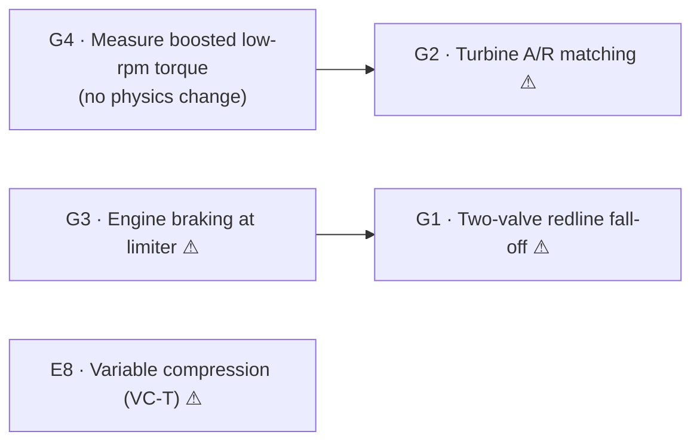

# Plan: remaining engine systems & gap closers (from build 474)

Follows [plans/engine-systems.md](engine-systems.md) after builds **461–473** shipped all 13 non-`⚠` items (`E1–E7`, `E9–E14`).

Every build here follows `AGENTS.md`: one change, one build, one PR, one new test, a `CHANGELOG.md` entry, and wording passed through `tr()` (no new Greek while Greek is paused). All builds below are marked **⚠** because they move existing cars' numbers and require owner approval + a before/after fingerprint report.

---

## 1. Gap closers ⚠ (move numbers: owner approval first)

| Build | Gap (test / anchor that holds it) | Approach | Expected movement |
|---|---|---|---|
| **G3** | **Engine braking stops at the limiter** | Fuel cut at the limiter keeps the engine's own drag (the overrun torque already used in braking zones) instead of dropping to zero. Fixes descent overspeed. | Moves overrun / coastdown / descent braking near the limiter; steady-state WOT dyno unchanged. |
| **G1** | **No power fall-off near the redline** — Dino 246 +28% (`RATING_KNOWN` in `tests/test115.mjs`), `AT_LIMITER_KNOWN` (`tests/test44.mjs`, `tests/test46.mjs`), plus `tests/test60.mjs` | Measure first which loss is missing on two-valve heads (port choke at high Mach, valve-curtain area, or trapped exhaust residual). Then derive it from head/valve geometry. | Shrinks `RATING_KNOWN` and `AT_LIMITER_KNOWN`; moves high-rpm power on two-valve / limiter-peaking presets. |
| **G4** | **Boosted low-rpm torque** — RS3 ~46% short, 1.0 EcoBoost ~44% short (last measured before build 425) | **Step 1 (measuring build, zero physics change):** re-measure all boosted presets' low-rpm torque against published curves on the post-473 model. **Step 2:** decide whether any remaining shortfall is compressor/turbine sizing (feeds G2) and whether a test should hold these figures. | Step 1 moves **nothing** (measurement + report only). |
| **G2** | **Turbine A/R chosen, not matched** — `p_exh / p_int` ~1.1 vs real petrol 1.5–2.0 (`tests/proto/housing.mjs`, boost-threshold RMS ~775 rpm in build 151) | Add residual-gas knock sensitivity (`knockAt()`) if still missing so petrol back-pressure has its real physical ceiling, then size `stock` turbine A/R from exhaust flow at rated power against a target back-pressure ratio instead of the fixed per-frame table (`0.42` / `0.64` / `0.86`). Report boost-threshold RMS against `tests/proto/housing.mjs`. | Boost comes in earlier on fixed-geometry turbo presets; moves boost threshold, mid-range torque, and back-pressure / pumping loss. |

---

## 2. Engine systems ⚠ (moves preset numbers)

| Build | System | What it does | Derived from | Moves |
|---|---|---|---|---|
| **E8** | **Variable compression (VC-T)** | Allows compression ratio to vary across load/boost (8:1–14:1) via multi-link crank geometry, and wires the real range onto the VC-T preset (`Nissan KR15DDT 1.5 VC-T` in `src/js/electric-presets.js`, plus optional VC-T part defaulting off for custom builds). | Nissan's published 8–14:1 CR-vs-load/boost schedule and the existing knock + Otto efficiency model. | Moves the VC-T preset's part-load BSFC / WLTP and boost knock margin; custom builds unaffected when off. |

---

## 3. Deferred (post-v1.0)

- **Camless valves and HCCI**: no production engines with complete sourced data (Mazda's SPCCI is the closest, as a partial case). Revisit after v1.0.

---

## Suggested order

1. **G4 (Step 1: measure only)** — zero risk, updates stale pre-425 low-rpm boost numbers and informs G2.
2. **G3** — smallest, cleanest physics fix (overrun drag at limiter).
3. **G1** — two-valve redline fall-off (measure then derive).
4. **G2** — turbine A/R matching (after G4's new baseline).
5. **E8** — variable compression (VC-T).
