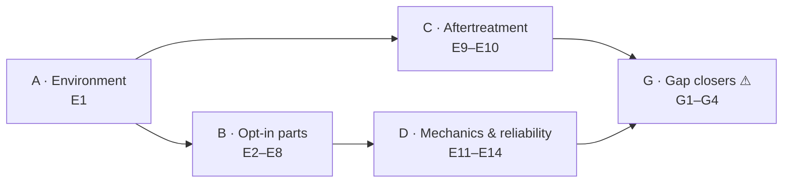

# Plan: new engine systems and the open gaps (from build 461)

Every build here follows `AGENTS.md`: one change, one build, one PR, one new test, a CHANGELOG entry, and wording
passed through `tr()` (no new Greek while Greek is paused).

**The rule for ordering:** a new part starts **off / stock**. That way the fingerprint stays **identical** and the
build needs no ruling from you. Builds that move existing cars' numbers (marked ⚠) wait for your approval and report
how far they moved things.

---

## A · Environment

| Build | System | What it does | Derived from | Moves |
|---|---|---|---|---|
| **E1** | **Ambient & altitude** | A setting for altitude, temperature and humidity on the dyno, lap and race. Ambient pressure and density feed `mapTarget()`, the compressor inlet and `effIAT()`, replacing the hard-coded `101325`. A naturally aspirated engine loses ~1%/100 m; a turbo holds boost until it hits its speed limit. | ISA 1976 standard atmosphere; Magnus formula for water vapour (humidity) | Nothing if the default is sea level and the current ambient temperature |

Test: the same engine at 0 / 2000 / 4000 m; the NA engine falls by its density ratio, the turbo holds to its limit.

## B · Opt-in parts (each defaults off → fingerprint identical)

| Build | System | What it does | Derived from |
|---|---|---|---|
| **E2** | **Water / methanol injection** | A new part on the AIR & BOOST card. Evaporation cools the charge → `effIAT` drops, knock margin rises, and the ECU may add timing. Costs a tank, a pump and a refill. | Latent heat of water (2257 kJ/kg) and methanol (1100 kJ/kg); BMW M4 GTS water injection as the reference |
| **E3** | **Cylinder deactivation** | At light load, half the cylinders close their valves. Pumping loss falls; the cylinders still firing run at higher load. Only shows on the WLTP and eco runs. | The existing pumping-loss and friction model; published operating windows for GM AFM / DFM and VW ACT |
| **E4** | **Start-stop** (cars without a hybrid) | The engine stops when the car stands still in the WLTP / eco cycles; the restart costs crank energy. | Starter energy (power × time) from the existing 12 V model; this ties into road-to-v1 group 5's "engine start's crank energy" |
| **E5** | **Electric turbo / MGU-H** | A motor on the turbo shaft: it spins up the turbo off boost and recovers exhaust energy at full load into the hybrid pack. | Turbo shaft inertia (already modelled) plus the motor model in `electric.js`; Garrett E-Turbo and F1 2014–25 limits as references |
| **E6** | **Wet vs dry sump** | Oil pickup starves under sustained lateral g from the g-g window. Starvation counts as bearing wear; a dry sump costs mass and pump drag but never starves. | Oil surface tilt from lateral g (tan θ = a/g) against sump geometry; pump work = flow × pressure |
| **E7** | **Diesel common rail & glow plugs** | Rail pressure and pilot/main split shape the burn: less noise, a NOx/soot trade-off. Glow plugs set cold-crank time on the WLTP cold start. | Bosch rail pressures (1600–2500 bar); injector orifice flow; glow-plug power per the Bosch Handbook |
| **E8** | **Variable compression** ⚠ | The Infiniti VC-T preset runs its real 8–14:1 range by load instead of the fixed 12:1. | Nissan's published ratio schedule and the existing knock model. *Moves one preset: needs your approval.* |

## C · Aftertreatment

| Build | System | What it does | Derived from |
|---|---|---|---|
| **E9** | **Catalyst light-off** | The catalyst converts nothing until it reaches light-off; WLTP cold-start emissions spike, then fall. Brick heat-up comes from exhaust temperature (EGT) and flow. | Light-off temperatures of ~250–300 °C (published for three-way catalysts); brick heat capacity from the cordierite substrate's mass |
| **E10** | **DPF / GPF** | Particulate filter on the diesel (and optionally petrol) exhaust. Soot load raises back-pressure; a regeneration costs fuel. Feeds the open `catRampTop` work on exhaust back-pressure. | Darcy flow through the filter wall; regeneration temperature ~550–600 °C |

## D · Mechanics & reliability

| Build | System | What it does | Derived from |
|---|---|---|---|
| **E11** | **Balance & NVH** | Primary/secondary shaking forces and rocking moments from layout, cylinder count, firing order and reciprocating mass. Shown as a smoothness figure; an optional **balance shaft** part cancels the second-order force at a cost in friction. | Engine balance worked out from crank geometry (Taylor, *The Internal-Combustion Engine*, vol. 2) |
| **E12** | **Crank torsional limit** | The crank's first torsional natural frequency against the firing orders; a resonance in the rev range counts as wear unless a damper is fitted. | Crank stiffness and inertia from bore, stroke and journal sizes. **Research first:** journal dimensions are mostly not published, so this may need an `unsure` list. |
| **E13** | **Blow-by & ring sealing** | Leakage past the rings from ring gap and cylinder pressure: a small loss of trapped mass, crankcase pressure, and oil use rising with wear. | Orifice flow through the ring gap; published blow-by rates (~0.5–1% of intake flow) as the check |
| **E14** | **Turbo as a breakable part** | Past its tip-speed limit (520 m/s) or surge, the turbo cartridge fails on its own instead of only counting as engine wear. Closes the README gap "A turbo only fails by wearing out the engine". | The overspeed / surge flags added in build 451 |

## G · Gap closers ⚠ (move numbers: your approval first)

| Build | Gap (test that holds it) | Approach |
|---|---|---|
| **G1** | **No power fall-off near the redline**: Dino 246 +28% (`RATING_KNOWN`, test115); `AT_LIMITER_KNOWN` (test46/60) | Measure first: which loss is missing on two-valve heads (port choke at high Mach, valve-curtain area, or how much exhaust gas is left in the cylinder). Then derive it. Expected to shrink both lists. |
| **G2** | **Turbine A/R chosen, not matched** (exhaust / intake pressure ~1.1 vs a real 1.5–2) | Size the A/R from exhaust flow at rated power against a target back-pressure ratio. Boost will come in earlier; report the boost-threshold RMS against `tests/proto`. |
| **G3** | **Engine braking stops at the limiter** | Fuel cut at the limiter keeps the engine's own drag (the overrun torque already used in braking zones). Small; fixes the descent overspeed. |
| **G4** | **Boosted low-rpm torque** (RS3 ~46%, 1.0 EcoBoost ~44% short; not re-measured since build 425) | A measuring build first, with no physics change; then decide whether a test should hold these figures. |

## Deferred

- **Camless valves and HCCI**: no production engines with sourced data (Mazda's SPCCI is the closest, as a partial
  case). Revisit after v1.0.

---

## Suggested order

E1 → E2 → E9 → E3 → E4 → E11 → E14 → E6 → E10 → E7 → E5 → E13 → E12, with **G3 → G1 → G2 → G4** and **E8** going in
whenever you approve them. That is **~20 builds**, one PR each and one session per PR (`AGENTS.md` §10).

## Questions for you

1. **E1:** default to sea level and the current ambient temperature (no numbers move), or let presets carry a home
   altitude?
2. **E4:** when start-stop lands, should it be **on** for real cars that ship with it? (That moves their eco numbers.)
3. **G1–G4 and E8:** approve each one separately, or the whole group?
4. Should this plan be committed as `plans/engine-systems.md` in its own PR?
