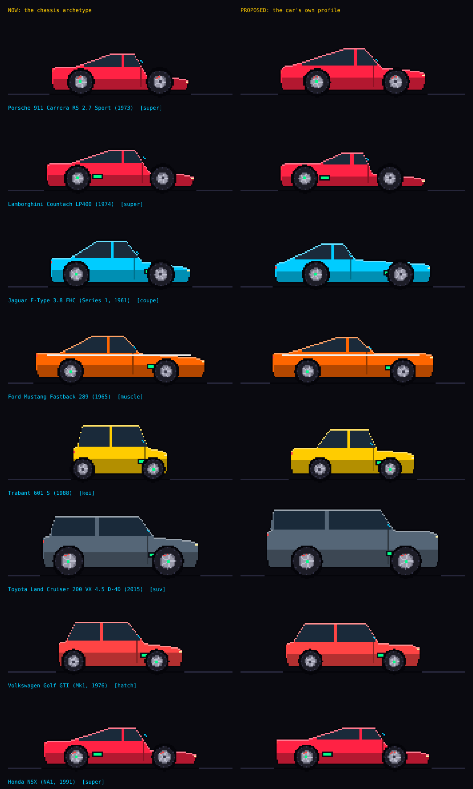

# A cheaper way to draw real cars side on

Research only. Nothing in `src/` was changed. `render.mjs` draws a before-and-after sheet, `compare.png`, from `profiles.json` using the game's own sprite code.

```
node research/vehicle-sprites/render.mjs
```

## The problem

The game has 100 real cars (`FACTORY_CARS`). Each one is drawn by `drawCarSprite` in `src/js/sprites.js` from its chassis archetype. Each archetype has one shape (`CAR_LOOK`), and only the wheelbase, tyres, ride height, aero parts and engine position come from the car itself. As a result, many different cars share a single body:

| Archetype | Real cars that share its shape |
| --- | --- |
| super | 18 (911 GT3, Countach, Dino, NSX, Ford GT, 720S, Cayman GT4 …) |
| coupe | 17 (E-Type, AE86, R34, Corvette C6, RX-7, 370Z …) |
| hatch | 12 |
| sedan | 8 |
| rally | 7 |
| kei, roadster, muscle, suv | 6 each |
| hyper, pickup | 5 each |
| gt | 2 |
| proto, openwheel | 1 each |

A 1973 911 is drawn as a mid-engined wedge, and a Trabant is drawn as a tall kei box. The goal is for a player to recognise the car, at a cost that stays reasonable across 100 cars and keeps up as more are added.

## What a solution has to keep

The sprites are drawn from the build, not chosen from a gallery (see the header of `sprites.js`). The design depends on this:

- Wheel size, tyre sidewall, ride height, wings, splitter, diffuser, caliper colour and the x-rayed engine all follow the parts the player fits.
- Garage thumbnails are drawn from the saved record.
- The art is a grid of whole cells, so it stays crisp at any zoom, works offline and adds nothing to the download.

A static picture per car would break all three. Fitting bigger wheels or a wing would need layered art and anchor points for every car.

## The options

Costs are per car. Totals are for the 100 cars the game has now.

| | Method | Cost per car | 100 cars | Keeps "drawn from the build" | Consistent style |
| --- | --- | --- | --- | --- | --- |
| A | Commission pixel art (Fiverr and similar) | about $10–50 and days of turnaround | $1,000–5,000 | No | Only with a single artist |
| B | AI pixel-art generator (PixelLab, Retro Diffusion) | about $0.01–0.18 per image or $9–50 a month, plus 15–30 min of clean-up | Low cash, 25–50 h of clean-up | No | Poor across 100 cars |
| C | Trace a 3D model or blueprint, render it orthographically, then downsample | 30–60 min, and licences vary by source | 50–100 h | No | Good |
| **D** | **Per-car profile numbers in the existing parametric drawer** | **5–10 min, $0** | **8–16 h** | **Yes** | **Yes, by construction** |
| E | D, plus a 12–20 point roof polyline for cars that need curves | 15 min more for each car that needs it | about 4 h for 15 icons | Yes | Yes |
| F | D, filled in by a tracer script from a side photo | 1–2 min to check each result | 2–3 h after the tool is built | Yes | Yes |

**A and B** cost the most once the work is counted honestly. Both produce a static image, so the wheels, aero and ride height would need new code that composites parts over each picture. AI generators are cheap per image. They do not know the exact proportions of a particular model year, though, and each image needs hand clean-up to match the palette and the 26 cells per metre scale. The price ranges above come from third-party listings found while researching this note. They change often, so check them before relying on them.

**C** gives accurate shapes but is slow. Free blueprints and 3D models usually come with restrictive or unclear licences.

**D** is cheap because it changes data, not art. `CAR_LOOK` already describes a side profile with 11 numbers:

- `h` is the overall height in metres.
- `ovF` and `ovR` are the overhangs as a share of the wheelbase.
- Eight numbers place the nose, bonnet, windscreen, roof, rear glass, deck and tail along the car.

Giving each real car its own values replaces the archetype's guesses with the car's own shape. Everything that follows the build keeps working, because the same drawer still draws the car.

## Proof: `compare.png`

Eight cars, chosen because their archetype gets them most wrong, plus the Golf Mk1 as a control. The left column is the game today. The right column uses a per-car profile.



- **Trabant 601.** It changes from a kei box to a small three-box saloon.
- **Porsche 911 RS 2.7.** It changes from a wedge to a fastback, with its real 1.32 m height and long rear overhang.
- **E-Type.** The cabin moves back behind the long bonnet.
- **Land Cruiser 200.** It becomes a tall, square-tailed 4×4 instead of a crossover.
- **Mustang 1965.** It gets a fastback roof in place of the muscle car notchback.
- **Golf Mk1.** It barely changes. This is expected: the hatch archetype already fits it.

The 8-number shape cannot draw curves. The E-Type's fender bulges, the 911's round wings and wheel-arch cut-outs are all beyond it. That limit is what option E addresses.

**The profile numbers are estimates.** Length and height are maker figures, quoted from memory and not re-checked against a source. The front overhang and the eight shape numbers were estimated by eye without a reference photo, because the Wikimedia Commons API rate-limited this session. The sheet shows that the method works. It does not show that these eight profiles are accurate. `profiles.json` records this in its `confidence` field.

## How to fill in a profile

1. **Get three numbers from a spec sheet:** overall length, height and front overhang. The vehicles research already collects wheelbase, so add `len_mm`, `h_mm` and `ovF_mm` to its schema. Length and height are in every brochure and on Wikipedia. Front overhang is in most press-kit dimension drawings. These three alone give every car its real height and overhangs, at no art cost.
   - `ovF = ovF_mm / wb`
   - `ovR = (len − wb − ovF_mm) / wb`
2. **Read eight shape numbers off a side photo.** Wikimedia Commons is a good source of side-on, freely licensed photos, and maker press photos also work. Measure along the car from the rear bumper (0) to the nose (1): the base of the windscreen, the front and rear of the roof, and the base of the rear glass. Measure heights as a share of the body's height above the sill: nose, bonnet, deck and tail. Only the numbers go into the game. The photo is not shipped.
3. **Run `render.mjs`.** Check the car against the photo and adjust.

## What it would take in the game

The change to the game is small. The profile would live in the preset's `body`, which `vehicleFromPreset` already copies into the vehicle record. That means saved builds and garage thumbnails would pick it up with no extra work. In `carGeometry`:

```js
const L=Object.assign({},CAR_LOOK[v.chassis]||CAR_LOOK.coupe,v.body&&v.body.look);
```

A preset would then carry:

```js
body:{kg:960,cd:0.39,area:1.73,wb:2.271,fWt:0.4,engPos:'rear',
      look:{h:1.32,ovF:0.365,ovR:0.46,nose:0.38,hood:0.52,ws:0.70,rf:0.58,rr:0.46,bk:0.08,deck:0.58,tail:0.46}}
```

Two details to settle when it is built:

- If a player changes the chassis on a real car, the car is no longer that car. The body record already has to handle this for `kg` and `cd`, and `look` should go with them.
- `look` must not set `col`, so that the livery stays a property of the archetype.

## Recommendation

1. **Now:** add `len_mm`, `h_mm` and `ovF_mm` to the vehicle research schema and fill them in for all 100 cars. This takes about 2 h of spec-sheet work. Every car gets its real height and overhangs, a fair share of what makes cars look different at this size.
2. **Next:** add `body.look` (the line above) and fill in the eight shape numbers. Start with the 18 `super` and 17 `coupe` cars, which suffer most from sharing a shape. This takes 5–10 min a car.
3. **Later, if wanted:** add an optional roof polyline (`body.prof`, 12–20 `[u, f]` points) for the 10–15 icons whose shape is in their curves: E-Type, 911, Countach, F40, Beetle-shaped cars. The drawer would use it in place of the 8-point `top` line. Wheel-arch cut-outs (a dark half-disc above each tyre) would help every car and cost one line in `drawCarSprite`.
4. **Only if the list grows into the hundreds:** build the tracer (F). It would cut the background out of a side photo with a local model such as rembg, find the two wheel centres, take the top contour column by column, normalise it to the wheelbase, and least-squares fit the eight `CAR_LOOK` numbers or simplify the contour with Douglas–Peucker into a `prof`. It runs offline and costs nothing per car. For 100 cars, filling in the numbers by hand is quicker than building the tool.

Options A–C are not worth it for this game. They cost more, and they would replace a drawer that follows the build with pictures that do not.

## Real names and shapes

The game already uses real car names. A car's shape can be protected trade dress: *Ferrari v. Roberts* (6th Cir. 1991) protected the Daytona Spyder's and Testarossa's shapes against replica bodies. Games have usually been treated differently. In *AM General v. Activision* (S.D.N.Y. 2020), the court ruled for Activision over the Humvees in Call of Duty. A 168 × 62 cell silhouette made from measured proportions is a long way from a replica body. This is not legal advice. If the game is ever sold, ask someone qualified.

## Sources

- PixelLab pricing (third-party listings, which disagree): <https://alternativeto.net/software/pixellab/about>, <https://www.cutout.pro/learn/pixellab/>, <https://devtoollab.com/ai-tools/pixellab-ai>
- Retro Diffusion pricing and API: <https://github.com/Retro-Diffusion/api-examples>, <https://mcpservers.org/servers/retro-diffusion/retro-diffusion-mcp>
- AI pixel-art generator comparison, 2026: <https://app.cinevva.com/es/guides/ai-pixel-art-generators>
- Commissioned pixel cars: <https://www.fiverr.com/indum_afrianto/draw-pixel-art-car>, <https://fiverr.com/rifoone/create-pixel-art-and-animation>
- Car shapes as trade dress: <https://cyber.harvard.edu/IPCoop/91ferr1.html> (*Ferrari v. Roberts*), <https://www.foxnews.com/auto/humvee-builder-am-general-suing-call-of-duty-publisher-for-trademark-infringement> (AM General's suit), <https://www.lexplug.com/outlines/trade-dress-in-entertainment-assets>
